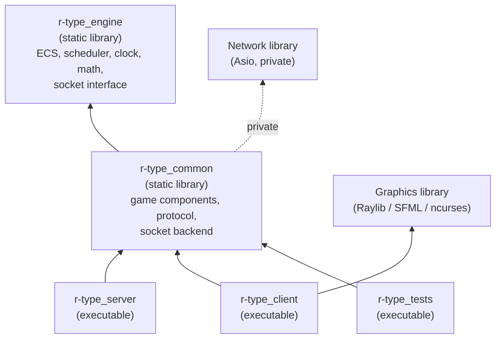
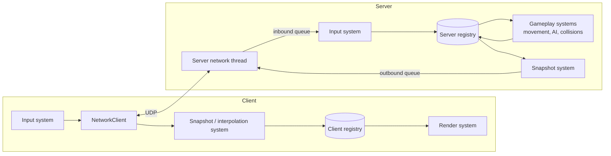
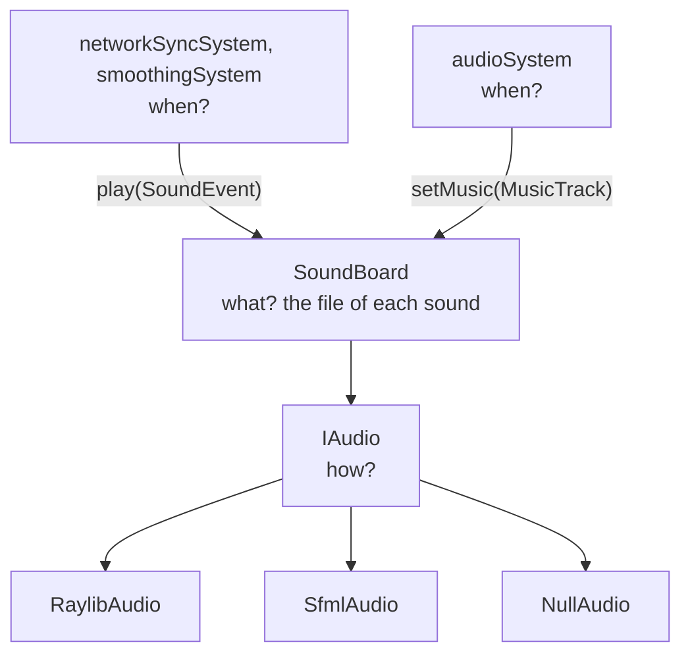
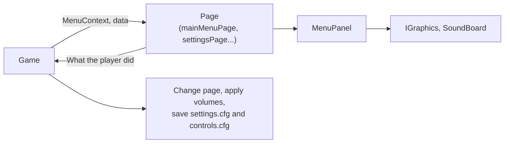
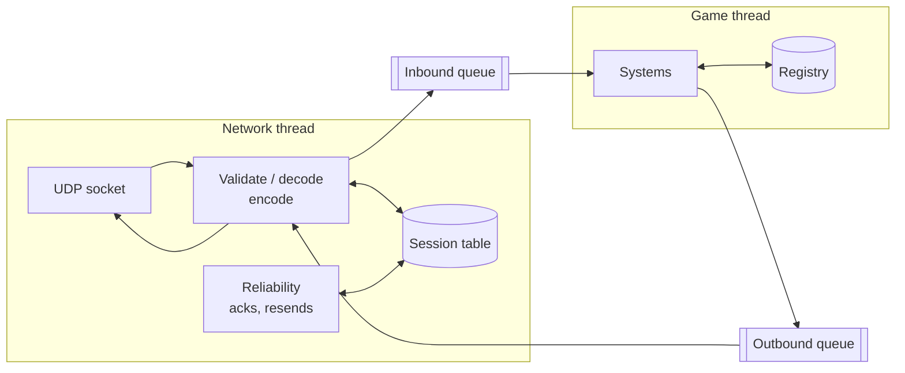
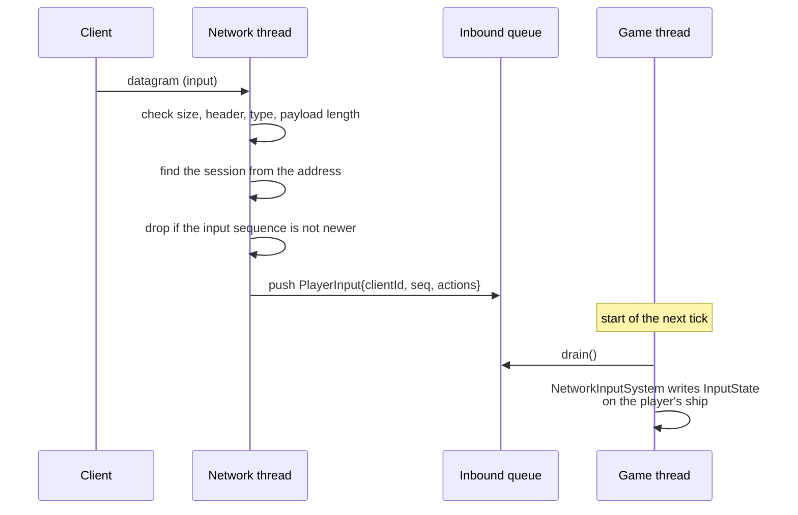
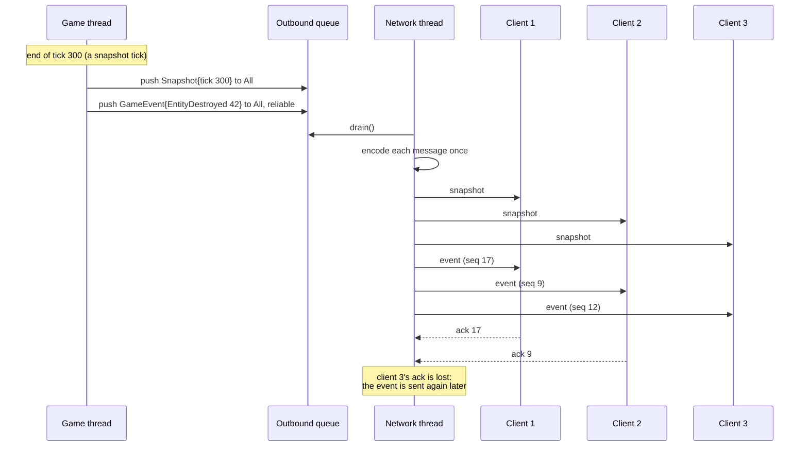
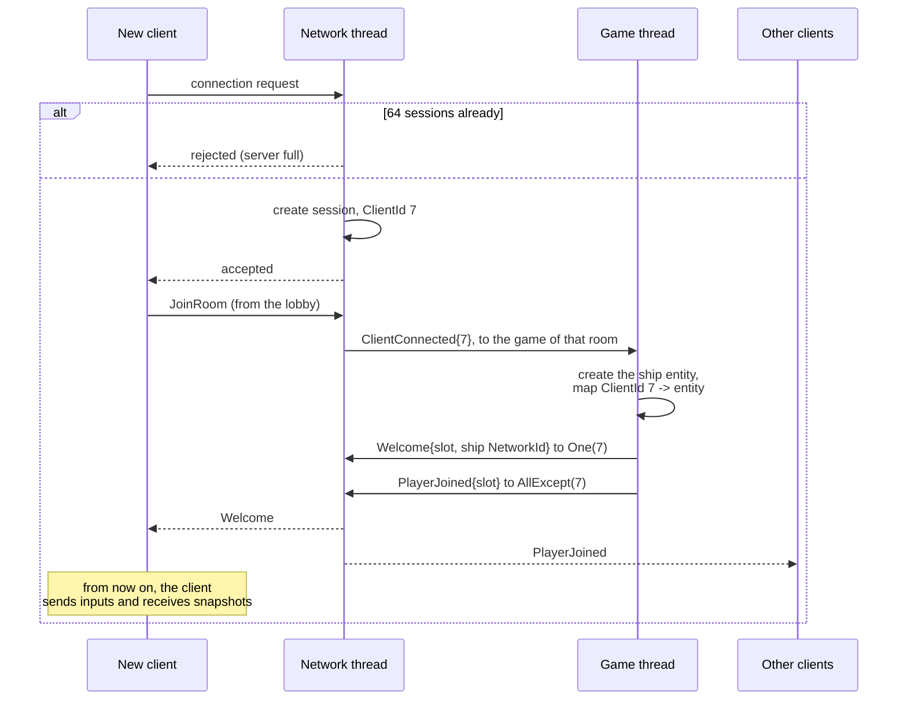

# Architecture

This document describes how the R-Type code is organized: the shared engine, the
Entity Component System (ECS), the subsystems and how they communicate, the game
loop and the threading model. The network protocol itself is described in
[PROTOCOL.md](PROTOCOL.md).

Why these choices were made, compared with the alternatives, is explained in
the [technical study](TECHNICAL_STUDY.md). The [how-to guides](HOWTO.md) show how
to add a component, a system, an enemy, a packet, a sound, a menu page or a setting.

## 1. Goals

The design follows the subject's constraints:

- **Decoupled subsystems.** Rendering, networking and game logic are separate.
  The rendering system only needs an entity's appearance and position, not its
  damage or speed.
- **Authoritative server.** The server owns the game state. Clients send their
  inputs and display what the server tells them.
- **The game loop never blocks on the network.** Networking runs on its own
  thread and exchanges messages with the game loop through queues.
- **Time comes from timers, not CPU speed.** The simulation advances by a fixed
  time step measured with a steady clock.
- **Robustness.** Malformed packets or a crashing client must never bring down
  the server.

## 2. Code layout

The code is split into four CMake targets. Arrows mean "links against".



| Directory | Target | Contents | Allowed dependencies |
|-----------|--------|----------|----------------------|
| `engine/` | `r-type_engine` | Generic ECS (entities, components, registry, systems), scheduler, clock, math types, the UDP socket interface (`engine::net`). Knows nothing about R-Type. | Standard library only |
| `common/` | `r-type_common` | R-Type components shared by both programs (`Transform`, `Velocity`, `Health`...), protocol messages and their serialization, the socket backend. | `r-type_engine`; Asio as a **private** dependency (Conan, or the Alpine package `asio-dev` in the `Dockerfile`) |
| `server/` | `r-type_server` (and `r-type_server_network`, `r-type_server_spawn`) | Server game loop, gameplay systems (movement, collisions, spawning, levels, weapons, AI), client sessions, network thread. | `r-type_common`; nlohmann-json for the level and weapon files (Conan, or the Alpine package `nlohmann-json` in the `Dockerfile`) |
| `client/` | `r-type_client` (and `r-type_client_network`, `r-type_client_audio`, `r-type_client_controls`, `r-type_client_settings`, `r-type_client_menu`) | Rendering, input, audio, menus, player settings, interpolation, connection to the server. | `r-type_common`, graphics library (Conan) |

Rules:

- `engine/` and `common/` must never include anything from `server/`, `client/`
  or a graphics library. The server is built alone in Docker
  (`-DBUILD_CLIENT=OFF`), so it can only use these two libraries.
- Keeping `engine/` game-agnostic makes it reusable for another game.
- Only `client/src/graphics/<backend>/` may include the graphics library. The
  rest of the client draws, loads textures and reads the keyboard through
  `client::gfx::IGraphics` (`client/include/graphics/IGraphics.hpp`), so
  switching library means writing one new backend and choosing it with the
  Conan option `graphics` and the CMake option `RTYPE_GRAPHICS_BACKEND`.
  Three backends exist: Raylib (default), SFML, and ncurses, which draws in a
  terminal (character cells of 8x16 virtual pixels, no textures).
- Only `client/src/audio/<backend>/` may include an audio library. The rest of
  the client plays sounds through `client::audio::SoundBoard`, over
  `client::audio::IAudio` (see [4.4](#44-audio)). The audio backend follows the
  graphics one, so there is no separate option to choose.
- Only `common/src/network/<backend>/` may include the network library. The
  server and the client send and receive datagrams through
  `engine::net::IUdpSocket` (see [2.1](#21-network-abstraction)), so no
  public header includes Asio and the library is linked `PRIVATE`.
- Tests link the libraries directly, so game logic can be tested without
  starting a server or opening a window. The network code is tested on an
  in-memory fake socket (`tests/src/FakeNetwork.hpp`).

### 2.1 Network abstraction

The network library is hidden behind a small interface, in the same way as
the graphics library:

| File | Role |
|------|------|
| `engine/include/engine/network/Endpoint.hpp` | `engine::net::Endpoint`: an IPv4 address and a port. Totally ordered, so it keys the server's session table. |
| `engine/include/engine/network/IUdpSocket.hpp` | `engine::net::IUdpSocket`: `sendTo()` (non-blocking, returns a `std::error_code`), `receive()` (waits for one datagram at most for a timeout; zero only polls), `localEndpoint()`. Also `engine::net::NetworkError`, the only exception the network code throws (socket cannot be opened or bound, host cannot be resolved). |
| `common/include/common/network/UdpSocket.hpp` | `rtype::network::openUdpSocket(port)` and `rtype::network::resolve(host, port)`: the entry points every backend defines. |
| `common/src/network/asio/` | The Asio backend (`AsioUdpSocket`), the only files that include `<asio.hpp>`. |

The interface lives in `engine/` because it is game-agnostic and uses the
standard library only, like the rest of the engine: another game can reuse
it. Its implementation lives in `common/`, the only library allowed to
depend on a network library. The interface has no callbacks, no event loop
and no timer: a socket only reads datagrams inside `receive()`, so the
caller keeps its own loop and the threading model stays the one of section
6 (the server's network thread waits in `receive()` until its next 10 ms
update; the client polls once per frame with a zero timeout).

To add another implementation (raw BSD sockets, Winsock...):

1. Create `common/src/network/<backend>/` with a class implementing
   `engine::net::IUdpSocket`, and define `rtype::network::openUdpSocket()`
   and `rtype::network::resolve()` there. Convert errors to
   `engine::net::NetworkError` or `std::error_code`; never let a library
   type cross the interface.
2. Add the backend to `RTYPE_NETWORK_BACKEND` in `common/CMakeLists.txt`
   (its source files and its library, linked `PRIVATE`).
3. Run the tests: `tests/src/udp_socket_test.cpp` checks a real backend over
   the loopback interface.

### 2.2 Platform-specific code

Platform-specific code is isolated in one place per subsystem, so the rest
of the code stays portable and never includes a system or library header
directly:

| Subsystem | Where platform or library code goes | Interface the rest of the code uses |
|-----------|-------------------------------------|-------------------------------------|
| Networking (sockets, addresses, OS error codes) | `common/src/network/<backend>/` | `engine::net::IUdpSocket`, `rtype::network::openUdpSocket()` |
| Graphics, windows, keyboard | `client/src/graphics/<backend>/` | `client::gfx::IGraphics` |
| Sound effects and music | `client/src/audio/<backend>/` | `client::audio::IAudio`, `client::audio::createAudio()` |

New platform-specific code (for example Windows sockets) goes into a new
backend directory behind an interface, never into
gameplay, protocol or engine code. The only other OS-dependent code is the
signal handling in `server/src/main.cpp` (standard `<csignal>`) and the
launcher `rtype.py`.

## 3. Entity Component System

### 3.1 Concepts

- **Entity**: an identifier and nothing else. It has no data and no behavior.
- **Component**: plain data attached to an entity (`Transform`, `Velocity`,
  `Sprite`...). Components have no logic.
- **System**: a function that runs every tick on all entities that have a given
  set of components. Systems hold all the logic.
- **Registry**: owns the entities and the component storages, and answers
  queries such as "every entity with a `Transform` and a `Velocity`".

### 3.2 Entities

An entity is a 32-bit index plus a 32-bit generation:

```cpp
struct Entity {
    std::uint32_t index;
    std::uint32_t generation;
};
```

- When an entity is destroyed, its index goes into a free list and its
  generation is incremented.
- When a new entity reuses that index, it gets the new generation. A stale
  handle to the old entity therefore no longer matches, and `registry.alive(e)`
  returns `false` instead of silently pointing at another entity.

### 3.3 Component storage: sparse sets

Each component type has its own storage, a **sparse set**:

```
sparse : entity index -> position in dense   (one array, holes allowed)
dense  : [ e7, e2, e9, ... ]                  (packed entity indexes)
data   : [ C7, C2, C9, ... ]                  (packed components, same order)
```

- Add, remove and lookup are O(1). Removal swaps the last element into the hole,
  so the arrays stay packed.
- Iterating over a component type walks a contiguous array, which is
  cache-friendly.
- A query over several components (`each<Transform, Velocity>`) iterates the
  storage of the first one and checks whether each entity is in the others.

Why sparse sets rather than archetypes: they are much simpler to implement and
debug, adding or removing a component is cheap (no moving the entity between
tables), and R-Type has at most a few thousand entities, where the difference in
iteration speed does not matter.

### 3.4 Registry API

```cpp
namespace engine {

class Registry {
public:
    Entity create();
    void destroy(Entity entity);          // deferred, see 3.5
    [[nodiscard]] bool alive(Entity entity) const;

    template <typename C, typename... Args>
    C &emplace(Entity entity, Args &&...args);
    template <typename C> void remove(Entity entity);
    template <typename C> [[nodiscard]] bool has(Entity entity);
    template <typename C> C &get(Entity entity);
    template <typename C> C *tryGet(Entity entity);

    template <typename First, typename... Others, typename Func>
    void each(Func func);                 // func(entity, first, others...)

    void flush();                         // applies deferred destructions
};

} // namespace engine
```

Usage in a system:

```cpp
void movementSystem(engine::Registry &registry, engine::Duration dt)
{
    registry.each<Transform, Velocity>(
        [dt](engine::Entity, Transform &transform, Velocity &velocity) {
            transform.position += velocity.value * dt.count();
        });
}
```

### 3.5 Destroying entities during a tick

Destroying an entity while a system iterates over a storage would invalidate the
iteration. `destroy()` therefore only marks the entity. The scheduler calls
`registry.flush()` after the Cleanup stage of each tick, which removes all marked
entities and their components.

### 3.6 Components

- Components are small, plain structs (aggregates). They have no virtual
  functions and no pointers to other components.
- Components that are sent over the network must be trivially copyable, so
  they can be serialized field by field into the binary protocol.
- A reference to another entity is stored as an `Entity` handle and checked with
  `alive()` before use.

First components (in `common/`):

| Component | Data | Used by |
|-----------|------|---------|
| `Transform` | position (`Vec2f`), rotation | movement, collision, rendering, network |
| `Velocity` | `Vec2f` in units per second | movement |
| `Collider` | box size, collision layer and mask | collision |
| `Health` | current and maximum points | damage, death |
| `Damage` | points dealt on contact | collision |
| `Player` | player slot (1-4), score | input, scoring |
| `InputState` | bitmask of pressed actions for this tick | player control |
| `Enemy` | enemy type, behavior parameters | AI |
| `Projectile` | owner entity, lifetime | collision, cleanup |
| `NetworkId` | 32-bit id shared by server and clients | network sync |
| `Sprite` (client) | texture id, frame, layer | rendering |
| `Animation` (client) | frame list, frame duration, elapsed time | animation |
| `Obstacle` (server) | whether it is a destroyable tile or a wall | damage (walls and tiles stop every shot), scoring |

## 4. Systems and subsystems

### 4.1 Communication between subsystems

Subsystems never call each other. They communicate only through:

1. **Components.** The collision system writes `Health`, the rendering system
   reads `Transform` and `Sprite`. Neither knows the other exists.
2. **Values kept by the game for one tick.** A result one system needs from
   another, such as the collisions found by the collision system, is a member
   of the game, read by the next system. One-off facts for the clients
   (`EntityDestroyed`, `PlayerJoined`...) go straight to the outbound queue.
3. **Thread-safe message queues**, only between the network thread and the
   game loop (see section 6).

### 4.2 Execution order

`engine::Scheduler` owns the systems and their order. A game registers each
system once, at startup, in a stage. Each tick runs the stages in this order,
and the systems of a stage in the order they were added:

| Stage | Server | Client |
|-------|--------|--------|
| 1. Input | Drain the inbound network queue, sessions, players' `InputState`, room phase, fire and AI decisions | Receive from the server, lobby messages, apply the latest snapshot, read and send the inputs |
| 2. Simulation | Levels, obstacles, spawning, shooting, player control, patterns, movement, collisions, damage, death, lifetime, boundaries, game over | Background scroll, smoothing, prediction, ship tilt, animation, tile cracks |
| 3. Cleanup | Create the requested entities (`spawnCommandSystem`); the scheduler then calls `registry.flush()` | The scheduler calls `registry.flush()` |
| 4. Output | Build snapshots and push them to the outbound queue | Nothing yet |

Cleanup comes before Output so that a snapshot never contains an entity that
was destroyed during the tick.

Registration also says when a system runs, so the game's tick holds no such
logic:

```cpp
scheduler.add(Stage::Simulation, "movement", rtype::movementSystem,
              {.when = [this] { return m_status != RoomStatus::Waiting; }});
scheduler.add(Stage::Output, "snapshot", snapshot, {.every = 3}); // 20 Hz
```

`every` keeps the snapshot rate out of the game code, and `when` stops a system
during a phase: the server's world only moves once the room has left its waiting
phase, and the client only reads the world while it is in a room.

A system has the signature `void(Registry &, Duration)`. A system that needs
something else, such as the outbound queue, is wrapped in a lambda that captures
it. Values passed from one system to the next in a tick, such as the collisions
found by the collision system, are members of the game.

The client draws once per frame with one more scheduler per layer: `Background`
and `Overlay` are in screen coordinates, `World` in playfield coordinates. The
game's `render()` keeps the frame itself (`beginFrame`, the switch to world
coordinates, `endFrame`) because it gives each layer its meaning. The lobby,
waiting room and game over screens also act on the game, so they stay together in
a single `screens` system of the `Overlay` layer.

### 4.3 Overview



### 4.4 Audio

The audio only exists on the client, and the protocol knows nothing about it: the
client deduces its sounds from the snapshots and game events it already receives.
Three layers each answer one question, so a change only touches one of them.



In this diagram, the systems at the top decide when something must be heard and
call the `SoundBoard`, which turns the name of a sound into a call to `IAudio`,
implemented by one of the three backends.

| Sound | Played when | Where |
|-------|-------------|-------|
| `PlayerShot`, `ChargedShot`, `EnemyShot` | A new `PlayerMissile`, `ChargedShot` or `EnemyMissile` appears in a snapshot | `applyEntity()` |
| `BossAlert`, `PowerUpSpawn` | A new `Boss` or `PowerUp` appears in a snapshot | `applyEntity()` |
| `EnemyHit` | The health of an entity other than a player's ship goes down in a snapshot | `applyEntity()` |
| `Charge` | The `Charging` flag of the local ship turns on; it stops when the flag turns off | `applyEntity()` |
| `Explosion`, `ExplosionLarge`, `ExplosionBoss`, `PlayerDeath` | `spawnExplosion()` created an explosion, so inside the playfield only; the sound depends on what exploded | `applyEvent()`, `smoothingSystem()` |
| `PowerUp` | `EntityDestroyed` for a power-up inside the playfield, the only place it disappears when it is taken | `applyEvent()` |
| `GameStart`, `LevelStart`, `GameOver`, `PlayerJoined`, `PlayerLeft` | The `GameEvent` of the same name | `applyEvent()` |
| `MenuMove`, `MenuConfirm`, `MenuBack`, `MenuRefused` | A key or choice in a menu, or `RoomRefused` | `Game` |

`audioSystem` runs in the `Output` stage of every frame. It picks the music from the
state of the game (the menu, the game, or the boss while one is alive), and `SoundBoard::setMusic()` only restarts it when the track
changes. It also calls `update()`, which feeds the music stream with Raylib and does
nothing with SFML, which streams on its own thread.

Sounds play directly, with no queue: `playSound()` returns at once and the library
mixes the sound on its own thread. A sound asked again while it plays restarts
instead of adding a second copy, which keeps a spread shot from getting louder.

`createAudio()` is defined once per build, by the file CMake compiles for the backend.
Audio never stops the game:

| Situation | Backend | Result |
|-----------|---------|--------|
| Raylib or SFML client | `RaylibAudio`, `SfmlAudio` | Sound plays |
| ncurses client | `NullAudio` | Silence |
| No audio device | `NullAudio`, with a warning | Silence |
| Missing or unreadable file | Any, with a warning | That sound or music stays silent |

A benchmark (`--bench`) sets both volumes to 0. The sound effects and musics are
generated by `tools/generate_sounds.py`; to add one, see
[Add a sound](HOWTO.md#5-add-a-sound).

### 4.5 Menus

The menus are immediate-mode: a page is a function that `Game` calls on every frame.
It recreates its widgets, draws them, and returns what the player did. No widget
survives the frame, so a page shows its data as it is now, and nothing has to be kept
in sync.



`Game` gives each page a `MenuContext` and the data it may change. The page draws
through a `MenuPanel` and returns its result, and `Game` applies it. Pages never
change page or write a file, which is what lets the tests run them on a fake graphics
backend.

| Part | File | Role |
|------|------|------|
| `MenuInput`, `MenuKeys` | `Menu.hpp` | The menu keys pressed this frame, rather than held. They are fixed: arrows, Space or Enter, Escape |
| `MenuPanel`, `MenuCursor` | `Menu.hpp` | The widgets: `button`, `backButton`, `checkbox`, `slider`, `tabs` |
| `drawMenuTitle`, `menuRow`, `menuGridCell` | `Menu.hpp` | The layout shared by the pages |
| Pages, `MenuState` | `MenuPages.hpp` | Main menu, Settings, Accessibility, How to play, Credits |
| `lobbyScreen`, `waitingRoomScreen` | `systems/LobbySystem.hpp` | The list of rooms and the waiting room, which need the protocol types |
| `gameOverScreen` | `systems/HudSystem.hpp` | The final scores |
| `Settings`, `Toggles` | `Settings.hpp` | The player's options and `settings.cfg` |
| `Controls` | `Controls.hpp` | The keys of each action and `controls.cfg` |
| `KeyCapture` | `KeyCapture.hpp` | Waits for the key to bind to an action |

**The keyboard selection.** `MenuPanel` numbers its widgets in the order the page
creates them, and the widget whose number equals `MenuCursor::selected` is the
selected one. The cursor is the only thing that lasts between frames. When the panel
is destroyed, it records the number of widgets, so the cursor wraps around and stays
valid if a page gets shorter. Each page has its own cursor in `MenuState`, and the
screens of a room have theirs in `LobbyState`.

**Going back.** `Game::handleBackKey()` handles Escape before any page draws. In
order, it leaves the room, cancels a key capture, or returns to the main menu. It does
nothing in the main menu or while a room is being joined, and it ends a benchmark.

**Settings.** `Settings` holds plain data, and the `Toggles` table describes the options
that are on or off. Both the file and the Accessibility page read this table. A page
reports a change through `SettingsResult`, and `Game` applies it and writes the file at
once, so closing the game loses nothing. A bad line in `settings.cfg` or `controls.cfg`
is reported on stderr and keeps the previous value. To add a page or a setting, see
[Add a menu page](HOWTO.md#6-add-a-menu-page) and
[Add a setting](HOWTO.md#7-add-a-setting).

**Changing a key.** Each action shows two keys on the Controls tab of Settings:

1. Choosing a key calls `KeyCapture::start()`.
2. `KeyCapture::update()` waits until every key is released, or the key that started
   the capture would be taken as the new one. It then returns the next key pressed.
   Escape is never captured, because it cancels.
3. `bindKey()` changes the controls that the game already reads, so the key works at
   once. If the action already has this key in its other place, the two places swap,
   so an action never has the same key twice.
4. `otherControlWith()` looks for another action with this key. Two actions may share
   a key, and the page says so.
5. `Game` saves `controls.cfg`, or the file given with `--controls`.

During a capture, the widgets receive empty `MenuKeys`, so the captured key cannot also
press a button or move the selection. `KeyCapture` reads the keys with `isKeyDown()`,
so the graphics backends need no code of their own for it.

## 5. Time and the game loop

All time values use `std::chrono::steady_clock`, which never goes backwards.
`engine::Duration` is a `std::chrono::duration<float>` in seconds.

### 5.1 Server: fixed time step

The server simulates at a fixed tick rate (**60 ticks per second**) with an
accumulator:

```cpp
constexpr engine::Duration tickDuration{1.0F / 60.0F};
auto previous = Clock::now();
Duration accumulator{};

while (running) {
    const auto now = Clock::now();
    accumulator += now - previous;
    previous = now;

    while (accumulator >= tickDuration) {
        instance.tick(tickDuration); // runs the game's scheduler
        accumulator -= tickDuration;
    }
    sleepUntil(previous + tickDuration);
}
```

- Every tick advances the game by exactly `tickDuration`, so the simulation
  gives the same result on a fast or a slow machine.
- Snapshots are sent at a lower rate (**20 per second**, every 3rd tick) to
  save bandwidth.
- If a game falls far behind, the accumulator is capped at 250 ms so it does not
  try to catch up forever.

### 5.2 Client: variable frame rate

The client renders as fast as the display allows (or with V-Sync) and uses the
real elapsed time (delta time) for animations and the star-field scrolling.
Remote entities are drawn slightly in the past and **interpolated** between the
two latest snapshots, so their movement looks smooth even with 20 snapshots per
second. The local ship is **predicted**: it moves as soon as a key is pressed,
and the server's snapshots correct it (section 6.9).

## 6. Threading and networking

This section explains how the game loop and the network work together: which
thread owns what, how messages cross between threads, and how the server sends
information to every connected client. The byte layout of each packet belongs
in [PROTOCOL.md](PROTOCOL.md); here, messages are described only by their
content.

### 6.1 Threads and ownership

The server runs one network thread, and one game thread per running room
([section 6.10](#610-parallel-games)). Each piece of data has exactly one owner:

| Thread | Owns | Never touches |
|--------|------|---------------|
| Network thread | The UDP socket, the session table (one entry per connected client), encoding and decoding, reliability, timeouts | The registries |
| Game thread (one per room) | The registry of its game, its systems, the players of its room | The socket, the sessions |

The network thread and a game thread share only:

- two **message queues**: inbound (network to game) and outbound (game to
  network);
- an atomic `running` flag, used to stop them ([section 6.12](#612-shutdown)).

Two helper threads complete the picture: the logger's writer, so that logging
never blocks a game, and the administration console
([section 6.11](#611-administration-console)).

Because nothing else is shared, there are no locks in the game code and the
systems are written as single-threaded code.



### 6.2 Message queues

Both queues use the same generic type, `engine::MessageQueue<T>` (standard
library only):

- A `std::vector<T>` protected by a `std::mutex`.
- `push(T)` locks, appends and unlocks.
- `drain()` locks, **swaps** the vector with an empty one and unlocks, then
  returns all the messages at once. The lock is held for a swap only, so the
  game thread never waits for the network thread in any meaningful way.
- The queue has a **capacity**. When it is full, new messages are refused and
  the failure is logged. A flood of packets can therefore never make the server
  allocate unbounded memory.

The queues carry **decoded messages** (C++ structs), not raw bytes:

- The game thread never parses packets.
- The game thread never sees an IP address or a port. A client is identified by
  a `ClientId` (a 32-bit number given by the network thread when the client
  connects).

#### Inbound messages (network thread to game thread)

| Message | Content | Pushed when |
|---------|---------|-------------|
| `ClientConnected` | `ClientId` | A new client finished the handshake |
| `ClientDisconnected` | `ClientId`, reason (left, timeout, kicked) | A client said goodbye, stopped answering or broke the protocol |
| `PlayerInput` | `ClientId`, input sequence number, actions bitmask | A valid, newer input arrived |

Pings, acknowledgments and handshake packets are handled entirely by the
network thread and never reach the game thread.

#### Outbound messages (game thread to network thread)

Each outbound message has a **recipient** and a payload. The delivery mode
(reliable or not) is fixed by the payload type, as listed in
[PROTOCOL.md](PROTOCOL.md#5-packet-types), so the game thread never chooses it:

```cpp
struct Recipient {
    enum class Kind : std::uint8_t { One, All, AllExcept };
    Kind kind;
    ClientId client; // used by One and AllExcept
};

struct OutboundMessage {
    Recipient to;
    std::variant<Welcome, Snapshot, GameEvent> payload;
};
```

| Payload | Recipient | Delivery | Content |
|---------|-----------|----------|---------|
| `Welcome` | One (the new player) | Reliable | Player slot, the `NetworkId` of the player's ship, current server tick |
| `Snapshot` | All | Unreliable | Server tick, state of every visible entity (section 6.7) |
| `GameEvent` | All, or AllExcept | Reliable | One-off facts: `EntityDestroyed`, `PlayerJoined`, `PlayerLeft`, `PlayerHit`, `GameOver` |

### 6.3 Sessions

The network thread keeps one **session** per connected client:

| Field | Use |
|-------|-----|
| `ClientId` | Identity shared with the game thread |
| Address and port | Where to send datagrams |
| Last time a packet was received | Timeout detection |
| Last input sequence number | Drop old or duplicated inputs |
| Reliable send state | Next sequence number, messages waiting for an ack |
| Reliable receive state | Last sequence number received, for acks and duplicates |

- Only a known address can send game packets. A datagram from an unknown
  address is accepted only if it is a connection request.
- The server accepts at most **64 sessions** (16 rooms of 4 players). One more
  client receives a rejection and no session is created. A room accepts at most
  4 players.

### 6.4 Receiving: from datagram to component



1. The network thread reads one datagram into a fixed-size buffer (the maximum
   packet size). A larger datagram is truncated by the system and rejected.
2. It validates the packet: size, header (protocol id, version), message type,
   payload length. Any failure drops the packet and writes a debug log line.
3. It decodes the payload field by field (explicit little-endian, never a
   `memcpy` of a struct) and pushes the message to the inbound queue.
4. At the start of each tick, the game thread drains the queue. If the queue is
   empty, the tick continues without waiting.
5. If several inputs from the same player arrived during one tick, only the
   newest is kept.

### 6.5 Sending: from the registry to every client

At the end of a tick, the output systems build messages and push them to the
outbound queue. They do not know how many clients are connected or where they
are; they only say "to everyone", "to this player" or "to everyone except this
player".

The network thread then:

1. drains the outbound queue;
2. **encodes each message once** into a byte buffer;
3. resolves the recipient against its session table: `All` means every session
   that exists at that moment;
4. sends the same buffer to each recipient with `sendto`;
5. for a reliable message, keeps a copy per recipient until that client
   acknowledges it (section 6.6).



Encoding once and sending the same bytes to every client keeps the cost low: a
snapshot is built once per snapshot tick, whatever the number of players. Only
the reliable header (sequence number) differs per client.

**When does the network thread run?** It loops on a receive with a short
timeout (about 1 ms). After each wake-up, whether a datagram arrived or the
timeout expired, it also sends the outbound messages, resends unacknowledged
reliable messages that are due, and checks timeouts. In the code, the loop
waits in `IUdpSocket::receive()` until the next update, which runs every
10 ms; the network library never runs its own thread or event loop.

### 6.6 Delivery: unreliable and reliable

UDP can lose, duplicate and reorder datagrams. Each kind of message deals with
it in the simplest way that is enough:

| Kind | Messages | Rule |
|------|----------|------|
| Unreliable, latest wins | Inputs (client to server), snapshots (server to client) | Each carries a sequence number or tick. The receiver keeps only the newest and ignores older ones. A lost packet does not matter: the next one, a few milliseconds later, replaces it. |
| Reliable, ordered | Handshake answers, `Welcome`, game events | Each message has a per-session sequence number. The receiver acknowledges it and delivers messages in order, once. The sender resends every unacknowledged message about every 100 ms. |

Limits that keep reliability safe:

- The number of unacknowledged messages per session is capped. A client that
  never acknowledges (or acknowledges too slowly) is disconnected instead of
  making the server store messages forever.
- Acknowledgments are added to the packets already being sent (inputs and
  snapshots), so they cost almost no extra packets.

### 6.7 Snapshots

A snapshot is the state of every entity the client needs to draw, at a given
server tick.

- It is built by the `SnapshotSystem` every 3rd tick (20 per second).
- For each entity with a `NetworkId`, it contains the id, the entity type
  (which sprite to use), the position and the few values the HUD needs
  (health, score).
- A datagram stays under **1200 bytes** to avoid IP fragmentation. With 16 bytes
  per entity, that is about 70 entities per datagram. A larger snapshot is split into several **parts**; each part is
  self-contained (tick + list of entities), so losing one part only delays the
  update of those entities.

How the client uses snapshots:

- An unknown `NetworkId` in a snapshot creates a local entity with the right
  `Sprite`.
- A known `NetworkId` updates its target position for interpolation.
- An entity is **removed** only by the reliable `EntityDestroyed` event, never
  because it is missing from a snapshot (that part may just have been lost).
- `NetworkId`s are never reused by the server, and the client remembers
  recently destroyed ids for a few seconds, so a late snapshot cannot bring a
  destroyed entity back.

Snapshots also act as a heartbeat: a client that receives nothing from the
server for a few seconds considers the connection lost.

### 6.8 Connection lifecycle

#### A player joins



#### A player leaves, crashes or misbehaves

All three cases end the same way:

| Case | Detected by |
|------|-------------|
| The player quits | The client sends a disconnect message (best effort, not reliable) |
| The client crashes or the network drops | No packet from that client for **5 seconds** (inputs are sent continuously, so silence means a problem) |
| The client never acknowledges | More than 256 unacknowledged reliable messages |
| The operator removes it | The `kick` and `ban` commands of the console |

Then:

1. The network thread removes the session and pushes
   `ClientDisconnected{id, reason}`.
2. The game thread destroys the player's ship and pushes `PlayerLeft{slot}` to
   `All`, reliable.
3. The remaining clients remove the ship and show a notice ("Player 2 left").

The game keeps running for the other players during all of this.

### 6.9 Client side

The client has no network thread: `NetworkClient` polls a non-blocking socket
once per frame, on the main thread that also runs the client's registry, systems
and rendering (graphics libraries require rendering on the main thread). Polling
never waits, so a slow network cannot slow the frame. The client's own
logic is therefore simple, single-threaded code; only the logger has a thread.

- **Outbound:** the input system pushes the **complete** input state (a bitmask
  of pressed actions) as soon as it changes, and otherwise about 30 times per
  second, whatever the frame rate. Sending the full state every time means a
  lost packet is corrected by the next one, and a key release can never get
  lost.
- **Inbound:** the main thread drains snapshots and events each frame. The
  snapshot system keeps the last few snapshots in a small buffer, and the
  interpolation system draws remote entities about **100 ms in the past**
  (two snapshot intervals), between the two snapshots around that time.
- **Prediction of the local ship:** the client keeps the inputs it sent and
  moves its ship with the same code as the server (`shipVelocity`, then
  `keepInPlayfield`), without waiting for the server. Each snapshot gives the
  ship's position on the server and, in the players block, the sequence of the
  player's last input the server applied (`lastInput`). The client restarts
  from that position, drops the applied inputs and replays the others
  (**reconciliation**). When the result differs from what it drew, the
  difference is not applied at once: it fades out in about 0.3 s, so the ship
  never jumps (except for a difference over 150 units). Missiles are not
  predicted: they appear when the server creates them.

### 6.10 Parallel games

One server process runs up to 16 independent games, one per **room**. A client
first arrives in a **lobby**, without any room: `NetworkServer` sends it the
list of the rooms, and it enters one with `JoinRoom`. A new game waits until a
player starts it (`RoomPhaseSystem`), and a client can go back to the lobby at
any time without a new handshake. The mechanism is in the engine and knows
nothing about R-Type:

| Part | Where | Job |
|------|-------|-----|
| `engine::IInstance` | Engine, implemented by the game | One run of a game: `tick()`, `onStop()`, `joinable()`, `status()` |
| `engine::InstanceRunner` | Engine | The thread of one instance: fixed time step, catches its exceptions |
| `engine::InstanceManager<In, Out>` | Engine | Creates an instance for its first member and stops it after the last one, gives each one its own queues, finds an instance with room, lists them |
| `server::Game`, `server::Rooms` | Server | The R-Type game as an instance, with the R-Type messages and limits |
| `NetworkServer`, room messages | Server, protocol | The lobby, the room of each session and the routing of the messages |

Another game reuses it by implementing `IInstance` and choosing its message
types and limits:

```cpp
engine::InstanceManager<MyInbound, MyOutbound> instances(
    [](auto &link) { return std::make_unique<MyGame>(link.inbound, link.outbound); },
    {.maxInstances = 8, .maxMembers = 2}, MyGame::TickStep);
const auto membership = instances.join(engine::AnyInstance);
```

- **Isolation:** each game has its own thread, registry and queues. A slow game
  only slows itself. An exception ends that game only: `reap()` reports it, and
  the network thread disconnects its players.
- **Limit:** a process-wide crash, such as a segmentation fault, still stops
  every game. Isolating that would need one process per game.
- **The network thread never waits for a game:** a stopped game finishes in the
  background and is destroyed by `reap()` once its thread is over.
- **What is not generic yet:** sessions, handshake and timeouts live in
  `server::NetworkServer` and the protocol in `common/`, tied to the R-Type
  messages. Another game can reuse `InstanceManager` and `IUdpSocket`, but
  writes its own session layer.

### 6.11 Administration console

The operator types commands in the terminal of the server: `status`, `rooms`,
`players`, `kick`, `ban`, `unban`, `banlist`, `stop-room`, `whitelist`, `quit`
and `help`.

| Part | Where | Job |
|------|-------|-----|
| `engine::CommandConsole` | Engine | Turns a line of text into a call of a registered command, with `help` and usage errors. No input or output, nothing about R-Type |
| `AccessList` | Server | The banned and allowed addresses, and their files |
| `NetworkServer` commands | Server | What each command does, on the sessions and the rooms |
| Console thread | `server/src/main.cpp` | Reads the standard input and prints the answers |

- **The commands run on the network thread.** It alone owns the sessions and
  `InstanceManager`, so the console thread never touches them: it pushes the
  line in an `AdminQueue` and waits for the answer in a `std::future`. A
  blocked network thread gives "The server did not answer", not a blocked
  console.
- **The console thread is detached:** a blocking read of the standard input
  cannot be interrupted at shutdown. It only shares the queue, through a
  `shared_ptr`, so it can outlive the server. If the input ends (no terminal),
  it stops and the server goes on.
- **Access** comes down to the machine: whoever reaches the terminal controls
  the server, and nothing listens on the network.
- **Limits:** bans and the white list work on IPv4 addresses, as there are no
  accounts. A ban also hits everyone behind the same address, and a player who
  changes address gets around it. `players` shows neither the slots nor the
  scores, as only the game threads know them.

### 6.12 Shutdown

- `SIGINT` and `SIGTERM` (sent by `docker stop`) set the atomic `running` flag
  to `false`. The signal handler does nothing else.
- The game loop finishes its current tick and stops. The network thread then
  sends a best-effort `Disconnect{ServerClosing}` to every client.
- The network thread sends what is left in the outbound queue, then stops; the
  game thread joins it.
- A client closing its window sends a disconnect message and exits.

### 6.13 Summary of network-related systems

| Side | Stage | System | Job |
|------|-------|--------|-----|
| Server | Input | `SessionSystem` | `ClientConnected` / `ClientDisconnected`: create or destroy ships, push `Welcome`, `PlayerJoined`, `PlayerLeft` |
| Server | Input | `NetworkInputSystem` | `PlayerInput`: write `InputState` on the right ship |
| Server | Output | `SnapshotSystem` | Every 3rd tick, push a `Snapshot` to `All` |
| Client | Input | `networkSyncSystem` | Create and update entities from snapshots, remove them on `EntityDestroyed`, note who joined or left |
| Client | Input | `inputSystem`, `sendInput` | Read the keyboard, send the input state |
| Client | Simulation | `smoothingSystem` | Place remote entities between two snapshots |
| Client | Simulation | `predictionSystem` | Predict the local ship and fade out the corrections |

## 7. Coordinate system and units

- **Playfield**: a fixed virtual area of **1920 x 1080 units**, whatever the
  window size. The client scales it to the window and keeps the aspect ratio
  (letterboxing).
- **Origin**: top-left corner. **x** grows to the right, **y** grows downwards
  (the convention of SFML, SDL and Raylib).
- **Units**: positions in units, velocities in units per second, time in
  seconds, angles in radians. Values are `float`.
- **Scrolling**: the camera does not move. The background star field scrolls to
  the left, and enemies spawn just past the right edge (`x > 1920`) and move
  left. Entities that leave the playfield by more than a margin are destroyed.
- `Transform.position` is the **center** of the entity. Colliders are
  axis-aligned boxes centered on it.

## 8. Testing

- The ECS (entity reuse, generations, storages, views, deferred destruction) is
  covered by unit tests in `tests/`.
- Gameplay systems are tested by creating a registry, adding a few entities,
  running the system for N ticks and checking the components. No window or
  socket is needed.
- Packet decoding is unit tested with valid, truncated and oversized packets,
  and randomized tests feed it mutated and random datagrams.
- The message queue (capacity, drain order) and the reliability logic (acks,
  resends, duplicates, reordering) are tested without a socket, by feeding
  them packets directly.
- The menus run on a fake graphics backend that scripts the keys and the mouse, and
  the settings and controls files are tested by reading back what was written.

## 9. Values open to tuning

The network values are constants that can still be tuned, with the
[benchmark](NETWORK_COMPARISON.md) to measure the effect: 60 ticks and 20
snapshots per second, 5 s timeout, 100 ms resend interval, 100 ms interpolation
delay, 1200-byte datagrams, queue capacities.
