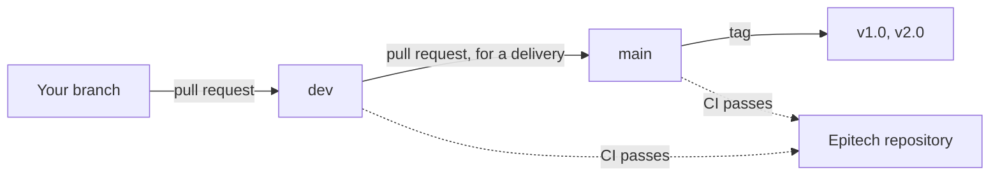

# Contributing

How we work on R-Type: what you need to know before your first pull request.
[The how-to guides](HOWTO.md) explain how to make the most common changes.

## Git workflow

There are two repositories. Everybody works on the **mirror**,
[T3a1/RType-mirror](https://github.com/T3a1/RType-mirror), and pushes only there.
The CI of the mirror then pushes to the Epitech repository by itself, once the checks
pass. Issues and the project board are on the Epitech repository only.



In words:

1. Create a branch from `dev`, named after the work (`lobby`, `boss`, `player-notices`).
2. Commit, then push it to the mirror.
3. Open a pull request into `dev`. A teammate reviews and merges it.
4. `main` is protected: it only changes through a pull request whose CI passes, for a
   delivery, which is then tagged.

Merge rather than rebase once a branch is pushed, and never force-push.

## Commits

```text
(<scope>) <type>: <title>

<description>
```

| Part | Values |
|------|--------|
| Scope | `global` (repository-wide: CI, tooling), `design` (client visuals, UI, sound), `network` (protocol, client/server communication), `architecture` (engine, ECS, structure, CMake, Docker, scripts) |
| Type | `feat`, `fix`, `chore`, `tests`, `docs`, `refactor` |
| Title | Very short, in English, lowercase, no final period |
| Description | 1 to 3 short lines on what the commit does |

The last line of the description may reference an issue, with its number on the
Epitech repository:

- `Closes #30.` when the commit completes the issue. It closes when the commit reaches
  `main`. Never close an epic this way.
- `Refs #30.` when it is only part of the issue.

```text
(network) fix: fixed input rate on the client

Send inputs when the actions change and otherwise every 30 ms, instead
of once per frame, which filled a slow link at high frame rates.
Refs #101.
```

## Pull requests

- The title has the same format as a commit, with the type `merge`:
  `(network) merge: on-screen player notices`.
- The description is a short summary, then the issues, with their full reference, as a
  short `#30` on the mirror points to the mirror's own pull requests:
  `Closes EpitechPGE3-2026/G-ING-500-LIL-5-1-rtype-3#30`.
- All the checks must pass: formatting, build and tests on Linux and Windows,
  clang-tidy, Docker image and documentation.
- A change to the protocol says so in the description: everyone must rebuild the
  server and the client together.

## Keeping the documentation up to date

**A change is finished when its documentation is.** Update the pages in the same pull
request as the code:

| When you change | Update |
|-----------------|--------|
| A packet, a field, or anything on the wire | [PROTOCOL.md](PROTOCOL.md) and its versioning table, `ProtocolVersion` |
| The structure, threads, stages or systems | [ARCHITECTURE.md](ARCHITECTURE.md) |
| A library, a tool, or a technical choice | [TECHNICAL_STUDY.md](TECHNICAL_STUDY.md) |
| Files stored, or what the server trusts | [Technical study](TECHNICAL_STUDY.md), sections 5 and 6 |
| An accessibility feature | [Technical study](TECHNICAL_STUDY.md), section 7, and the [README](https://github.com/T3a1/RType-mirror#readme) if players use it |
| What it takes to add content | [HOWTO.md](HOWTO.md), [LEVELS.md](LEVELS.md), [WEAPONS.md](WEAPONS.md), [ENEMIES.md](ENEMIES.md) |
| Controls, options, or how to run the game | The [README](https://github.com/T3a1/RType-mirror#readme) and [INSTALLATION.md](INSTALLATION.md) |
| Network code that affects performance | Run `./tools/netbench.py`, then update the analysis of [NETWORK_COMPARISON.md](NETWORK_COMPARISON.md) |
| A new page | Link it from the documentation table of the [README](https://github.com/T3a1/RType-mirror#readme), and add its translation |
| Any page | Its French version in `docs/fr/`, with the same file name; the English one is the reference |
| A new member, or a new main area of work | [CONTRIBUTORS.md](CONTRIBUTORS.md) |

Before a delivery, also refresh the [before and after](TECHNICAL_STUDY.md#9-before-and-after-the-part-1-prototype-and-the-final-version)
figures of the technical study.

The CI builds the website on every push: a broken link between pages, or a page
without its French version, fails the documentation check. Build it yourself with `./rtype.py --docs`.

### Writing rules

- Simple sentences: many readers are not native speakers. The pages of `docs/` are in
  English, those of `docs/fr/` in French, and code comments are in English only.
- Explain the why and how things work together. The code says the details, and
  Doxygen comments describe each function.
- Images have a description, shown as a caption on the website. Headings follow each other without skipping a
  level. A diagram is explained in the text too.

## Code style

clang-format and clang-tidy decide, and the CI enforces them:

```bash
./rtype.py --format
```

```bash
./rtype.py --tidy
```

The versioned pre-commit hook refuses badly formatted C++ files. Everyone uses the
same clang-format version (18.1.3), installed by `rtype.py`.

| Thing | Convention | Example |
|-------|------------|---------|
| Classes, structs, enums | `PascalCase` | `NetworkServer`, `EnemyType` |
| Functions, variables | `camelCase` | `sendInput`, `lastSequence` |
| Members of a class with private data | `m_` prefix | `m_sessions` |
| Constants | `PascalCase` | `MaxSessions`, `PeerTimeout` |
| Namespaces | lowercase | `engine`, `rtype`, `server`, `client` |
| Source files | The name of what they hold | `NetworkServer.cpp`, `HudSystem.hpp` |
| Test files | `snake_case`, ending in `_test` | `reliable_channel_test.cpp` |

- Each source file starts with the Epitech header.
- Public functions and types have Doxygen comments. A comment says why, not what.
- `engine/` knows nothing about R-Type. `engine/` and `common/` include nothing from
  `server/`, `client/` or a graphics library. Library headers stay in their backend
  directory ([architecture](ARCHITECTURE.md#2-code-layout)).
- Dependencies go through a package manager and are never copied into the repository.

## Tests

Every new piece of logic has a unit test in `tests/`, with no window and no real
network when possible (`tests/src/FakeNetwork.hpp` is a fake socket):

```bash
./rtype.py --test
```

Code under test must be in a library target, not in a `main.cpp`.
