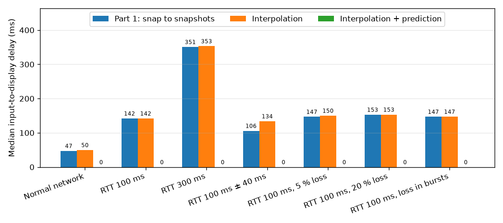
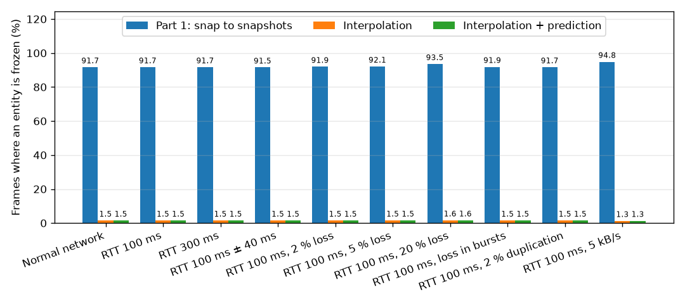
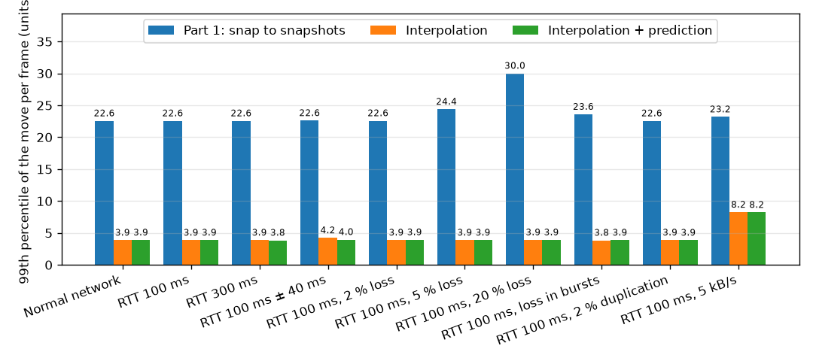

# Network performance comparison

This page measures what the client-side networking techniques of Part 2
change for the player, compared with the Part 1 prototype. It is the network
part of the technical study's "Before vs after" item.

## Contents

1. [What is compared](#1-what-is-compared)
2. [Method](#2-method)
3. [Metrics](#3-metrics)
4. [Results](#4-results)
5. [Analysis](#5-analysis)
6. [Running the benchmark](#6-running-the-benchmark)

## 1. What is compared

| Mode | Client option | What the client does with a snapshot |
|------|---------------|---------------------------------------|
| Part 1: snap to snapshots | `--no-interpolation --no-prediction` | Moves every entity straight to its new position, 20 times per second, as the `v1.0` prototype did. |
| Interpolation | `--no-prediction` | Draws the other entities 100 ms in the past, interpolated between the two snapshots around that time (see [Architecture](ARCHITECTURE.md)). The local ship still jumps to each snapshot. |
| Interpolation + prediction | (default) | Also predicts the local ship: it moves as soon as a key is pressed, and each snapshot corrects it smoothly (reconciliation). |

All the modes run the same build of the same code: only the technique
changes, so any difference comes from it.

## 2. Method

- **Network conditions:** the scenarios of the
  [network testing guide](NETWORK_TESTING.md), applied with `tc netem` to the
  game's UDP traffic on the loopback interface: normal network, latency, high
  latency, jitter, random loss, loss in bursts, duplication and low bandwidth.
- **Same game every time:** each run starts a fresh server with
  `--invincible`, so the measured ship never dies, and one client with
  `--bench`.
- **Same inputs every time:** instead of the keyboard, the benchmarked client
  repeats a fixed sequence every 2 seconds: no key for 0.7 s, Up for 0.3 s, no
  key for 0.7 s, Down for 0.3 s.
- **Measured where the player looks:** the client records the positions it is
  about to draw, every frame, and writes them to a CSV file at the end of the
  run. `tools/netbench.py` then computes the metrics below.

## 3. Metrics

| Metric | What it shows | Better when |
|--------|---------------|-------------|
| Input-to-display delay | Time between a key press and the first frame where the local ship moves that way on screen; 0 means the frame of the key press itself. "Missed" counts the presses never shown before the next one. | Lower |
| Frozen frames | Share of the frames where a synced entity (enemy, missile) does not move on screen. Every entity of the game moves all the time, so a frozen frame is a stutter. | Lower |
| Move per frame, 99th percentile | The largest on-screen jumps of an entity between two frames, in playfield units (1920 × 1080). Smooth movement spreads a move over every frame; snapping does it in one jump. | Lower |
| Prediction corrections | How often the server disagreed with the predicted ship, and by how much. Each correction fades out smoothly instead of being drawn as a jump. | Fewer, smaller |
| Traffic | Bytes per second received and sent by the client, to check that a gain does not cost bandwidth. | Equal |

## 4. Results

<!-- results:begin -->

Generated by `tools/netbench.py` on 2026-11-05: 30 s per run, client at about 240 frames per second.

**Input-to-display delay of the local ship, median (95th percentile), in ms**

| Scenario | Part 1: snap to snapshots | Interpolation | Interpolation + prediction |
|---|---:|---:|---:|
| Normal network | 53 (61) | 42 (50) | 0 (0) |
| RTT 100 ms | 150 (158) | 147 (155) | 0 (5) |
| RTT 300 ms | 345 (350) | 342 (350) | 0 (0) |
| RTT 100 ms ± 40 ms | 139 (158) | 142 (153) | 0 (0) |
| RTT 100 ms, 2 % loss | 150 (156) | 151 (158) | 0 (7) |
| RTT 100 ms, 5 % loss | 147 (192) | 148 (156) | 0 (0) |
| RTT 100 ms, 20 % loss | 151 (253) | 150 (197) | 0 (8) |
| RTT 100 ms, loss in bursts | 153 (159) | 149 (202) | 0 (0) |
| RTT 100 ms, 2 % duplication | 150 (156) | 153 (158) | 0 (0) |
| RTT 100 ms, 5 kB/s | 197 (885), 13 missed | 189 (976), 14 missed | 0 (0) |

**Frames where a synced entity is frozen on screen**

| Scenario | Part 1: snap to snapshots | Interpolation | Interpolation + prediction |
|---|---:|---:|---:|
| Normal network | 91.7 % | 1.5 % | 1.5 % |
| RTT 100 ms | 91.7 % | 1.5 % | 1.5 % |
| RTT 300 ms | 91.7 % | 1.5 % | 1.5 % |
| RTT 100 ms ± 40 ms | 91.5 % | 1.5 % | 1.5 % |
| RTT 100 ms, 2 % loss | 91.9 % | 1.5 % | 1.5 % |
| RTT 100 ms, 5 % loss | 92.1 % | 1.5 % | 1.5 % |
| RTT 100 ms, 20 % loss | 93.5 % | 1.6 % | 1.6 % |
| RTT 100 ms, loss in bursts | 91.9 % | 1.5 % | 1.5 % |
| RTT 100 ms, 2 % duplication | 91.7 % | 1.5 % | 1.5 % |
| RTT 100 ms, 5 kB/s | 94.8 % | 1.3 % | 1.3 % |

**99th percentile of the move of an entity in one frame, in playfield units**

| Scenario | Part 1: snap to snapshots | Interpolation | Interpolation + prediction |
|---|---:|---:|---:|
| Normal network | 22.6 | 3.9 | 3.9 |
| RTT 100 ms | 22.6 | 3.9 | 3.9 |
| RTT 300 ms | 22.6 | 3.9 | 3.8 |
| RTT 100 ms ± 40 ms | 22.6 | 4.2 | 4.0 |
| RTT 100 ms, 2 % loss | 22.6 | 3.9 | 3.9 |
| RTT 100 ms, 5 % loss | 24.4 | 3.9 | 3.9 |
| RTT 100 ms, 20 % loss | 30.0 | 3.9 | 3.9 |
| RTT 100 ms, loss in bursts | 23.6 | 3.8 | 3.9 |
| RTT 100 ms, 2 % duplication | 22.6 | 3.9 | 3.9 |
| RTT 100 ms, 5 kB/s | 23.2 | 8.2 | 8.2 |

**Corrections of the predicted ship per second, and their median size in playfield units**

| Scenario | Part 1: snap to snapshots | Interpolation | Interpolation + prediction |
|---|---:|---:|---:|
| Normal network | n/a | n/a | 7.0 (8.5) |
| RTT 100 ms | n/a | n/a | 6.9 (8.4) |
| RTT 300 ms | n/a | n/a | 6.8 (8.4) |
| RTT 100 ms ± 40 ms | n/a | n/a | 6.8 (8.5) |
| RTT 100 ms, 2 % loss | n/a | n/a | 6.8 (8.4) |
| RTT 100 ms, 5 % loss | n/a | n/a | 5.9 (8.2) |
| RTT 100 ms, 20 % loss | n/a | n/a | 5.9 (8.4) |
| RTT 100 ms, loss in bursts | n/a | n/a | 6.7 (8.3) |
| RTT 100 ms, 2 % duplication | n/a | n/a | 6.9 (8.3) |
| RTT 100 ms, 5 kB/s | n/a | n/a | 21.8 (2.6) |

**Traffic of the client, received / sent, in bytes per second**

| Scenario | Part 1: snap to snapshots | Interpolation | Interpolation + prediction |
|---|---:|---:|---:|
| Normal network | 3524 / 520 | 3525 / 517 | 3525 / 519 |
| RTT 100 ms | 3538 / 518 | 3537 / 518 | 3536 / 518 |
| RTT 300 ms | 3561 / 519 | 3560 / 518 | 3562 / 521 |
| RTT 100 ms ± 40 ms | 3527 / 526 | 3531 / 521 | 3527 / 520 |
| RTT 100 ms, 2 % loss | 3438 / 519 | 3444 / 519 | 3463 / 518 |
| RTT 100 ms, 5 % loss | 3363 / 522 | 3372 / 517 | 3359 / 518 |
| RTT 100 ms, 20 % loss | 2769 / 519 | 2775 / 517 | 2814 / 519 |
| RTT 100 ms, loss in bursts | 3446 / 520 | 3458 / 520 | 3469 / 520 |
| RTT 100 ms, 2 % duplication | 3602 / 520 | 3584 / 518 | 3593 / 519 |
| RTT 100 ms, 5 kB/s | 2403 / 518 | 2403 / 522 | 2404 / 518 |







<!-- results:end -->

## 5. Analysis

**Smoothness: interpolation removes the stutter.** The server sends 20
snapshots per second and the client draws about 240 frames per second. When it
snaps to each snapshot, an entity stays still for 11 frames out of 12 (92 %
frozen frames) and then jumps its whole 50 ms move at once (over 20 units for
the fastest ones). With interpolation it moves a little on every frame: under
2 % frozen frames, and the largest per-frame moves are about 6 times smaller.
The remaining 1.5 % are mostly new entities, which wait about 100 ms at their spawn
point for the render clock to reach their first snapshot.

**Robust to the network.** The interpolation figures barely move from a
perfect network to 300 ms of latency, jitter or 20 % loss: the 100 ms render
delay always keeps two snapshots to interpolate between, and a short
extrapolation bridges the gaps left by lost snapshots.

**Responsiveness: prediction removes the latency of the local ship.**
Without prediction, the ship only moves once the server has applied the input
and its snapshot has come back: about 50 ms on a perfect network (waiting for
the next snapshot), then the round-trip time plus 50 ms (about 150 ms at
100 ms RTT, 350 ms at 300 ms RTT, up to 250 ms with 20 % loss).
Interpolation does not change this. With prediction, the ship moves in the
very frame of the key press (0 ms median, at most two frames in 95 % of the
presses), whatever the network.

**The server stays in charge.** While the ship moves, each snapshot corrects
the prediction by about 8 units (the ship is 64 units wide), and at most about
18. This comes from the input rate: between two inputs the server keeps moving
the ship while the client also replays these frames, so the difference depends
on when the last input arrived. Each correction fades out over about 0.3 s
instead of being drawn as a jump. Measured on a normal network at 240 frames
per second:

| Time between two inputs | Median correction | 95th percentile | Largest | Sent |
|---:|---:|---:|---:|---:|
| One input per frame (about 4 ms) | 0.3 | 2.9 | 4.2 | 4030 B/s |
| 16 ms, like a client at 60 frames per second | 0.1 | 12.6 | 14.4 | 1020 B/s |
| 30 ms (kept) | 8.3 | 14.7 | 17.8 | 520 B/s |

**Inputs: a fixed rate for every frame rate.** The client used to send one
input per displayed frame, which is 4 kB/s at 240 frames per second, and about
11 kB/s with the packet headers. It now sends one when the actions change, and
otherwise every 30 ms. The keys still reach the server as soon as they change,
and the upload is divided by 8. Interpolation and prediction add no packet:
the received traffic does not depend on the mode. Auto-fire, always on in the
game, only holds the fire action: it adds no input.

**Duplication and loss: no effect beyond the lost data.** With 2 % duplication
the figures are the same as without it. With 50 % duplication, in a separate
20 s run, the server logged no warning and neither program failed: inputs and
snapshots older than the newest are ignored, and reliable messages are
delivered once. 2 % loss barely differs from 5 %.

**Low bandwidth: playable for a few seconds, then late.** The 5 kB/s scenario
limits both directions together. Before the fixed input rate, the inputs alone
filled this limit: the client received about 530 B/s and none of the key
presses of a 12 s run was shown. Now the game needs about 6.1 kB/s with the
headers (4.4 kB/s of snapshots, 1.8 kB/s of inputs). The first 7 seconds run
with about 190 ms of delay, then the queue fills as enemies appear: the delay
reaches about 900 ms after 10 s, and about half of the presses are not shown
within the 1 s window (13 "missed" above). Limiting each direction to 5 kB/s
instead, as a real link would, is better but not enough: in a separate 30 s
run the delay stays around 180 ms for 11 s, then rises above 1 s when enemies
are numerous, and comes back down afterwards (5 presses out of 29 missed).
Nothing crashes or disconnects in either case, and the local ship stays
responsive thanks to prediction. Holding at 5 kB/s would need smaller
snapshots or fewer of them: every snapshot sends all the entities, 20 times
per second.

**Costs and limits.**

- The other entities are drawn 100 ms in the past. This delay does not show
  in the metrics above, but it is the price of their smoothness: a player sees
  the enemies where they were 100 ms earlier, while the server decides hits on
  the real positions.
- The local ship is now drawn ahead of the server, but its missiles are not
  predicted: they appear when the server creates them, slightly behind a
  moving ship (about the distance the ship covers in one round trip).

## 6. Running the benchmark

Linux only (`tc netem`). Build the server and the client first, then run
every scenario (about 30 s per run, so a few minutes; `tc` asks for the sudo
password once):

```bash
./rtype.py --native
```

```bash
./tools/netbench.py
```

A client window opens for each run: do not touch it until the run ends. The
raw measures go to `build/netbench/`, and the results above are rewritten,
with their charts in `docs/images/network-comparison/`. Useful options:

| Option | Effect |
|--------|--------|
| `run` / `report` | Only measure, or only rewrite the results from the last measures. |
| `-d SECONDS` | Duration of each run (default 30). |
| `-s SCENARIO...` | Only some scenarios: `normal`, `latency`, `high-latency`, `jitter`, `loss-2`, `loss-5`, `loss-20`, `bursts`, `duplicate`, `bandwidth`. |
| `-m MODE...` | Only some client modes: `snap`, `interpolation`, `prediction`. The report keeps the last measures of the other modes. |
| `--no-netem` | Measure the current network without `tc` (one "normal" run per mode). |
| `--no-charts` | Tables only, without installing matplotlib. |

The client options can also be used by hand:

```bash
./build/r-type_server --invincible
```

```bash
./build/r-type_client 127.0.0.1 4242 --no-interpolation --no-prediction --bench 30 snap.csv
```
