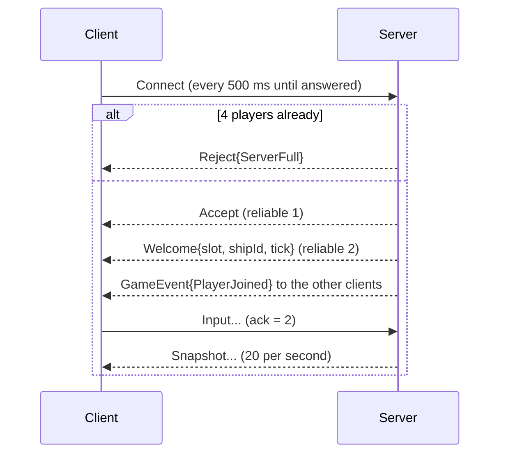

# R-Type network protocol (version 1)

This document specifies the binary protocol spoken between the R-Type server
and its clients. It is precise enough to write a compatible client or server
without reading our code. The reference implementation is in
[`common/include/common/protocol/`](../common/include/common/protocol/) and
[`common/src/protocol/`](../common/src/protocol/); the threads and queues that
use it are described in [ARCHITECTURE.md](ARCHITECTURE.md), section 6.

The key words **MUST**, **MUST NOT**, **SHOULD** and **MAY** are used as in
[RFC 2119](https://www.rfc-editor.org/rfc/rfc2119).

## Contents

1. [Overview](#1-overview)
2. [Conventions](#2-conventions)
3. [Transport](#3-transport)
4. [Packet header](#4-packet-header)
5. [Packet types](#5-packet-types)
6. [Payloads](#6-payloads)
7. [Reliability](#7-reliability)
8. [Connection lifecycle](#8-connection-lifecycle)
9. [Snapshots](#9-snapshots)
10. [Robustness rules](#10-robustness-rules)
11. [Examples](#11-examples)
12. [Versioning](#12-versioning)

## 1. Overview

- All traffic uses **UDP**. There is no TCP connection.
- The server is **authoritative**: clients only send their inputs, the server
  simulates the game and sends the state back.
- Every datagram holds exactly **one packet**: a 12-byte header followed by a
  payload whose layout depends on the packet type.
- Most traffic is **unreliable and replaced by the next packet**: inputs
  (client to server, about 60 per second) and snapshots (server to client, 20
  per second). A lost one does not matter.
- A few packets are **reliable**: acknowledged, resent until acknowledged, and
  delivered once and in order. They carry facts that are never repeated:
  `Accept`, `Welcome` and `GameEvent`.

## 2. Conventions

| Notation | Meaning |
|----------|---------|
| `u8`, `u16`, `u32` | Unsigned integers of 1, 2 and 4 bytes |
| `f32` | IEEE 754 binary32 float, 4 bytes, sent as the `u32` with the same bits |
| Byte order | **Little-endian**: least significant byte first. `1000` (`0x000003E8`) is sent as `E8 03 00 00` |
| Layout | Fields are packed in the order listed, with no padding and no alignment |
| Enumerations | Sent as one `u8`. Values not listed in this document are invalid |
| Drop | Discard the datagram silently: no answer, no state change |

Implementations **MUST** write and read fields one by one. Copying a C or C++
structure into the datagram (`memcpy`) is not portable: it would send padding
bytes and depend on the processor's byte order.

## 3. Transport

| Parameter | Value |
|-----------|-------|
| Protocol | UDP over IPv4 |
| Default server port | 4242 |
| Maximum datagram size | **1200 bytes**, header included (1188 bytes of payload) |

1200 bytes stays below the usual path MTU (1280 bytes is the IPv6 minimum),
so datagrams are never fragmented by IP. A sender **MUST NOT** send a larger
packet; a receiver **MUST** drop one.

## 4. Packet header

Every packet starts with this 12-byte header:

| Offset | Size | Field | Value |
|-------:|-----:|-------|-------|
| 0 | 2 | magic | `52 54` (ASCII `"RT"`). Recognizes our packets: a random datagram almost never starts with these bytes |
| 2 | 1 | version | `1`. See [Versioning](#12-versioning) |
| 3 | 1 | type | Which payload follows. See [Packet types](#5-packet-types) |
| 4 | 1 | flags | Bit 0: **Reliable**. Bits 1 to 7 are reserved and **MUST** be 0 |
| 5 | 1 | reserved | **MUST** be 0 |
| 6 | 2 | sequence | `u16`. Packet counter of the sender, see [Reliability](#7-reliability) |
| 8 | 2 | ack | `u16`. Last reliable sequence received in order from the other side |
| 10 | 2 | payload size | `u16`. Number of bytes after the header |

The Reliable flag **MUST** be set on reliable packet types and **MUST NOT** be
set on the others ([section 5](#5-packet-types)).

### Validation order

A receiver checks a datagram in this order and drops it at the first failure.
The names are the `DecodeError` values of the reference implementation.

| # | Check | Error |
|--:|-------|-------|
| 1 | At most 1200 bytes | `TooLarge` |
| 2 | At least 12 bytes | `TooShort` |
| 3 | Magic is `"RT"` | `BadMagic` |
| 4 | Version is 1 | `BadVersion` |
| 5 | Type is listed in section 5 | `UnknownType` |
| 6 | No reserved flag bit, and Reliable set exactly on reliable types | `BadFlags` |
| 7 | Reserved byte is 0 | `BadReserved` |
| 8 | Payload size equals the datagram size minus 12 | `BadPayloadSize` |
| 9 | The sender's side may send this type (section 5) | `WrongSender` |
| 10 | The payload decodes, every value is in range, and no byte is left over | `BadPayload` |

Check 8 catches truncated and padded datagrams before any payload decoding.

## 5. Packet types

| Value | Name | Sent by | Delivery | Payload size (bytes) |
|------:|------|---------|----------|---------------------:|
| `0x01` | `Connect` | Client | Unreliable, retried | 0 |
| `0x02` | `Accept` | Server | Reliable | 0 |
| `0x03` | `Reject` | Server | Unreliable | 1 |
| `0x04` | `Disconnect` | Both | Unreliable (best effort) | 1 |
| `0x05` | `Ack` | Both | Unreliable | 0 |
| `0x10` | `Input` | Client | Unreliable | 5 |
| `0x20` | `Snapshot` | Server | Unreliable | 8 + players block + 16 per entity |
| `0x21` | `Welcome` | Server | Reliable | 9 |
| `0x22` | `GameEvent` | Server | Reliable | 1 to 5 |

Values are grouped by range: `0x0_` for the connection (both directions),
`0x1_` from client to server, `0x2_` from server to client. A packet sent by
the wrong side (for example a `Snapshot` sent by a client) **MUST** be dropped.

## 6. Payloads

Offsets in this section are relative to the start of the payload, that is
byte 12 of the datagram.

### `Connect` (0x01), `Accept` (0x02), `Ack` (0x05)

No payload. `Connect` asks to join (the protocol version is in the header).
`Accept` answers it. `Ack` carries only the header's `ack` field, for a peer
that has nothing else to send.

### `Reject` (0x03)

| Offset | Size | Field | Values |
|-------:|-----:|-------|--------|
| 0 | 1 | reason | `0` ServerFull, `1` VersionMismatch |

### `Disconnect` (0x04)

| Offset | Size | Field | Values |
|-------:|-----:|-------|--------|
| 0 | 1 | reason | `0` Left (the player quit), `1` Timeout, `2` Kicked (protocol broken), `3` ServerClosing |

### `Input` (0x10)

The complete input state of the player. Sending the full state each time
means a lost packet is corrected by the next one, and a key release cannot be
lost.

| Offset | Size | Field | Values |
|-------:|-----:|-------|--------|
| 0 | 4 | sequence | `u32`, incremented for each `Input` sent. The server keeps the newest only |
| 4 | 1 | actions | Bit field, see below. Unlisted bits **MUST** be 0 |

| Bit | Mask | Action |
|----:|-----:|--------|
| 0 | `0x01` | Up |
| 1 | `0x02` | Down |
| 2 | `0x04` | Left |
| 3 | `0x08` | Right |
| 4 | `0x10` | Fire |

### `Welcome` (0x21)

Sent once to a new player, after `Accept`.

| Offset | Size | Field | Values |
|-------:|-----:|-------|--------|
| 0 | 1 | slot | Player number, `1` to `4` |
| 1 | 4 | shipId | `u32`, network id of the player's own ship in snapshots |
| 5 | 4 | tick | `u32`, current server tick |

### `Snapshot` (0x20)

The state of the visible entities at one server tick. A snapshot that does
not fit in one datagram is split into several **parts**
([section 9](#9-snapshots)).

**Snapshot header (8 bytes)**

| Offset | Size | Field | Values |
|-------:|-----:|-------|--------|
| 0 | 4 | tick | `u32`, server tick of this state |
| 4 | 1 | part | Part number, from `0` to `partCount - 1` |
| 5 | 1 | partCount | Number of parts for this tick, at least `1` |
| 6 | 2 | entityCount | `u16`, number of entity records in this part |

**Players block (part 0 only): 1 + 5 bytes per player**

| Size | Field | Values |
|-----:|-------|--------|
| 1 | playerCount | `0` to `4` |
| 1 | slot | `1` to `4`, repeated `playerCount` times with the score |
| 4 | score | `u32` |

**Entity record (16 bytes), repeated `entityCount` times**

| Offset | Size | Field | Values |
|-------:|-----:|-------|--------|
| 0 | 4 | networkId | `u32`, identifies the entity. Never reused by the server |
| 4 | 1 | type | Entity type, see below. The client chooses the sprite from it |
| 5 | 1 | flags | Bit 0 (`0x01`) Invincible (blinking), bit 1 (`0x02`) Charging. Other bits **MUST** be 0 |
| 6 | 2 | health | `u16`, for health bars |
| 8 | 4 | x | `f32`, center, in playfield units |
| 12 | 4 | y | `f32`, center, in playfield units |

The playfield is 1920 × 1080 units, origin at the top-left corner, y growing
downwards. Positions **MAY** be outside the playfield (enemies spawn past its
right edge) but **MUST** be finite: NaN and infinities are invalid.

| Value | Entity type |
|------:|-------------|
| 0 | PlayerShip |
| 1 | PlayerMissile |
| 2 | EnemyBasic |
| 3 | EnemyWave |
| 4 | EnemyShooter |
| 5 | EnemyMissile |
| 6 | EnemySmall |
| 7 | EnemyMedium |
| 8 | EnemyLarge |

### `GameEvent` (0x22)

A one-off fact. The body depends on the kind:

| Offset | Size | Field |
|-------:|-----:|-------|
| 0 | 1 | kind |
| 1 | 0 or 1 or 4 | body |

| Kind | Name | Body | Meaning |
|-----:|------|------|---------|
| 0 | EntityDestroyed | networkId (`u32`) | Remove this entity |
| 1 | PlayerJoined | slot (`u8`, 1 to 4) | Another player joined |
| 2 | PlayerLeft | slot (`u8`, 1 to 4) | A player left, timed out or was kicked |
| 3 | PlayerHit | slot (`u8`, 1 to 4) | A player was hit (sound, screen flash) |
| 4 | GameOver | none | The game is over |

## 7. Reliability

UDP may lose, duplicate and reorder datagrams. Unreliable packets accept
this: each one carries a newer state (`Input::sequence`, `Snapshot::tick`)
and the receiver ignores anything older than what it already has. Reliable
packets use the header fields `sequence` and `ack` as follows. The reference
implementation of this section is `ReliableChannel`
([`ReliableChannel.hpp`](../common/include/common/protocol/ReliableChannel.hpp)).

### Two counters

Each side keeps, for each peer, **two separate counters** for the packets it
sends:

- **Reliable counter**: written in `sequence` of reliable packets. The first
  reliable packet carries sequence **1**, then 2, 3...
- **Unreliable counter**: written in `sequence` of the other packets. It has
  no meaning for reliability; a receiver **MAY** use it to measure packet
  loss.

Keeping them separate means that a gap in reliable sequences always means a
lost reliable packet, never a lost snapshot.

### Receiving a reliable packet

Each side keeps `lastInOrder`, the last reliable sequence it received in
order from the peer, starting at **0** ("nothing received").

| Received sequence | Action |
|-------------------|--------|
| `lastInOrder + 1` | Deliver the packet, then `lastInOrder = sequence` |
| Not newer than `lastInOrder` | Duplicate: drop it |
| Newer, but not the next one | A packet before it was lost: drop it. The sender resends both |

So reliable packets are delivered **in order and exactly once**. Order
matters: a client must not apply `GameOver` before an `EntityDestroyed` sent
earlier.

### Acknowledging

Every packet, of any type, carries `ack = lastInOrder` in its header. Since
clients send inputs about 60 times per second and the server sends snapshots
20 times per second, acknowledgments cost no extra packets. A peer that has
received a reliable packet and has nothing else to send **SHOULD** send an
`Ack` packet within 50 ms.

The ack is **cumulative**: `ack = 7` acknowledges every reliable packet up to
7. On every received packet, the sender forgets the stored reliable packets
whose sequence is not newer than `ack`.

### Resending

| Parameter | Value |
|-----------|-------|
| Resend interval | 100 ms |
| Maximum unacknowledged reliable packets per peer | 256 |

A reliable packet not acknowledged after 100 ms is sent again with the same
`sequence` (and an up-to-date `ack`). A peer that lets more than 256 reliable
packets go unacknowledged is disconnected instead of making the sender store
them forever.

### Wrap-around

Sequences are 16-bit and wrap from 65535 to 0. Comparisons **MUST** use
serial number arithmetic: `a` is newer than `b` when
`(a - b) mod 65536` is between 1 and 32767. So 3 is newer than 65530. In the
reference implementation, this is `isNewer(a, b)`.

## 8. Connection lifecycle

### Joining



In words:

1. The client sends `Connect` and repeats it every **500 ms** until it
   receives `Accept` or `Reject`.
2. The server accepts at most **4** clients. A fifth one receives
   `Reject{ServerFull}` and no session is created for it.
3. Otherwise the server creates a session for the client's address and port
   and answers `Accept`. A `Connect` from an address that already has a
   session is ignored: the reliability layer resends the pending `Accept`.
4. The server creates the player's ship and sends `Welcome` to the new player
   and `GameEvent{PlayerJoined}` to the others.
5. From then on, the client sends `Input` continuously and receives
   snapshots and events.

The server **MUST** drop every packet other than `Connect` from an address
that has no session. A client **MUST** drop datagrams that do not come from
the server's address.

### Version mismatch

A server that receives a datagram with the right magic but another version
**SHOULD** answer `Reject{VersionMismatch}`. That answer is encoded with the
server's own version, so an older or newer client cannot decode it fully. For
that reason, a client that receives, from the server's address, a datagram
with the right magic but another version **MUST** stop connecting and tell
the player that the versions do not match.

### Leaving

| Case | Detection | Wire |
|------|-----------|------|
| The player quits | Immediate | The client sends `Disconnect{Left}` (best effort, not resent) |
| A client crashes or its network drops | No valid packet from it for **5 seconds** | None |
| A client breaks the protocol | Too many invalid packets, or too many unacknowledged reliable packets | The server sends `Disconnect{Kicked}` |
| The server shuts down | Immediate | The server sends `Disconnect{ServerClosing}` to every client |

In every case the server removes the session and sends
`GameEvent{PlayerLeft}` to the remaining clients, and the game goes on for
them. A client that receives nothing from the server for 5 seconds considers
the connection lost; snapshots, 20 per second, act as a heartbeat.

### Timing summary

| Parameter | Value |
|-----------|-------|
| Connect retry interval | 500 ms |
| Reliable resend interval | 100 ms |
| Peer timeout | 5 s |
| Client input rate | about 60 per second |
| Server tick rate | 60 per second |
| Snapshot rate | 20 per second (every 3rd tick) |

## 9. Snapshots

### Splitting

A snapshot whose entities do not fit in 1188 bytes of payload is split into
parts. Each part is **self-contained**: it carries the tick and a list of
complete entity records, so losing one part only delays the update of its
entities. Only part 0 carries the players block.

| Part | Room for entities |
|------|-------------------|
| Part 0, with 4 players | (1188 − 8 − 21) / 16 = **72** entities |
| Other parts | (1188 − 8) / 16 = **73** entities |

`partCount` is at most 255.

### Applying

- A client applies a part if its `tick` is **not older** than the newest tick
  it has applied. Parts of the same tick are all applied.
- An unknown `networkId` creates an entity, using `type` to pick the sprite.
  A known one updates it.
- An entity is removed **only** by `GameEvent{EntityDestroyed}`, never
  because it is missing from a snapshot (its part may just have been lost).
- `networkId` values are never reused, and a client remembers recently
  destroyed ids for a few seconds, so a late snapshot cannot bring a
  destroyed entity back.

## 10. Robustness rules

The protocol is designed so that no datagram, valid or not, can crash a peer
or make it use unbounded memory:

- Every field is validated before use ([section 4](#validation-order)). An
  invalid datagram is dropped; it is never partially applied.
- A count read from a packet (`entityCount`, `playerCount`) is checked against
  the bytes actually present **before** any memory is reserved. A 20-byte
  packet claiming 65535 entities is rejected without allocating anything.
- A receiver reads each datagram into a fixed-size buffer; anything larger
  than 1200 bytes is dropped, never reallocated.
- The number of stored reliable packets per peer is capped
  ([section 7](#resending)).

**Known limitation.** Version 1 has no handshake token. A `Connect` sent with
a forged source address makes the server send `Accept`, `Welcome` and
snapshots to that address until the 5-second timeout, and takes one of the 4
slots meanwhile. A challenge-response handshake (the server answers
`Connect` with a random token that the client must send back) would fix it
in a later version.

The reference decoder is covered by unit tests with valid, truncated, padded
and out-of-range packets, and by randomized tests that feed it hundreds of
thousands of mutated and random datagrams
([`tests/src/packet_fuzz_test.cpp`](../tests/src/packet_fuzz_test.cpp)).

## 11. Examples

All bytes in hexadecimal.

### `Input` from a client: Up and Fire held

Unreliable sequence 298, acknowledging reliable packet 17, input number 1000:

```text
52 54 01 10 00 00 2A 01 11 00 05 00   header: "RT", v1, Input, no flags,
                                              sequence 298, ack 17, size 5
E8 03 00 00                           sequence 1000
11                                    actions 0x11 = Up | Fire
```

### `Welcome` to a new player

Reliable sequence 2, slot 2, ship 58, tick 1200:

```text
52 54 01 21 01 00 02 00 00 00 09 00   header: Welcome, Reliable,
                                              sequence 2, ack 0, size 9
02                                    slot 2
3A 00 00 00                           shipId 58
B0 04 00 00                           tick 1200
```

### `Snapshot` with one player and one entity

```text
52 54 01 20 00 00 2B 01 11 00 1E 00   header: Snapshot, size 30
2C 01 00 00                           tick 300
00 01                                 part 0 of 1
01 00                                 1 entity
01                                    1 player
01 DC 05 00 00                          slot 1, score 1500
07 00 00 00                           networkId 7
00                                      type PlayerShip
00                                      flags none
64 00                                   health 100
00 00 48 43                             x = 200.0 (bits 0x43480000)
00 00 07 44                             y = 540.0 (bits 0x44070000)
```

## 12. Versioning

- The magic, the version and the type stay at offsets 0, 2 and 3 in every
  future version, so that any version can recognize a packet of another one.
- Any change to the layout or the meaning of a packet increments the
  version. Peers of different versions do not talk to each other
  ([section 8](#version-mismatch)).
- New packet types, enumeration values and flag bits are added only with a
  new version: until then, receivers reject them.
