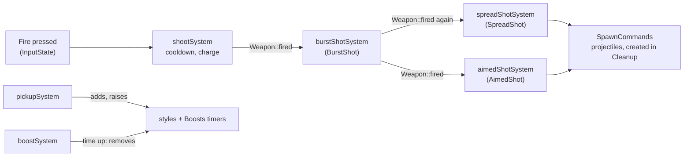

# Weapons and power-ups

## In the game

- **Normal shot**: each press of the fire key fires once (at most about 12
  times per second). Tap it to shoot fast.
- **Charged shot**: hold the fire key. While it is held, the ship stops
  shooting and charges: a glow appears in front of it. Released after 1
  second, a large beam flies across the screen, goes **through** every enemy
  on its way and deals each one heavy damage (300, against 50 for a normal
  shot). Released earlier, nothing more is fired.
- **Auto-fire** is on by default: it presses the fire key for you 10 times
  per second. F or Right Shift turns it off or on. Holding the fire key still
  charges a shot, and auto-fire starts again when you release it.
- **Power-ups**: medium and large enemies, and the bosses, leave an orb
  when they are destroyed. It slowly floats to the left; the ship that
  touches it gets its **boost** for a limited time. Each orb has a random
  kind, shown by its color and its letter:

  | Letter | Boost | Effect | Lasts |
  |:------:|-------|--------|------:|
  | S (yellow) | Spread | 3 shots in a spread; taken again while active, 5 in a wider spread | 30 s |
  | A (blue) | Aimed | One more shot, flying towards the nearest enemy | 45 s |
  | B (orange) | Burst | Each shot is fired again twice, right after it | 30 s |

  Boosts **stack**: each has its own timer. For example, a spread taken at
  5:02 and an aimed boost taken at 5:22 both fire together until 5:32, when
  the spread ends; the aimed boost goes on until 6:07. Taking a boost the
  ship already has restarts its timer. The HUD lists the active boosts of
  the local player with their seconds left (`Spread 12s`). Without any
  boost, a ship fires a single shot.

## Weapon settings: `server/weapons.json`

The weapons are data, read by the server when it starts, from `weapons.json`
next to its executable (`build/weapons.json`, copied there by the build, or
`/weapons.json` in the Docker image). Every key is optional: a missing key
keeps its default. A missing, too large (over 64 KiB) or invalid file is
reported in the server's output and the defaults are used; it never stops
the server.

```json
{
    "fireInterval": 0.08,
    "shotSpeed": 1400,
    "shotDamage": 50,
    "enemyShotSpeed": 450,
    "chargeTime": 1.0,
    "beamSpeed": 1800,
    "beamDamage": 300,
    "spreadAngle": 0.12,
    "maxLevel": 3,
    "spreadDuration": 30,
    "aimedDuration": 45,
    "burstDuration": 30,
    "burstShots": 2,
    "burstDelay": 0.08
}
```

| Key | Default | Range | Meaning |
|-----|--------:|-------|---------|
| `fireInterval` | 0.08 | 0.05 to 5 | Shortest time between two shots of a player: faster presses are ignored |
| `shotSpeed` | 1400 | 100 to 5000 | Speed of a player's shot, in playfield units per second (the playfield is 1920 wide) |
| `shotDamage` | 50 | 1 to 10000 | Damage of a player's shot (a basic enemy has 100 health points) |
| `enemyShotSpeed` | 450 | 100 to 5000 | Speed of an enemy's shot |
| `chargeTime` | 1.0 | 0.1 to 10 | Seconds the fire key must be held for a charged shot |
| `beamSpeed` | 1800 | 100 to 5000 | Speed of a charged shot |
| `beamDamage` | 300 | 1 to 10000 | Damage of a charged shot to each enemy it goes through |
| `spreadAngle` | 0.12 | 0 to 1 | Angle between two shots of a spread, in radians |
| `maxLevel` | 3 | 1 to 5 | Highest spread level; a level N spread fires 2N - 1 shots (the first Spread boost gives level 2) |
| `spreadDuration` | 30 | 1 to 255 | Seconds a Spread boost lasts |
| `aimedDuration` | 45 | 1 to 255 | Seconds an Aimed boost lasts |
| `burstDuration` | 30 | 1 to 255 | Seconds a Burst boost lasts |
| `burstShots` | 2 | 1 to 5 | How many times a Burst boost fires each shot again |
| `burstDelay` | 0.08 | 0.02 to 1 | Seconds between two shots of a burst |

Unknown keys and values of the wrong type or out of range make the file
invalid, so that a typo is reported instead of silently ignored.

## Shot styles

A shot style is **how a player's weapon turns one shot into projectiles**.
It is an ECS component on the player's ship, applied by its own system, so
a ship can have several styles at once:



- `shootSystem` handles what every weapon shares: the fire rate, holding to
  charge and the charged shot. When the player fires this tick, it only
  sets `Weapon::fired`.
- The system of each style turns `fired` into projectiles for the players
  that have its component. `SpreadShot` is on every ship (level 1: a single
  shot); `AimedShot` and `BurstShot` come from boosts. `burstShotSystem`
  runs first and only sets `fired` again on the next ticks of a burst, so
  every other style repeats with it.
- A power-up carries its boost (`rtype::PowerUpKind`, shared with the
  client). `pickupSystem` sets that boost's timer in the ship's `Boosts` to
  its full duration and adds the style (a Spread boost raises the spread
  level instead). `boostSystem` counts the timers down and, when one runs
  out, removes its style (the spread goes back to level 1).
- `powerUpDropSystem` picks the kind of each dropped power-up at random.

### Adding a boost

Example: a rapid fire, which halves the time between two shots.

1. **Kind**, in `common/include/common/components/PowerUpKind.hpp`: add
   `PowerUpKind::Rapid` before `Count`, to `PowerUpKinds` and to
   `powerUpName()`. This is a protocol change (see step 6).
2. **Component and system**: a style that makes shots goes in
   `server/include/components/ShotStyles.hpp` with its own system in
   `systems/ShotStyleSystems.*`, registered in
   `server::Game::registerSystems()` next to `"spreadShot"`. A boost that
   changes the weapon instead (here: `struct RapidFire {};`, read by
   `shootSystem` when it sets the cooldown) needs no new system.
3. **Boost**: in `server/src/systems/PowerUpSystem.cpp`, add the case to
   `applyPowerUp()` (add the component) and to `endBoost()` (remove it).
4. **Settings**: add its duration (`rapidDuration`) to `parseWeapons()`
   (`server/src/Weapons.cpp`, in `PowerUpKind` order) and to the table
   above.
5. **Client**: give it a color in `powerUpColor()`
   (`client/include/PlayerColors.hpp`); its letter and HUD line come from
   `powerUpName()`.
6. **Protocol**: the players block gets one more byte per player and the
   Boost flag bits may need one more bit: increment `ProtocolVersion` and
   update `docs/PROTOCOL.md`.
7. **Tests**, in `tests/src/weapons_test.cpp`: the fixture's `pick()`
   gives a boost, `wait()` runs the timers and `hold()` fires.

## Code

- [`server/include/Weapons.hpp`](https://github.com/T3a1/RType-mirror/blob/dev/server/include/Weapons.hpp):
  `WeaponStats`, `parseWeapons()` and `loadWeapons()`.
- [`server/include/systems/ShootSystem.hpp`](https://github.com/T3a1/RType-mirror/blob/dev/server/include/systems/ShootSystem.hpp):
  the fire rate, the charge and the charged shot (`Piercing` projectile).
- [`server/include/components/ShotStyles.hpp`](https://github.com/T3a1/RType-mirror/blob/dev/server/include/components/ShotStyles.hpp)
  and [`server/include/systems/ShotStyleSystems.hpp`](https://github.com/T3a1/RType-mirror/blob/dev/server/include/systems/ShotStyleSystems.hpp):
  the shot styles and their systems.
- [`server/include/systems/PowerUpSystem.hpp`](https://github.com/T3a1/RType-mirror/blob/dev/server/include/systems/PowerUpSystem.hpp):
  dropping power-ups (`EnemyDef::dropsPowerUp`), picking them up
  (`applyPowerUp()`) and the boost timers (`boostSystem()`).
- The `Charging` flag of a player ship's snapshot record makes the clients
  draw the glow (see the [protocol](PROTOCOL.md)).
