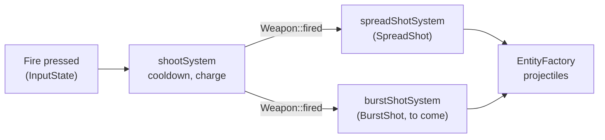

# Weapons and power-ups

## In the game

- **Normal shot**: each press of the fire key fires once (at most 4 times
  per second). Tap it to shoot fast.
- **Charged shot**: hold the fire key. While it is held, the ship stops
  shooting and charges: a glow appears in front of it. Released after 1
  second, a large beam flies across the screen, goes **through** every enemy
  on its way and deals each one heavy damage (300, against 50 for a normal
  shot). Released earlier, nothing more is fired.
- **Auto-fire** (F or Right Shift) presses the fire key for you 4 times per
  second: rapid fire without tapping, and no charged shot.
- **Power-ups**: medium and large enemies, and the boss, leave an orb when
  they are destroyed. It slowly floats to the left; the ship that touches it
  gets one more level of its **shot style**. Today there is one style, the
  spread:

  | Spread level | Shots at once |
  |-------------:|---------------|
  | 1 | 1 |
  | 2 | 3, in a spread |
  | 3 | 5, in a wider spread |

  A new ship starts with a level 1 spread (a single shot).

## Weapon settings: `server/weapons.json`

The weapons are data, read by the server when it starts, from `weapons.json`
next to its executable (`build/weapons.json`, copied there by the build, or
`/weapons.json` in the Docker image). Every key is optional: a missing key
keeps its default. A missing, too large (over 64 KiB) or invalid file is
reported in the server's output and the defaults are used; it never stops
the server.

```json
{
    "fireInterval": 0.25,
    "shotSpeed": 900,
    "shotDamage": 50,
    "enemyShotSpeed": 450,
    "chargeTime": 1.0,
    "beamSpeed": 1300,
    "beamDamage": 300,
    "spreadAngle": 0.12,
    "maxLevel": 3
}
```

| Key | Default | Range | Meaning |
|-----|--------:|-------|---------|
| `fireInterval` | 0.25 | 0.05 to 5 | Shortest time between two shots of a player: faster presses are ignored |
| `shotSpeed` | 900 | 100 to 5000 | Speed of a player's shot, in playfield units per second (the playfield is 1920 wide) |
| `shotDamage` | 50 | 1 to 10000 | Damage of a player's shot (a basic enemy has 100 health points) |
| `enemyShotSpeed` | 450 | 100 to 5000 | Speed of an enemy's shot |
| `chargeTime` | 1.0 | 0.1 to 10 | Seconds the fire key must be held for a charged shot |
| `beamSpeed` | 1300 | 100 to 5000 | Speed of a charged shot |
| `beamDamage` | 300 | 1 to 10000 | Damage of a charged shot to each enemy it goes through |
| `spreadAngle` | 0.12 | 0 to 1 | Angle between two shots of a spread, in radians |
| `maxLevel` | 3 | 1 to 5 | Highest level of a shot style; a level N spread fires 2N - 1 shots |

Unknown keys and values of the wrong type or out of range make the file
invalid, so that a typo is reported instead of silently ignored.

## Shot styles

A shot style is **how a player's weapon turns one shot into projectiles**.
It is an ECS component on the player's ship, applied by its own system:



- `shootSystem` handles what every weapon shares: the fire rate, holding to
  charge and the charged shot. When the player fires this tick, it only
  sets `Weapon::fired`.
- The system of each style turns `fired` into projectiles for the players
  that have its component. A ship has exactly one style: without any, it
  fires nothing.
- A power-up carries the style it gives (`PowerUpKind`). Picking up the
  style the ship already has raises its level; another style replaces it.

### Adding a shot style

Example: a burst, which fires 3 shots one after the other.

1. **Component**, in `server/include/components/ShotStyles.hpp`: the style
   and its own state, e.g.
   `struct BurstShot { std::uint8_t level = 1; std::uint8_t left = 0; engine::Duration next{0.0F}; };`,
   and a new `PowerUpKind::Burst`.
2. **System**, in `server/include/systems/ShotStyleSystems.hpp` and its
   `.cpp`: `burstShotSystem(registry, factory, stats, dt)` iterates
   `Weapon, BurstShot, Transform`; on `weapon.fired` it starts a burst
   (`left = 3`) and fires the remaining shots as `next` runs out, with
   `factory.create(registry, SpawnProjectile{...})`.
3. **Register it** in `server::Game::registerSystems()`, right after
   `"spreadShot"`, with the `playing` option.
4. **Power-up**: in `applyPowerUp()` (`server/src/systems/PowerUpSystem.cpp`)
   add the `PowerUpKind::Burst` case: remove the other style components
   (`registry.remove<SpreadShot>(player)`) and add or upgrade `BurstShot`.
   Then choose who drops it: the `SpawnPowerUp::kind` used by
   `powerUpDropSystem()` (for example a field in `EnemyDef`).
5. **Settings**: if it needs some (shots per burst, delay), add them to
   `WeaponStats` and to `parseWeapons()` (`server/src/Weapons.cpp`), then
   to the table above.
6. **Client**: every power-up is drawn with the same orb. To draw this one
   differently, give it its own `EntityType` (a protocol change: new value
   at the end, version incremented, `docs/PROTOCOL.md`) and its sprite in
   `client/src/SpriteSheets.cpp` (`lookOf()`).
7. **Tests**, in `tests/src/weapons_test.cpp`: the fixture runs
   `shootSystem` then `spreadShotSystem`; add your system to `hold()` and
   check the number of `PlayerMissile` created.

## Code

- [`server/include/Weapons.hpp`](../server/include/Weapons.hpp):
  `WeaponStats`, `parseWeapons()` and `loadWeapons()`.
- [`server/include/systems/ShootSystem.hpp`](../server/include/systems/ShootSystem.hpp):
  the fire rate, the charge and the charged shot (`Piercing` projectile).
- [`server/include/components/ShotStyles.hpp`](../server/include/components/ShotStyles.hpp)
  and [`server/include/systems/ShotStyleSystems.hpp`](../server/include/systems/ShotStyleSystems.hpp):
  the shot styles and their systems.
- [`server/include/systems/PowerUpSystem.hpp`](../server/include/systems/PowerUpSystem.hpp):
  dropping power-ups (`EnemyDef::dropsPowerUp`) and picking them up
  (`applyPowerUp()`).
- The `Charging` flag of a player ship's snapshot record makes the clients
  draw the glow (see the [protocol](PROTOCOL.md)).
