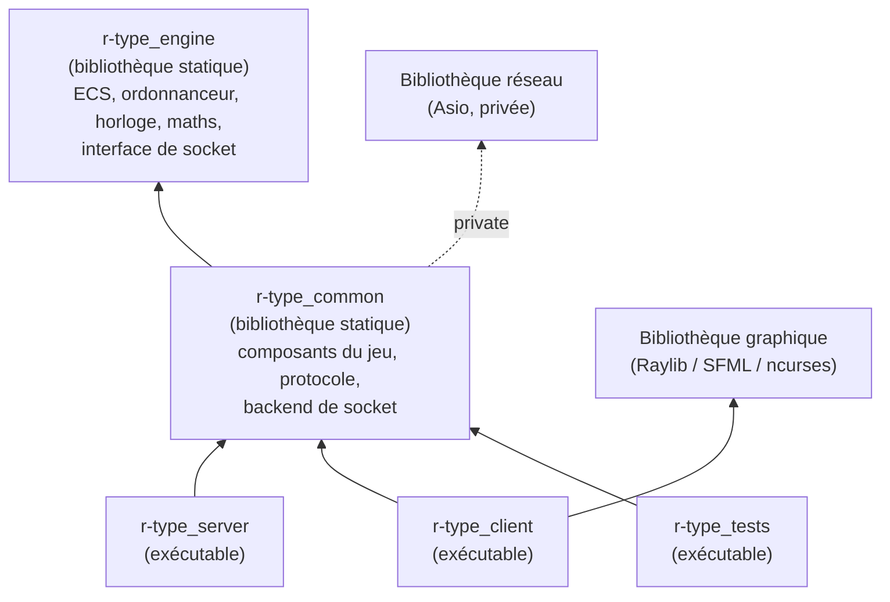
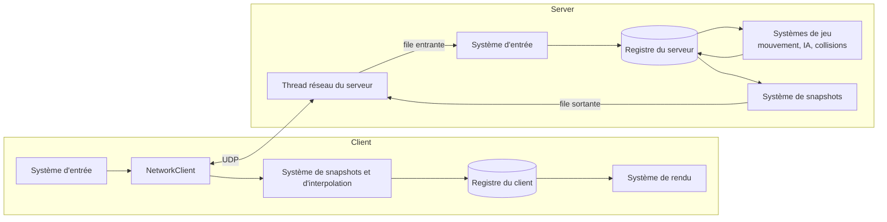
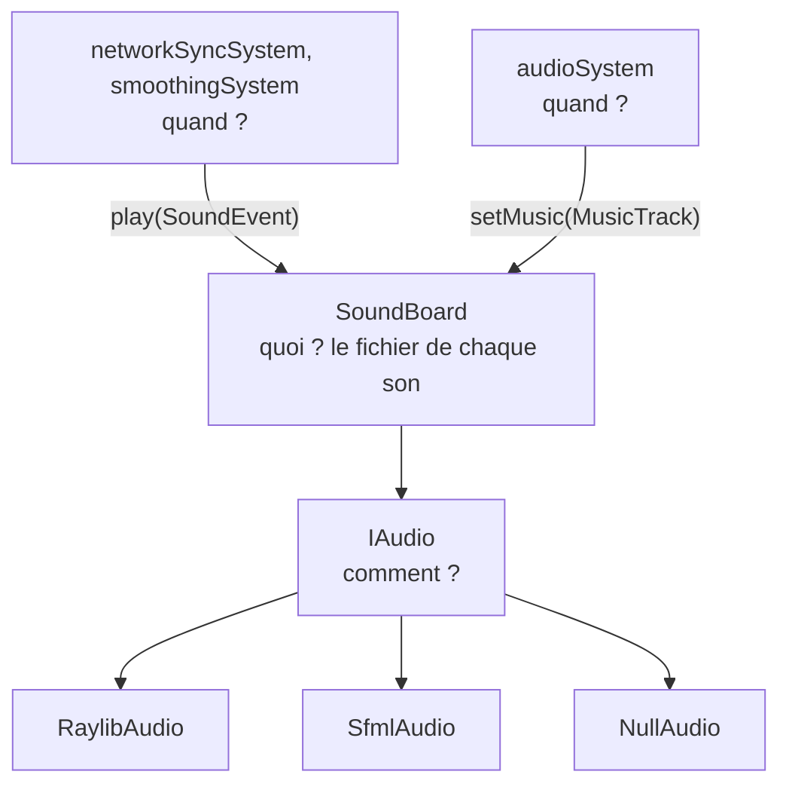
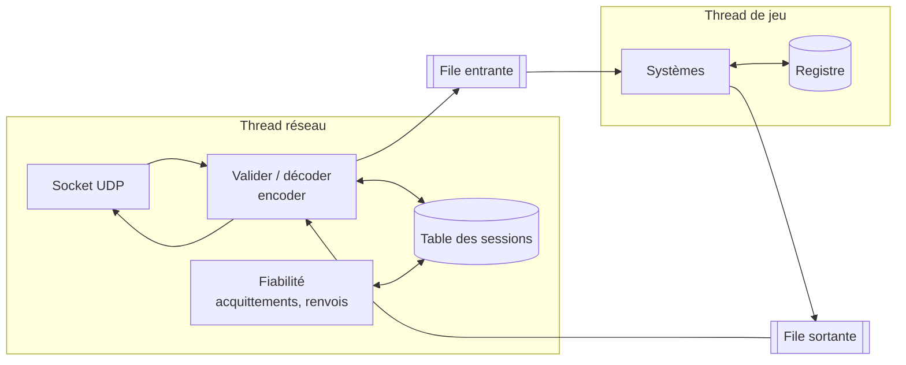
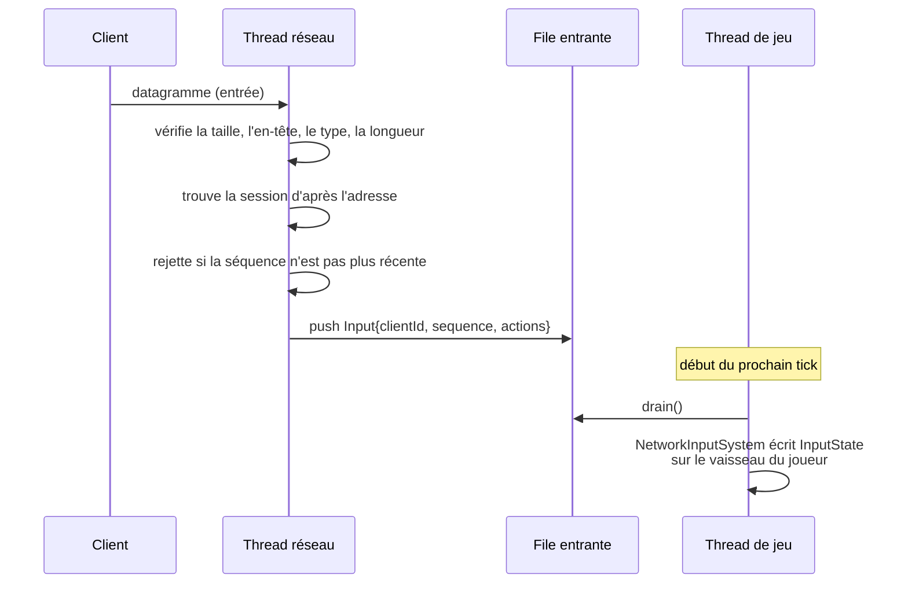
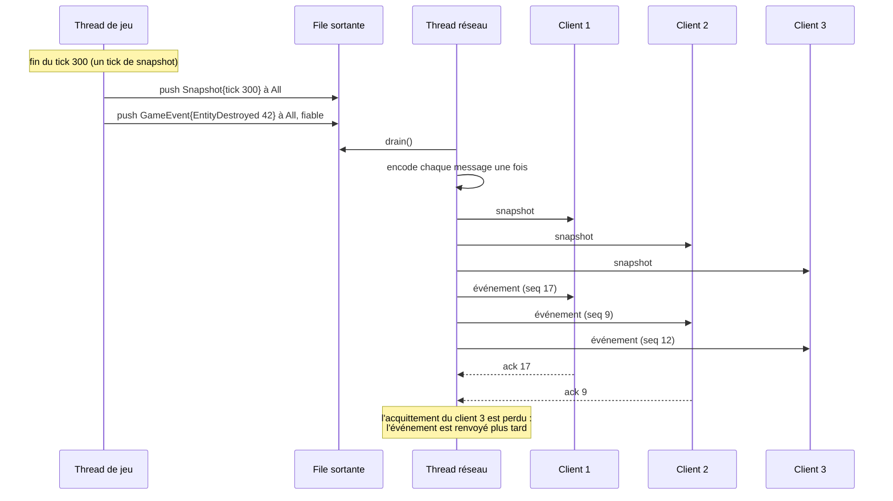
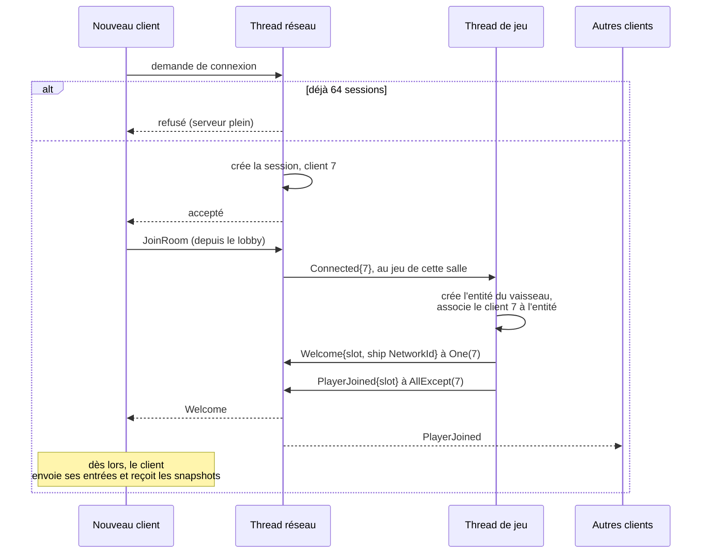

# Architecture

Ce document décrit l'organisation du code de R-Type : le moteur partagé, l'Entity Component System (ECS), les sous-systèmes et
leur communication, la boucle de jeu et le modèle de threads. Le protocole réseau est décrit dans [PROTOCOL.md](PROTOCOL.md).

Le pourquoi de ces choix, comparés aux alternatives, est expliqué dans l'[étude technique](TECHNICAL_STUDY.md). Les
[guides pratiques](HOWTO.md) montrent comment ajouter un composant, un système, un ennemi ou un paquet.

## 1. Objectifs

La conception suit les contraintes du sujet :

- **Sous-systèmes découplés.** Le rendu, le réseau et la logique de jeu sont séparés. Le système de rendu n'a besoin que de
  l'apparence et de la position d'une entité, pas de ses dégâts ni de sa vitesse.
- **Serveur autoritaire.** Le serveur possède l'état du jeu. Les clients envoient leurs entrées et affichent ce que le serveur
  leur dit.
- **La boucle de jeu ne bloque jamais sur le réseau.** Le réseau tourne sur son propre thread et échange des messages avec la
  boucle de jeu par des files.
- **Le temps vient de minuteries, pas de la vitesse du CPU.** La simulation avance par un pas de temps fixe, mesuré avec une
  horloge monotone.
- **Robustesse.** Des paquets malformés ou un client qui plante ne doivent jamais faire tomber le serveur.

## 2. Organisation du code

Le code est réparti en quatre cibles CMake. Les flèches signifient « se lie à ».



| Dossier | Cible | Contenu | Dépendances autorisées |
|---------|-------|---------|------------------------|
| `engine/` | `r-type_engine` | ECS générique (entités, composants, registre, systèmes), ordonnanceur, horloge, types mathématiques, interface de socket UDP (`engine::net`). Ne connaît rien de R-Type. | Bibliothèque standard uniquement |
| `common/` | `r-type_common` | Composants R-Type partagés par les deux programmes (`Transform`, `Velocity`, `Health`...), messages du protocole et leur sérialisation, backend de socket. | `r-type_engine` ; Asio en dépendance **privée** (Conan, ou le paquet Alpine `asio-dev` dans le `Dockerfile`) |
| `server/` | `r-type_server` (et `r-type_server_network`, `r-type_server_spawn`) | Boucle de jeu du serveur, systèmes de jeu (mouvement, collisions, apparition, niveaux, armes, IA), sessions des clients, thread réseau. | `r-type_common` ; nlohmann-json pour les fichiers de niveaux et d'armes (Conan, ou le paquet Alpine `nlohmann-json` dans le `Dockerfile`) |
| `client/` | `r-type_client` (et `r-type_client_network`, `r-type_client_audio`) | Rendu, entrées, audio, interpolation, connexion au serveur. | `r-type_common`, bibliothèque graphique (Conan) |

Règles :

- `engine/` et `common/` ne doivent jamais inclure quoi que ce soit de `server/`, de `client/` ni d'une bibliothèque graphique.
  Le serveur est compilé seul dans Docker (`-DBUILD_CLIENT=OFF`) : il ne peut donc utiliser que ces deux bibliothèques.
- Garder `engine/` indépendant du jeu le rend réutilisable pour un autre jeu.
- Seul `client/src/graphics/<backend>/` peut inclure la bibliothèque graphique. Le reste du client dessine, charge les textures
  et lit le clavier par `client::gfx::IGraphics` (`client/include/graphics/IGraphics.hpp`) : changer de bibliothèque revient donc
  à écrire un nouveau backend et à le choisir avec l'option Conan `graphics` et l'option CMake `RTYPE_GRAPHICS_BACKEND`. Trois
  backends existent : Raylib (par défaut), SFML, et ncurses, qui dessine dans un terminal (cellules de caractères de 8x16 pixels
  virtuels, sans textures).
- Seul `client/src/audio/<backend>/` peut inclure une bibliothèque audio. Le reste du client joue les sons par
  `client::audio::SoundBoard`, au-dessus de `client::audio::IAudio` (voir [4.4](#44-audio)). Le backend audio suit le backend
  graphique : il n'y a donc pas d'option à part.
- Seul `common/src/network/<backend>/` peut inclure la bibliothèque réseau. Le serveur et le client envoient et reçoivent les
  datagrammes par `engine::net::IUdpSocket` (voir [2.1](#21-abstraction-du-réseau)) : aucun en-tête public n'inclut donc Asio, et
  la bibliothèque est liée en `PRIVATE`.
- Les tests se lient directement aux bibliothèques : la logique de jeu se teste sans lancer de serveur ni ouvrir de fenêtre. Le
  code réseau se teste sur un faux socket en mémoire (`tests/src/FakeNetwork.hpp`).

### 2.1 Abstraction du réseau

La bibliothèque réseau est cachée derrière une petite interface, comme la bibliothèque graphique :

| Fichier | Rôle |
|---------|------|
| `engine/include/engine/network/Endpoint.hpp` | `engine::net::Endpoint` : une adresse IPv4 et un port. Totalement ordonné, il sert de clé à la table des sessions du serveur. |
| `engine/include/engine/network/IUdpSocket.hpp` | `engine::net::IUdpSocket` : `sendTo()` (non bloquant, renvoie un `std::error_code`), `receive()` (attend un datagramme au plus pendant un délai ; zéro ne fait que vérifier), `localEndpoint()`. Aussi `engine::net::NetworkError`, la seule exception du code réseau (socket impossible à ouvrir ou à lier, hôte introuvable). |
| `common/include/common/network/UdpSocket.hpp` | `rtype::network::openUdpSocket(port)` et `rtype::network::resolve(host, port)` : les points d'entrée que chaque backend définit. |
| `common/src/network/asio/` | Le backend Asio (`AsioUdpSocket`), les seuls fichiers qui incluent `<asio.hpp>`. |

L'interface se trouve dans `engine/` car elle est indépendante du jeu et n'utilise que la bibliothèque standard, comme le reste du
moteur : un autre jeu peut la réutiliser. Son implémentation se trouve dans `common/`, la seule bibliothèque autorisée à dépendre
d'une bibliothèque réseau. L'interface n'a ni callback, ni boucle d'événements, ni minuterie : un socket ne lit les datagrammes que
dans `receive()`, donc l'appelant garde sa propre boucle et le modèle de threads reste celui de la section 6 (le thread réseau du
serveur attend dans `receive()` sa prochaine mise à jour de 10 ms ; le client vérifie une fois par image avec un délai nul).

Pour ajouter une autre implémentation (sockets BSD bruts, Winsock...) :

1. Créez `common/src/network/<backend>/` avec une classe qui implémente `engine::net::IUdpSocket`, et définissez-y
   `rtype::network::openUdpSocket()` et `rtype::network::resolve()`. Convertissez les erreurs en `engine::net::NetworkError` ou en
   `std::error_code` ; ne laissez jamais un type de bibliothèque traverser l'interface.
2. Ajoutez le backend à `RTYPE_NETWORK_BACKEND` dans `common/CMakeLists.txt` (ses fichiers source et sa bibliothèque, liée en
   `PRIVATE`).
3. Lancez les tests : `tests/src/udp_socket_test.cpp` vérifie un vrai backend sur la boucle locale.

### 2.2 Code propre à une plateforme

Le code propre à une plateforme est isolé à un seul endroit par sous-système : le reste du code reste portable et n'inclut jamais
directement un en-tête du système ou d'une bibliothèque.

| Sous-système | Où va le code de plateforme ou de bibliothèque | Interface utilisée par le reste du code |
|--------------|------------------------------------------------|-----------------------------------------|
| Réseau (sockets, adresses, codes d'erreur du système) | `common/src/network/<backend>/` | `engine::net::IUdpSocket`, `rtype::network::openUdpSocket()` |
| Graphisme, fenêtres, clavier | `client/src/graphics/<backend>/` | `client::gfx::IGraphics` |
| Effets sonores et musique | `client/src/audio/<backend>/` | `client::audio::IAudio`, `client::audio::createAudio()` |

Du nouveau code de plateforme (par exemple des sockets Windows) va dans un nouveau dossier de backend derrière une interface, jamais
dans le code de jeu, du protocole ou du moteur. Le seul autre code dépendant du système est la gestion des signaux dans
`server/src/main.cpp` (le standard `<csignal>`) et le launcher `rtype.py`.

## 3. Entity Component System

### 3.1 Concepts

- **Entité** : un identifiant et rien d'autre. Elle n'a ni données ni comportement.
- **Composant** : des données simples attachées à une entité (`Transform`, `Velocity`, `Sprite`...). Les composants n'ont pas de
  logique.
- **Système** : une fonction qui tourne à chaque tick sur toutes les entités qui ont un ensemble donné de composants. Les systèmes
  contiennent toute la logique.
- **Registre** : possède les entités et le stockage des composants, et répond aux requêtes comme « toutes les entités avec un
  `Transform` et une `Velocity` ».

### 3.2 Entités

Une entité est un indice de 32 bits (`id`) et une génération de 32 bits :

```cpp
struct Entity {
    std::uint32_t id;
    std::uint32_t generation;
};
```

- Quand une entité est détruite, son indice part dans une liste libre et sa génération est incrémentée.
- Quand une nouvelle entité réutilise cet indice, elle reçoit la nouvelle génération. Un ancien identifiant ne correspond donc plus,
  et `registry.alive(e)` renvoie `false` au lieu de désigner en silence une autre entité.

### 3.3 Stockage des composants : les sparse sets

Chaque type de composant a son propre stockage, un **sparse set** :

```
sparse : entity index -> position in dense   (un tableau, avec des trous)
dense  : [ e7, e2, e9, ... ]                  (indices d'entités compacts)
data   : [ C7, C2, C9, ... ]                  (composants compacts, même ordre)
```

- L'ajout, le retrait et la recherche sont en O(1). Le retrait déplace le dernier élément dans le trou : les tableaux restent compacts.
- Parcourir un type de composant revient à parcourir un tableau contigu, ce qui est favorable au cache.
- Une requête sur plusieurs composants (`each<Transform, Velocity>`) parcourt le stockage du premier et vérifie si chaque entité se
  trouve dans les autres.

Pourquoi des sparse sets plutôt que des archétypes : ils sont bien plus simples à écrire et à déboguer, ajouter ou retirer un composant
coûte peu (l'entité ne change pas de table), et R-Type a au plus quelques milliers d'entités, où la différence de vitesse de parcours
ne compte pas.

### 3.4 API du registre

```cpp
namespace engine {

class Registry {
public:
    Entity create();
    void destroy(Entity entity);          // deferred, see 3.5
    [[nodiscard]] bool alive(Entity entity) const;

    template <typename C, typename... Args>
    C &emplace(Entity entity, Args &&...args);
    template <typename C> void remove(Entity entity);
    template <typename C> [[nodiscard]] bool has(Entity entity);
    template <typename C> C &get(Entity entity);
    template <typename C> C *tryGet(Entity entity);

    template <typename First, typename... Others, typename Func>
    void each(Func func);                 // func(entity, first, others...)

    void flush();                         // applies deferred destructions
};

} // namespace engine
```

Utilisation dans un système :

```cpp
void movementSystem(engine::Registry &registry, engine::Duration dt)
{
    registry.each<Transform, Velocity>(
        [dt](engine::Entity, Transform &transform, Velocity &velocity) {
            transform.position += velocity.value * dt.count();
        });
}
```

### 3.5 Détruire des entités pendant un tick

Détruire une entité pendant qu'un système parcourt un stockage invaliderait le parcours. `destroy()` se contente donc de marquer
l'entité. L'ordonnanceur appelle `registry.flush()` après l'étape Cleanup de chaque tick, ce qui retire toutes les entités marquées et
leurs composants.

### 3.6 Composants

- Les composants sont de petites structs simples (des agrégats). Ils n'ont ni fonctions virtuelles ni pointeurs vers d'autres composants.
- Les composants envoyés sur le réseau doivent être copiables trivialement, pour être sérialisés champ par champ dans le protocole binaire.
- Une référence à une autre entité est stockée sous forme d'identifiant `Entity` et vérifiée avec `alive()` avant usage.

Premiers composants (dans `common/`) :

| Composant | Données | Utilisé par |
|-----------|---------|-------------|
| `Transform` | position (`Vec2f`), rotation | mouvement, collision, rendu, réseau |
| `Velocity` | `Vec2f` en unités par seconde | mouvement |
| `Collider` | taille de la boîte, couche et masque de collision | collision |
| `Health` | points actuels et maximum | dégâts, mort |
| `Damage` | points infligés au contact | collision |
| `Player` | numéro du joueur (1-4), score | entrées, score |
| `InputState` | masque de bits des actions appuyées pour ce tick | contrôle du joueur |
| `Enemy` | type d'ennemi, paramètres de comportement | IA |
| `Projectile` | entité propriétaire, durée de vie | collision, nettoyage |
| `NetworkId` | identifiant de 32 bits partagé par le serveur et les clients | synchronisation réseau |
| `Sprite` (client) | identifiant de texture, image, couche | rendu |
| `Animation` (client) | liste d'images, durée d'image, temps écoulé | animation |
| `Obstacle` (serveur) | s'il s'agit d'un bloc destructible ou d'un mur | dégâts (les murs et les blocs arrêtent tous les tirs), score |

## 4. Systèmes et sous-systèmes

### 4.1 Communication entre sous-systèmes

Les sous-systèmes ne s'appellent jamais entre eux. Ils communiquent uniquement par :

1. **Les composants.** Le système de collision écrit `Health`, le système de rendu lit `Transform` et `Sprite`. Aucun ne sait que l'autre
   existe.
2. **Des valeurs gardées par le jeu pendant un tick.** Un résultat dont un système a besoin d'un autre, comme les collisions trouvées par
   le système de collision, est un membre du jeu, lu par le système suivant. Les faits ponctuels pour les clients (`EntityDestroyed`,
   `PlayerJoined`...) vont directement dans la file sortante.
3. **Des files de messages thread-safe**, uniquement entre le thread réseau et la boucle de jeu (voir la section 6).

### 4.2 Ordre d'exécution

`engine::Scheduler` possède les systèmes et leur ordre. Un jeu enregistre chaque système une fois, au démarrage, dans une étape. Chaque
tick exécute les étapes dans cet ordre, et les systèmes d'une étape dans leur ordre d'ajout :

| Étape | Serveur | Client |
|-------|---------|--------|
| 1. Input | Vider la file réseau entrante, sessions, `InputState` des joueurs, phase de la salle, décisions de tir et d'IA | Recevoir du serveur, messages du lobby, appliquer le dernier snapshot, lire et envoyer les entrées |
| 2. Simulation | Niveaux, obstacles, apparition, tirs, contrôle des joueurs, trajectoires, mouvement, collisions, dégâts, bonus et minuteurs de leurs boosts, mort, durée de vie, limites, fin de partie | Défilement du fond, lissage, prédiction, inclinaison des vaisseaux, animation, fissures des blocs |
| 3. Cleanup | Créer les entités demandées (`spawnCommandSystem`) ; l'ordonnanceur appelle ensuite `registry.flush()` | L'ordonnanceur appelle `registry.flush()` |
| 4. Output | Construire les snapshots et les pousser dans la file sortante | Choisir la musique (`audioSystem`) |

Cleanup vient avant Output pour qu'un snapshot ne contienne jamais une entité détruite pendant le tick.

L'enregistrement dit aussi quand un système tourne, et le tick du jeu ne contient donc pas cette logique :

```cpp
scheduler.add(Stage::Simulation, "movement", rtype::movementSystem,
              {.when = [this] { return m_status != RoomStatus::Waiting; }});
scheduler.add(Stage::Output, "snapshot", snapshot, {.every = 3}); // 20 Hz
```

`every` garde le rythme des snapshots hors du code de jeu, et `when` arrête un système pendant une phase : le monde du serveur ne bouge
qu'une fois la salle sortie de sa phase d'attente, les niveaux, les obstacles et les apparitions s'arrêtent à la fin de la partie tandis
que le monde continue de bouger derrière les scores finaux, et le client ne lit le monde que lorsqu'il est dans une salle.

Un système a la signature `void(Registry &, Duration)`. Un système qui a besoin d'autre chose, comme la file sortante, est enveloppé dans
une lambda qui le capture. Les valeurs passées d'un système au suivant pendant un tick, comme les collisions trouvées par le système de
collision, sont des membres du jeu.

Le client dessine une fois par image avec un ordonnanceur de plus par couche : `Background` et `Overlay` sont en coordonnées d'écran,
`World` en coordonnées de l'aire de jeu. La fonction `render()` du jeu garde l'image elle-même (`beginFrame`, le passage en coordonnées du
monde, `endFrame`) car elle donne son sens à chaque couche. Les écrans de lobby, de salle d'attente et de fin de partie agissent aussi sur
le jeu : ils restent donc ensemble dans un seul système `screens` de la couche `Overlay`.

Le fond est fait de deux images raccordables qui défilent sans fin (composants
`Background`, dessinés par `depth`) : des planètes loin derrière, et des étoiles devant
qui défilent trois fois plus vite, pour une impression de profondeur (parallaxe). Les
couches, leurs images et leurs vitesses sont listées dans `client/src/Game.cpp`
(`BackgroundLayers`).

### 4.3 Vue d'ensemble



### 4.4 Audio

L'audio n'existe que sur le client, et le protocole n'en sait rien : le client déduit ses sons des snapshots et des événements de jeu qu'il
reçoit déjà. Trois couches répondent chacune à une question, donc un changement n'en touche qu'une.



Dans ce diagramme, les systèmes du haut décident quand quelque chose doit s'entendre et appellent le `SoundBoard`, qui transforme le nom
d'un son en un appel à `IAudio`, implémenté par l'un des trois backends.

| Son | Joué quand | Où |
|-----|------------|----|
| `PlayerShot`, `ChargedShot`, `EnemyShot` | Un nouveau `PlayerMissile`, `ChargedShot` ou `EnemyMissile` apparaît dans un snapshot | `applyEntity()` |
| `BossAlert`, `PowerUpSpawn` | Un nouveau `Boss` ou `PowerUp` apparaît dans un snapshot | `applyEntity()` |
| `EnemyHit` | La vie d'une entité autre qu'un vaisseau de joueur baisse dans un snapshot | `applyEntity()` |
| `Charge` | Le drapeau `Charging` du vaisseau local s'active ; il s'arrête quand le drapeau se désactive | `applyEntity()` |
| `Explosion`, `ExplosionLarge`, `ExplosionBoss`, `PlayerDeath` | `spawnExplosion()` a créé une explosion, donc dans l'aire de jeu uniquement ; le son dépend de ce qui a explosé | `applyEvent()`, `smoothingSystem()` |
| `PowerUp` | `EntityDestroyed` pour un bonus dans l'aire de jeu, seul endroit où il disparaît quand il est ramassé | `applyEvent()` |
| `GameStart`, `LevelStart`, `GameOver`, `PlayerJoined`, `PlayerLeft` | Le `GameEvent` du même nom | `applyEvent()` |
| `MenuMove`, `MenuConfirm`, `MenuBack`, `MenuRefused` | Une touche ou un choix dans un menu, ou `RoomRefused` | `Game` |

`audioSystem` tourne à l'étape `Output` de chaque image. Il choisit la musique d'après l'état du jeu (le menu, la partie, ou le boss tant qu'il
est en vie), et `SoundBoard::setMusic()` ne la relance que lorsque le morceau change. Il appelle aussi `update()`, qui alimente le flux de
musique avec Raylib et ne fait rien avec SFML, dont le flux tourne sur son propre thread.

Les sons se jouent directement, sans file : `playSound()` rend la main aussitôt et la bibliothèque mixe le son sur son propre thread. Un son
redemandé pendant qu'il joue repart du début au lieu d'ajouter une seconde copie, ce qui évite qu'un tir en éventail devienne plus fort.

`createAudio()` est défini une fois par build, par le fichier que CMake compile pour le backend. L'audio n'arrête jamais le jeu :

| Situation | Backend | Résultat |
|-----------|---------|----------|
| Client Raylib ou SFML | `RaylibAudio`, `SfmlAudio` | Le son joue |
| Client ncurses | `NullAudio` | Silence |
| Pas de périphérique audio | `NullAudio`, avec un avertissement | Silence |
| Fichier absent ou illisible | N'importe lequel, avec un avertissement | Ce son ou cette musique reste silencieux |

Un benchmark (`--bench`) met les deux volumes à 0. Les effets sonores et les musiques sont générés par `tools/generate_sounds.py` ; pour en
ajouter un, voir [Ajouter un son](HOWTO.md#5-ajouter-un-son).

## 5. Le temps et la boucle de jeu

Toutes les valeurs de temps utilisent `std::chrono::steady_clock`, qui ne recule jamais. `engine::Duration` est un
`std::chrono::duration<float>` en secondes.

### 5.1 Serveur : pas de temps fixe

Le serveur simule à une fréquence fixe (**60 ticks par seconde**) avec un accumulateur :

```cpp
constexpr engine::Duration tickDuration{1.0F / 60.0F};
auto previous = Clock::now();
Duration accumulator{};

while (running) {
    const auto now = Clock::now();
    accumulator += now - previous;
    previous = now;

    while (accumulator >= tickDuration) {
        instance.tick(tickDuration); // runs the game's scheduler
        accumulator -= tickDuration;
    }
    sleepUntil(previous + tickDuration);
}
```

- Chaque tick fait avancer le jeu d'exactement `tickDuration` : la simulation donne le même résultat sur une machine rapide ou lente.
- Les snapshots partent à un rythme plus bas (**20 par seconde**, un tick sur 3) pour économiser le débit.
- Si une partie prend beaucoup de retard, l'accumulateur est plafonné à 250 ms pour qu'elle n'essaie pas de rattraper indéfiniment.

### 5.2 Client : fréquence d'images variable

Le client dessine aussi vite que l'écran le permet (ou avec la V-Sync) et utilise le temps réel écoulé pour les animations et le défilement
du fond étoilé. Les entités distantes sont dessinées un peu dans le passé et **interpolées** entre les deux derniers snapshots : leur
mouvement paraît donc fluide même avec 20 snapshots par seconde. Le vaisseau local est **prédit** : il bouge dès l'appui sur une touche, et
les snapshots du serveur le corrigent (section 6.9).

## 6. Threads et réseau

Cette section explique comment la boucle de jeu et le réseau fonctionnent ensemble : quel thread possède quoi, comment les messages passent
d'un thread à l'autre, et comment le serveur envoie l'information à chaque client connecté. La disposition en octets de chaque paquet se
trouve dans [PROTOCOL.md](PROTOCOL.md) ; ici, les messages sont décrits seulement par leur contenu.

### 6.1 Threads et propriété

Le serveur fait tourner un thread réseau, et un thread de jeu par salle en cours ([section 6.10](#610-parties-en-parallèle)). Chaque donnée a
exactement un propriétaire :

| Thread | Possède | Ne touche jamais |
|--------|---------|------------------|
| Thread réseau | Le socket UDP, la table des sessions (une entrée par client connecté), l'encodage et le décodage, la fiabilité, les expirations | Les registres |
| Thread de jeu (un par salle) | Le registre de sa partie, ses systèmes, les joueurs de sa salle | Le socket, les sessions |

Le thread réseau et un thread de jeu ne partagent que :

- deux **files de messages** : entrante (du réseau au jeu) et sortante (du jeu au réseau) ;
- un drapeau atomique `running`, qui sert à les arrêter ([section 6.12](#612-arrêt)).

Deux threads auxiliaires complètent le tableau : l'écrivain du logger, pour que journaliser ne bloque jamais une partie, et la console
d'administration ([section 6.11](#611-console-dadministration)).

Comme rien d'autre n'est partagé, le code de jeu n'a pas de verrous et les systèmes s'écrivent comme du code à un seul thread.



### 6.2 Files de messages

Les deux files utilisent le même type générique, `engine::MessageQueue<T>` (bibliothèque standard uniquement) :

- Un `std::deque<T>` protégé par un `std::mutex`.
- `push(T)` verrouille, ajoute et déverrouille.
- `drain()` verrouille, **déplace** chaque message dans un vecteur et déverrouille, puis les renvoie tous d'un coup. Le verrou n'est tenu que
  pour quelques déplacements : le thread de jeu n'attend donc jamais le thread réseau de façon significative.
- La file a une **capacité**. Quand elle est pleine, les nouveaux messages sont refusés et l'échec est journalisé. Une inondation de paquets
  ne peut donc jamais faire allouer au serveur une mémoire sans limite.

Les files portent des **messages décodés** (des structs C++), pas des octets bruts :

- Le thread de jeu n'analyse jamais de paquets.
- Le thread de jeu ne voit jamais d'adresse IP ni de port. Un client est identifié par son identifiant de client (un nombre de 32 bits donné
  par le thread réseau à la connexion du client).

#### Messages entrants (du thread réseau au thread de jeu)

| Message | Contenu | Poussé quand |
|---------|---------|--------------|
| `Connected` | l'identifiant du client | Un nouveau client a terminé la connexion |
| `Disconnected` | l'identifiant du client | Un client a dit au revoir, a cessé de répondre ou a été retiré |
| `Input` | l'identifiant du client, le numéro de séquence de l'entrée, le masque de bits des actions | Une entrée valide et plus récente est arrivée |

Les acquittements et les paquets de connexion sont traités entièrement par le thread réseau et n'atteignent jamais le thread de jeu.

#### Messages sortants (du thread de jeu au thread réseau)

Chaque message sortant a un **destinataire** et une charge utile. Le mode de livraison (fiable ou non) est fixé par le type de charge, comme
le liste [PROTOCOL.md](PROTOCOL.md#5-types-de-paquets), donc le thread de jeu ne le choisit jamais :

```cpp
enum class Recipient : std::uint8_t { All, AllExcept, One };

struct OutboundMessage {
    Recipient to = Recipient::All;
    std::uint32_t cliendId = 0; // used by One and AllExcept
    rtype::protocol::Payload payload = rtype::protocol::Accept{};
};
```

| Charge | Destinataire | Livraison | Contenu |
|--------|--------------|-----------|---------|
| `Welcome` | One (le nouveau joueur) | Fiable | Le numéro du joueur, le `NetworkId` de son vaisseau, le tick actuel du serveur |
| `Snapshot` | All | Non fiable | Le tick du serveur, l'état de chaque entité visible (section 6.7) |
| `GameEvent` | All, ou AllExcept | Fiable | Faits ponctuels : `EntityDestroyed`, `PlayerJoined`, `PlayerLeft`, `PlayerHit`, `GameOver` |

### 6.3 Sessions

Le thread réseau garde une **session** par client connecté :

| Champ | Usage |
|-------|-------|
| L'identifiant du client | L'identité partagée avec le thread de jeu |
| Adresse et port | Où envoyer les datagrammes |
| Dernière réception d'un paquet | La détection d'expiration |
| Dernier numéro de séquence d'entrée | Rejeter les entrées anciennes ou dupliquées |
| État d'envoi fiable | Le prochain numéro de séquence, les messages en attente d'acquittement |
| État de réception fiable | Le dernier numéro de séquence reçu, pour les acquittements et les doublons |

- Seule une adresse connue peut envoyer des paquets de jeu. Un datagramme d'une adresse inconnue n'est accepté que si c'est une demande de
  connexion.
- Le serveur accepte **64 sessions** au maximum (16 salles de 4 joueurs). Un client de plus reçoit un refus et aucune session n'est créée. Une
  salle accepte 4 joueurs au maximum.

### 6.4 Réception : du datagramme au composant



1. Le thread réseau lit un datagramme dans un tampon de taille fixe (la taille maximale d'un paquet). Un datagramme plus grand est tronqué par
   le système et rejeté.
2. Il valide le paquet : taille, en-tête (identifiant du protocole, version), type de message, longueur de la charge. Tout échec rejette le
   paquet et écrit une ligne de journal au niveau debug.
3. Il décode la charge champ par champ (little-endian explicite, jamais de `memcpy` d'une struct) et pousse le message dans la file entrante.
4. Au début de chaque tick, le thread de jeu vide la file. Si elle est vide, le tick continue sans attendre.
5. Si plusieurs entrées d'un même joueur sont arrivées pendant un tick, seule la plus récente est gardée.

### 6.5 Envoi : du registre à chaque client

À la fin d'un tick, les systèmes de sortie construisent les messages et les poussent dans la file sortante. Ils ne savent pas combien de clients
sont connectés ni où ils sont ; ils disent seulement « à tous », « à ce joueur » ou « à tous sauf ce joueur ».

Le thread réseau, ensuite :

1. vide la file sortante ;
2. **encode chaque message une fois** dans un tampon d'octets ;
3. résout le destinataire d'après sa table des sessions : `All` désigne toutes les sessions existant à ce moment ;
4. envoie le même tampon à chaque destinataire avec `sendto` ;
5. pour un message fiable, garde une copie par destinataire jusqu'à ce que ce client l'acquitte (section 6.6).



Encoder une fois et envoyer les mêmes octets à chaque client limite le coût : un snapshot est construit une fois par tick de snapshot, quel que
soit le nombre de joueurs. Seul l'en-tête fiable (le numéro de séquence) diffère selon le client.

**Quand le thread réseau tourne-t-il ?** Il boucle sur une réception, en attendant dans `IUdpSocket::receive()` la prochaine mise à jour, qui a lieu
toutes les 10 ms. À chaque mise à jour, il envoie aussi les messages sortants, renvoie les messages fiables non acquittés arrivés à échéance et
vérifie les expirations. La bibliothèque réseau n'a jamais son propre thread ni sa boucle d'événements.

### 6.6 Livraison : non fiable et fiable

UDP peut perdre, dupliquer et réordonner les datagrammes. Chaque type de message s'en accommode de la façon la plus simple qui suffise :

| Type | Messages | Règle |
|------|----------|-------|
| Non fiable, le dernier gagne | Entrées (du client au serveur), snapshots (du serveur au client) | Chacun porte un numéro de séquence ou un tick. Le récepteur ne garde que le plus récent et ignore les anciens. Un paquet perdu n'a pas d'importance : le suivant, quelques millisecondes plus tard, le remplace. |
| Fiable, ordonné | Réponses de connexion, `Welcome`, événements de jeu | Chaque message a un numéro de séquence par session. Le récepteur l'acquitte et livre les messages dans l'ordre, une seule fois. L'émetteur renvoie tout message non acquitté environ toutes les 100 ms. |

Les limites qui gardent la fiabilité sûre :

- Le nombre de messages non acquittés par session est plafonné. Un client qui n'acquitte jamais (ou trop lentement) est déconnecté, plutôt que de
  forcer le serveur à stocker des messages indéfiniment.
- Les acquittements s'ajoutent aux paquets déjà envoyés (entrées et snapshots) : ils ne coûtent donc presque aucun paquet de plus.

### 6.7 Snapshots

Un snapshot est l'état de chaque entité que le client doit dessiner, à un tick donné du serveur.

- Il est construit par le `SnapshotSystem` un tick sur 3 (20 par seconde).
- Pour chaque entité avec un `NetworkId`, il contient l'identifiant, le type d'entité (le sprite à utiliser), la position et les quelques valeurs
  dont le HUD a besoin (vie, score).
- Un datagramme reste sous **1200 octets** pour éviter la fragmentation IP. À 16 octets par entité, cela fait environ 70 entités par datagramme. Un
  snapshot plus grand est découpé en plusieurs **parties** ; chaque partie est autonome (tick + liste d'entités), donc en perdre une ne fait que
  retarder la mise à jour de ces entités.

Comment le client utilise les snapshots :

- Un `NetworkId` inconnu dans un snapshot crée une entité locale avec le bon `Sprite`.
- Un `NetworkId` connu met à jour sa position cible pour l'interpolation.
- Une entité n'est **retirée** que par l'événement fiable `EntityDestroyed`, jamais parce qu'elle manque dans un snapshot (cette partie a pu être
  simplement perdue).
- Les `NetworkId` ne sont jamais réutilisés par le serveur, et le client se souvient quelques secondes des identifiants récemment détruits : un
  snapshot en retard ne peut donc pas faire revenir une entité détruite.

Les snapshots servent aussi de signal de vie : un client qui ne reçoit rien du serveur pendant quelques secondes considère la connexion perdue.

### 6.8 Cycle de vie d'une connexion

#### Un joueur arrive



#### Un joueur part, plante ou se comporte mal

Tous les cas se terminent de la même façon :

| Cas | Détecté par |
|-----|-------------|
| Le joueur quitte | Le client envoie un message de déconnexion (au mieux, non fiable) |
| Le client plante ou le réseau tombe | Aucun paquet de ce client pendant **5 secondes** (les entrées partent en continu, donc le silence indique un problème) |
| Le client n'acquitte jamais | Plus de 256 messages fiables non acquittés |
| L'opérateur le retire | Les commandes `kick` et `ban` de la console |

Ensuite :

1. Le thread réseau retire la session et pousse `Disconnected{id}`.
2. Le thread de jeu détruit le vaisseau du joueur et pousse `PlayerLeft{slot}` à `All`, en fiable.
3. Les clients restants retirent le vaisseau et affichent une notification (« Player 2 left »).

La partie continue pour les autres joueurs pendant tout cela.

### 6.9 Côté client

Le client n'a pas de thread réseau : `NetworkClient` interroge un socket non bloquant une fois par image, sur le thread principal qui fait aussi
tourner le registre, les systèmes et le rendu du client (les bibliothèques graphiques exigent le rendu sur le thread principal). L'interrogation
n'attend jamais : un réseau lent ne peut donc pas ralentir l'image. La logique propre au client est donc du code simple à un seul thread ; seul le
logger a un thread.

- **Sortant :** le système d'entrée pousse l'état **complet** des entrées (un masque de bits des actions appuyées) dès qu'il change, et sinon environ
  30 fois par seconde, quelle que soit la fréquence d'images. Envoyer tout l'état à chaque fois signifie qu'un paquet perdu est corrigé par le suivant,
  et qu'un relâchement de touche ne peut jamais se perdre.
- **Entrant :** le thread principal vide les snapshots et les événements à chaque image. Le système de snapshots garde les derniers snapshots dans un
  petit tampon, et le système d'interpolation dessine les entités distantes environ **100 ms dans le passé** (deux intervalles de snapshot), entre les
  deux snapshots qui encadrent cet instant.
- **Prédiction du vaisseau local :** le client garde les entrées qu'il a envoyées et déplace son vaisseau avec le même code que le serveur
  (`shipVelocity`, puis `keepInPlayfield`), sans attendre le serveur. Chaque snapshot donne la position du vaisseau sur le serveur et, dans le bloc des
  joueurs, la séquence de la dernière entrée du joueur appliquée par le serveur (`lastInput`). Le client repart de cette position, retire les entrées
  appliquées et rejoue les autres (**réconciliation**). Quand le résultat diffère de ce qu'il a dessiné, l'écart n'est pas appliqué d'un coup : il
  s'estompe en environ 0,3 s, donc le vaisseau ne saute jamais (sauf pour un écart de plus de 150 unités). Les missiles ne sont pas prédits : ils
  apparaissent quand le serveur les crée.

### 6.10 Parties en parallèle

Un processus serveur fait tourner jusqu'à 16 parties indépendantes, une par **salle**. Un client arrive d'abord dans un **lobby**, sans salle :
`NetworkServer` lui envoie la liste des salles, et il en rejoint une avec `JoinRoom`. Une nouvelle partie attend qu'un joueur la lance
(`RoomPhaseSystem`), et un client peut retourner au lobby à tout moment sans nouvelle connexion. Le mécanisme se trouve dans le moteur et ne connaît
rien de R-Type :

| Partie | Où | Rôle |
|--------|----|------|
| `engine::IInstance` | Moteur, implémenté par le jeu | Une exécution d'une partie : `tick()`, `onStop()`, `joinable()`, `status()` |
| `engine::InstanceRunner` | Moteur | Le thread d'une instance : pas de temps fixe, attrape ses exceptions |
| `engine::InstanceManager<In, Out>` | Moteur | Crée une instance pour son premier membre et l'arrête après le dernier, donne à chacune ses files, trouve une instance avec de la place, les liste |
| `server::Game`, `server::Rooms` | Serveur | Le jeu R-Type comme instance, avec les messages et les limites de R-Type |
| `NetworkServer`, messages de salle | Serveur, protocole | Le lobby, la salle de chaque session et le routage des messages |

Un autre jeu le réutilise en implémentant `IInstance` et en choisissant ses types de messages et ses limites :

```cpp
engine::InstanceManager<MyInbound, MyOutbound> instances(
    [](auto &link) { return std::make_unique<MyGame>(link.inbound, link.outbound); },
    {.maxInstances = 8, .maxMembers = 2}, MyGame::TickStep);
const auto membership = instances.join(engine::AnyInstance);
```

- **Isolation :** chaque partie a son thread, son registre et ses files. Une partie lente ne ralentit qu'elle-même. Une exception ne termine que cette
  partie : `reap()` la signale, et le thread réseau déconnecte ses joueurs.
- **Limite :** un plantage de tout le processus, comme une erreur de segmentation, arrête toujours toutes les parties. L'isoler demanderait un processus
  par partie.
- **Le thread réseau n'attend jamais une partie :** une partie arrêtée se termine en arrière-plan et est détruite par `reap()` une fois son thread fini.
- **Ce qui n'est pas encore générique :** les sessions, la connexion et les expirations sont dans `server::NetworkServer` et le protocole dans `common/`,
  liés aux messages de R-Type. Un autre jeu peut réutiliser `InstanceManager` et `IUdpSocket`, mais écrit sa propre couche de sessions.

### 6.11 Console d'administration

L'opérateur tape des commandes dans le terminal du serveur : `status`, `rooms`, `players`, `kick`, `ban`, `unban`, `banlist`, `stop-room`, `whitelist`,
`quit` et `help`.

| Partie | Où | Rôle |
|--------|----|------|
| `engine::CommandConsole` | Moteur | Transforme une ligne de texte en appel d'une commande enregistrée, avec `help` et les erreurs d'usage. Ni entrée ni sortie, rien sur R-Type |
| `AccessList` | Serveur | Les adresses bannies et autorisées, et leurs fichiers |
| Commandes de `NetworkServer` | Serveur | Ce que fait chaque commande, sur les sessions et les salles |
| Thread de console | `server/src/main.cpp` | Lit l'entrée standard et affiche les réponses |

- **Les commandes tournent sur le thread réseau.** Lui seul possède les sessions et `InstanceManager` : le thread de console n'y touche donc jamais. Il
  pousse la ligne dans une `AdminQueue` et attend la réponse dans un `std::future`. Un thread réseau bloqué donne « The server did not answer », pas une
  console bloquée.
- **Le thread de console est détaché :** une lecture bloquante de l'entrée standard ne peut pas être interrompue à l'arrêt. Il ne partage que la file, par
  un `shared_ptr`, et peut donc survivre au serveur. Si l'entrée se termine (pas de terminal), il s'arrête et le serveur continue.
- **L'accès** se résume à la machine : qui atteint le terminal contrôle le serveur, et rien n'écoute sur le réseau.
- **Limites :** les bannissements et la liste blanche portent sur des adresses IPv4, car il n'y a pas de comptes. Un bannissement touche aussi tous ceux
  qui partagent la même adresse, et un joueur qui change d'adresse le contourne. `players` n'affiche ni les numéros ni les scores, que seuls les threads de
  jeu connaissent.

### 6.12 Arrêt

- `SIGINT` et `SIGTERM` (envoyé par `docker stop`) mettent le drapeau atomique `running` à `false`. Le gestionnaire de signal ne fait rien d'autre.
- La boucle de jeu termine son tick en cours et s'arrête. Le thread réseau envoie ensuite un `Disconnect{ServerClosing}` au mieux à chaque client.
- Le thread réseau envoie ce qui reste dans la file sortante, puis s'arrête ; le thread de jeu le rejoint.
- Un client qui ferme sa fenêtre envoie un message de déconnexion et s'arrête.

### 6.13 Résumé des systèmes liés au réseau

| Côté | Étape | Système | Rôle |
|------|-------|---------|------|
| Serveur | Input | `SessionSystem` | `Connected` / `Disconnected` : créer ou détruire les vaisseaux, pousser `Welcome`, `PlayerJoined`, `PlayerLeft` |
| Serveur | Input | `NetworkInputSystem` | `Input` : écrire `InputState` sur le bon vaisseau |
| Serveur | Input | `ChatSystem` | `Chat` : ajoute le numéro de l'auteur, envoie `ChatMessage` à `All` |
| Serveur | Output | `SnapshotSystem` | Un tick sur 3, pousser un `Snapshot` à `All` |
| Client | Input | `networkSyncSystem` | Créer et mettre à jour les entités d'après les snapshots, les retirer sur `EntityDestroyed`, noter qui arrive ou part |
| Client | Output | `updateChat`, `chatOverlay` | Donne le clavier au chat quand il est ouvert, envoie la ligne, dessine le chat |
| Client | Input | `inputSystem`, `sendInput` | Lire le clavier, envoyer l'état des entrées |
| Client | Simulation | `smoothingSystem` | Placer les entités distantes entre deux snapshots |
| Client | Simulation | `predictionSystem` | Prédire le vaisseau local et estomper les corrections |

## 7. Système de coordonnées et unités

- **Aire de jeu** : une zone virtuelle fixe de **1920 x 1080 unités**, quelle que soit la taille de la fenêtre. Le client l'adapte à la fenêtre en gardant
  les proportions (bandes noires).
- **Origine** : le coin en haut à gauche. **x** croît vers la droite, **y** vers le bas (la convention de SFML, SDL et Raylib).
- **Unités** : les positions en unités, les vitesses en unités par seconde, le temps en secondes, les angles en radians. Les valeurs sont des `float`.
- **Défilement** : la caméra ne bouge pas. Le fond étoilé défile vers la gauche, et les ennemis apparaissent juste après le bord droit (`x > 1920`) et
  vont vers la gauche. Les entités qui sortent de l'aire de plus d'une marge sont détruites.
- `Transform.position` est le **centre** de l'entité. Les colliders sont des boîtes alignées sur les axes, centrées dessus.

## 8. Tests

- L'ECS (réutilisation des entités, générations, stockages, requêtes, destruction différée) est couvert par des tests unitaires dans `tests/`.
- Les systèmes de jeu se testent en créant un registre, en ajoutant quelques entités, en lançant le système pendant N ticks et en vérifiant les composants.
  Ni fenêtre ni socket ne sont nécessaires.
- Le décodage des paquets est testé avec des paquets valides, tronqués et trop gros, et des tests aléatoires lui donnent des datagrammes modifiés et
  aléatoires.
- La file de messages (capacité, ordre de vidage) et la logique de fiabilité (acquittements, renvois, doublons, réordonnancement) se testent sans socket, en
  leur donnant directement des paquets.

## 9. Valeurs ajustables

Les valeurs réseau sont des constantes qu'on peut encore ajuster, avec le [benchmark](NETWORK_COMPARISON.md) pour mesurer l'effet : 60 ticks et 20 snapshots
par seconde, expiration de 5 s, renvoi toutes les 100 ms, délai d'interpolation de 100 ms, datagrammes de 1200 octets, capacités des files.
