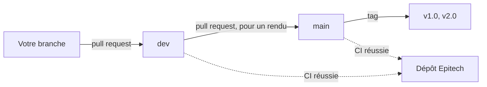

# Contribuer

Comment nous travaillons sur R-Type : ce qu'il faut savoir avant votre première pull
request. [Les guides pratiques](HOWTO.md) expliquent comment faire les changements les
plus courants.

## Méthode Git

Il y a deux dépôts. Tout le monde travaille sur le **miroir**,
[T3a1/RType-mirror](https://github.com/T3a1/RType-mirror), et ne pousse que là. La CI du
miroir pousse ensuite d'elle-même vers le dépôt Epitech, une fois les contrôles passés. Les
issues et le tableau de projet sont uniquement sur le dépôt Epitech.



En mots :

1. Créez une branche depuis `dev`, nommée d'après le travail (`lobby`, `boss`, `player-notices`).
2. Commitez, puis poussez-la sur le miroir.
3. Ouvrez une pull request vers `dev`. Un coéquipier la relit et la fusionne.
4. `main` est protégée : elle ne change que par une pull request dont la CI réussit, pour
   un rendu, qui reçoit ensuite un tag.

Fusionnez plutôt que de rebaser une fois la branche poussée, et ne forcez jamais un push.

## Commits

```text
(<scope>) <type>: <title>

<description>
```

| Partie | Valeurs |
|--------|---------|
| Portée | `global` (tout le dépôt : CI, outillage), `design` (visuels du client, interface, son), `network` (protocole, communication client/serveur), `architecture` (moteur, ECS, structure, CMake, Docker, scripts) |
| Type | `feat`, `fix`, `chore`, `tests`, `docs`, `refactor` |
| Titre | Très court, en anglais, en minuscules, sans point final |
| Description | 1 à 3 lignes courtes sur ce que fait le commit |

La dernière ligne de la description peut citer une issue, avec son numéro sur le dépôt
Epitech :

- `Closes #30.` quand le commit termine l'issue. Elle se ferme quand le commit arrive sur
  `main`. Ne fermez jamais une epic de cette façon.
- `Refs #30.` quand il n'en fait qu'une partie.

```text
(network) fix: fixed input rate on the client

Send inputs when the actions change and otherwise every 30 ms, instead
of once per frame, which filled a slow link at high frame rates.
Refs #101.
```

## Pull requests

- Le titre a le même format qu'un commit, avec le type `merge` :
  `(network) merge: on-screen player notices`.
- La description est un court résumé, puis les issues avec leur référence complète, car
  un `#30` court sur le miroir désigne les pull requests du miroir :
  `Closes EpitechPGE3-2026/G-ING-500-LIL-5-1-rtype-3#30`.
- Tous les contrôles doivent réussir : format, compilation et tests sous Linux et Windows,
  clang-tidy, image Docker et documentation.
- Un changement de protocole se signale dans la description : tout le monde doit recompiler
  le serveur et le client ensemble.

## Garder la documentation à jour

**Un changement est terminé quand sa documentation l'est.** Mettez à jour les pages dans la
même pull request que le code :

| Quand vous changez | Mettez à jour |
|--------------------|---------------|
| Un paquet, un champ, ou quoi que ce soit sur le réseau | [PROTOCOL.md](PROTOCOL.md) et sa table des versions, `ProtocolVersion` |
| La structure, les threads, les étapes ou les systèmes | [ARCHITECTURE.md](ARCHITECTURE.md) |
| Une bibliothèque, un outil ou un choix technique | [TECHNICAL_STUDY.md](TECHNICAL_STUDY.md) |
| Les fichiers stockés, ou ce à quoi le serveur fait confiance | L'[étude technique](TECHNICAL_STUDY.md), sections 5 et 6 |
| Une fonction d'accessibilité | L'[étude technique](TECHNICAL_STUDY.md), section 7, et le [README](https://github.com/T3a1/RType-mirror#readme) si les joueurs s'en servent |
| Ce qu'il faut pour ajouter du contenu | [HOWTO.md](HOWTO.md), [LEVELS.md](LEVELS.md), [WEAPONS.md](WEAPONS.md), [ENEMIES.md](ENEMIES.md) |
| Les commandes, les options ou le lancement du jeu | Le [README](https://github.com/T3a1/RType-mirror#readme) et [INSTALLATION.md](INSTALLATION.md) |
| Du code réseau qui influe sur les performances | Lancez `./tools/netbench.py`, puis mettez à jour l'analyse de [NETWORK_COMPARISON.md](NETWORK_COMPARISON.md) |
| Une nouvelle page | Ajoutez-la au tableau de documentation du [README](https://github.com/T3a1/RType-mirror#readme), avec sa traduction |
| N'importe quelle page | Sa version française dans `docs/fr/`, sous le même nom de fichier ; la version anglaise fait foi |
| Un nouveau membre, ou un nouveau domaine de travail | [CONTRIBUTORS.md](CONTRIBUTORS.md) |

Avant un rendu, actualisez aussi les chiffres de l'[avant et après](TECHNICAL_STUDY.md#9-avant-et-après--le-prototype-de-la-partie-1-et-la-version-finale)
de l'étude technique.

La CI génère le site à chaque push : un lien cassé entre les pages, ou une page sans sa
version française, fait échouer le contrôle de la documentation. Générez-le vous-même avec
`./rtype.py --docs`.

### Règles d'écriture

- Des phrases simples : beaucoup de lecteurs ne sont pas natifs. Les pages de `docs/` sont
  en anglais, celles de `docs/fr/` en français, et les commentaires du code uniquement en
  anglais.
- Expliquez le pourquoi et comment les choses s'articulent. Le code dit les détails, et
  les commentaires Doxygen décrivent chaque fonction.
- Les images ont une description, affichée en légende sur le site. Les titres se suivent
  sans sauter de niveau. Un diagramme est aussi expliqué dans le texte.

## Style de code

clang-format et clang-tidy décident, et la CI les fait respecter :

```bash
./rtype.py --format
```

```bash
./rtype.py --tidy
```

Le hook pre-commit versionné refuse les fichiers C++ mal formatés. Tout le monde utilise la
même version de clang-format (18.1.3), installée par `rtype.py`.

| Élément | Convention | Exemple |
|---------|------------|---------|
| Classes, structs, enums | `PascalCase` | `NetworkServer`, `EnemyType` |
| Fonctions, variables | `camelCase` | `sendInput`, `lastSequence` |
| Membres d'une classe à données privées | Préfixe `m_` | `m_sessions` |
| Constantes | `PascalCase` | `MaxSessions`, `PeerTimeout` |
| Espaces de noms | Minuscules | `engine`, `rtype`, `server`, `client` |
| Fichiers source | Le nom de ce qu'ils contiennent | `NetworkServer.cpp`, `HudSystem.hpp` |
| Fichiers de test | `snake_case`, finissant par `_test` | `reliable_channel_test.cpp` |

- Chaque fichier source commence par l'en-tête Epitech.
- Les fonctions et types publics ont des commentaires Doxygen. Un commentaire dit pourquoi,
  pas quoi.
- `engine/` ne connaît rien de R-Type. `engine/` et `common/` n'incluent rien de `server/`,
  de `client/` ni d'une bibliothèque graphique. Les en-têtes des bibliothèques restent dans
  le dossier de leur backend ([architecture](ARCHITECTURE.md#2-organisation-du-code)).
- Les dépendances passent par un gestionnaire de paquets et ne sont jamais copiées dans le
  dépôt.

## Tests

Toute nouvelle logique a un test unitaire dans `tests/`, sans fenêtre ni vrai réseau si
possible (`tests/src/FakeNetwork.hpp` est un faux socket) :

```bash
./rtype.py --test
```

Le code testé doit se trouver dans une cible de bibliothèque, pas dans un `main.cpp`.
