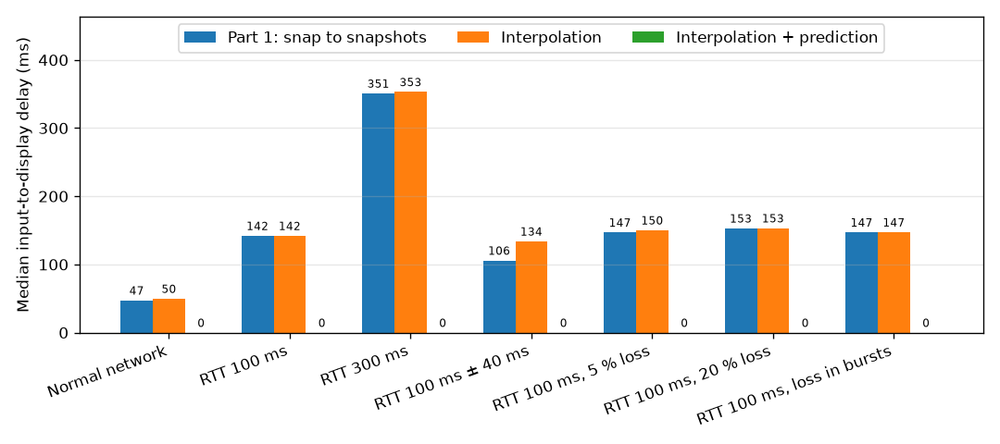
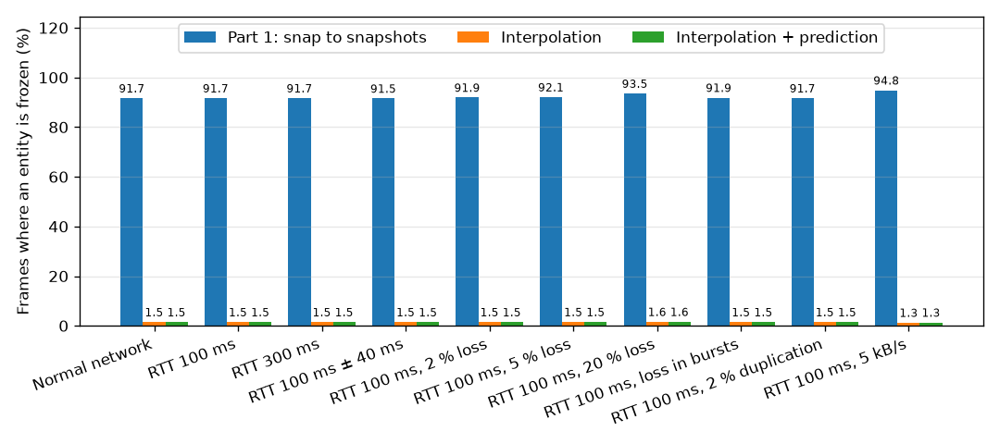
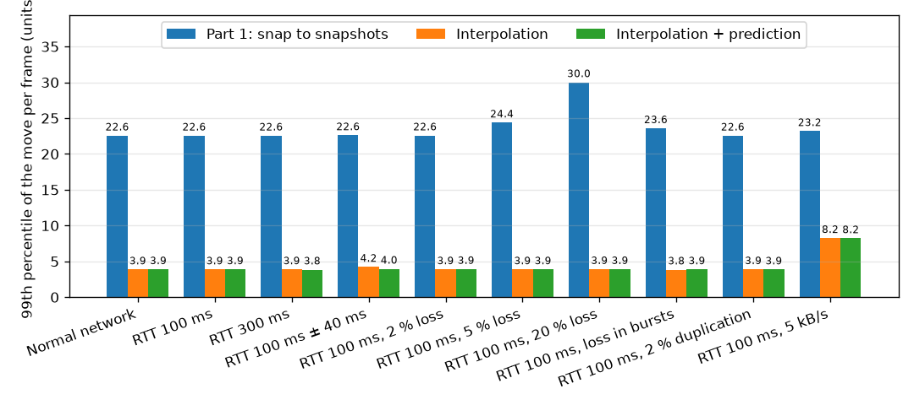

# Comparaison des performances réseau

Cette page mesure ce que les techniques réseau côté client de la partie 2 changent pour le
joueur, par rapport au prototype de la partie 1. C'est la partie réseau du point « Avant et
après » de l'étude technique.

## Sommaire

1. [Ce qui est comparé](#1-ce-qui-est-comparé)
2. [Méthode](#2-méthode)
3. [Métriques](#3-métriques)
4. [Résultats](#4-résultats)
5. [Analyse](#5-analyse)
6. [Lancer le benchmark](#6-lancer-le-benchmark)

## 1. Ce qui est comparé

| Mode | Option du client | Ce que fait le client d'un snapshot |
|------|------------------|-------------------------------------|
| Partie 1 : saut aux snapshots | `--no-interpolation --no-prediction` | Déplace chaque entité directement à sa nouvelle position, 20 fois par seconde, comme le prototype `v1.0`. |
| Interpolation | `--no-prediction` | Dessine les autres entités 100 ms dans le passé, interpolées entre les deux snapshots qui encadrent cet instant (voir l'[architecture](ARCHITECTURE.md)). Le vaisseau local saute toujours à chaque snapshot. |
| Interpolation + prédiction | (par défaut) | Prédit aussi le vaisseau local : il bouge dès l'appui sur une touche, et chaque snapshot le corrige en douceur (réconciliation). |

Tous les modes utilisent le même build du même code : seule la technique change, donc toute
différence vient d'elle.

## 2. Méthode

- **Conditions réseau :** les scénarios du [guide des tests réseau](NETWORK_TESTING.md),
  appliqués avec `tc netem` au trafic UDP du jeu sur l'interface de boucle locale : réseau
  normal, latence, forte latence, gigue, perte aléatoire, perte en rafales, duplication et
  faible débit.
- **La même partie à chaque fois :** chaque essai lance un nouveau serveur avec
  `--invincible`, pour que le vaisseau mesuré ne meure jamais, et un client avec `--bench`.
- **Les mêmes entrées à chaque fois :** à la place du clavier, le client du benchmark répète
  une séquence fixe toutes les 2 secondes : aucune touche pendant 0,7 s, Haut pendant 0,3 s,
  aucune touche pendant 0,7 s, Bas pendant 0,3 s.
- **Mesuré là où le joueur regarde :** le client enregistre les positions qu'il s'apprête à
  dessiner, à chaque image, et les écrit dans un fichier CSV à la fin de l'essai.
  `tools/netbench.py` calcule ensuite les métriques ci-dessous.

## 3. Métriques

| Métrique | Ce qu'elle montre | Meilleure quand |
|----------|-------------------|-----------------|
| Délai entre l'entrée et l'affichage | Le temps entre un appui et la première image où le vaisseau local bouge dans ce sens à l'écran ; 0 désigne l'image même de l'appui. « Missed » compte les appuis jamais affichés avant le suivant. | Plus bas |
| Images figées | La part des images où une entité synchronisée (ennemi, missile) ne bouge pas à l'écran. Toutes les entités du jeu bougent tout le temps : une image figée est donc une saccade. | Plus basse |
| Déplacement par image, 99e centile | Les plus grands sauts à l'écran d'une entité entre deux images, en unités de l'aire de jeu (1920 × 1080). Un mouvement fluide répartit le déplacement sur chaque image ; le saut le fait d'un coup. | Plus bas |
| Corrections de la prédiction | À quelle fréquence le serveur a contredit le vaisseau prédit, et de combien. Chaque correction s'estompe en douceur au lieu d'être dessinée comme un saut. | Moins nombreuses, plus petites |
| Trafic | Les octets par seconde reçus et envoyés par le client, pour vérifier qu'un gain ne coûte pas de débit. | Égal |

## 4. Résultats

Ce bloc est généré par `tools/netbench.py` et reste donc en anglais.

<!-- results:begin -->

Generated by `tools/netbench.py` on 2026-11-05: 30 s per run, client at about 240 frames per second.

**Input-to-display delay of the local ship, median (95th percentile), in ms**

| Scenario | Part 1: snap to snapshots | Interpolation | Interpolation + prediction |
|---|---:|---:|---:|
| Normal network | 53 (61) | 42 (50) | 0 (0) |
| RTT 100 ms | 150 (158) | 147 (155) | 0 (5) |
| RTT 300 ms | 345 (350) | 342 (350) | 0 (0) |
| RTT 100 ms ± 40 ms | 139 (158) | 142 (153) | 0 (0) |
| RTT 100 ms, 2 % loss | 150 (156) | 151 (158) | 0 (7) |
| RTT 100 ms, 5 % loss | 147 (192) | 148 (156) | 0 (0) |
| RTT 100 ms, 20 % loss | 151 (253) | 150 (197) | 0 (8) |
| RTT 100 ms, loss in bursts | 153 (159) | 149 (202) | 0 (0) |
| RTT 100 ms, 2 % duplication | 150 (156) | 153 (158) | 0 (0) |
| RTT 100 ms, 5 kB/s | 197 (885), 13 missed | 189 (976), 14 missed | 0 (0) |

**Frames where a synced entity is frozen on screen**

| Scenario | Part 1: snap to snapshots | Interpolation | Interpolation + prediction |
|---|---:|---:|---:|
| Normal network | 91.7 % | 1.5 % | 1.5 % |
| RTT 100 ms | 91.7 % | 1.5 % | 1.5 % |
| RTT 300 ms | 91.7 % | 1.5 % | 1.5 % |
| RTT 100 ms ± 40 ms | 91.5 % | 1.5 % | 1.5 % |
| RTT 100 ms, 2 % loss | 91.9 % | 1.5 % | 1.5 % |
| RTT 100 ms, 5 % loss | 92.1 % | 1.5 % | 1.5 % |
| RTT 100 ms, 20 % loss | 93.5 % | 1.6 % | 1.6 % |
| RTT 100 ms, loss in bursts | 91.9 % | 1.5 % | 1.5 % |
| RTT 100 ms, 2 % duplication | 91.7 % | 1.5 % | 1.5 % |
| RTT 100 ms, 5 kB/s | 94.8 % | 1.3 % | 1.3 % |

**99th percentile of the move of an entity in one frame, in playfield units**

| Scenario | Part 1: snap to snapshots | Interpolation | Interpolation + prediction |
|---|---:|---:|---:|
| Normal network | 22.6 | 3.9 | 3.9 |
| RTT 100 ms | 22.6 | 3.9 | 3.9 |
| RTT 300 ms | 22.6 | 3.9 | 3.8 |
| RTT 100 ms ± 40 ms | 22.6 | 4.2 | 4.0 |
| RTT 100 ms, 2 % loss | 22.6 | 3.9 | 3.9 |
| RTT 100 ms, 5 % loss | 24.4 | 3.9 | 3.9 |
| RTT 100 ms, 20 % loss | 30.0 | 3.9 | 3.9 |
| RTT 100 ms, loss in bursts | 23.6 | 3.8 | 3.9 |
| RTT 100 ms, 2 % duplication | 22.6 | 3.9 | 3.9 |
| RTT 100 ms, 5 kB/s | 23.2 | 8.2 | 8.2 |

**Corrections of the predicted ship per second, and their median size in playfield units**

| Scenario | Part 1: snap to snapshots | Interpolation | Interpolation + prediction |
|---|---:|---:|---:|
| Normal network | n/a | n/a | 7.0 (8.5) |
| RTT 100 ms | n/a | n/a | 6.9 (8.4) |
| RTT 300 ms | n/a | n/a | 6.8 (8.4) |
| RTT 100 ms ± 40 ms | n/a | n/a | 6.8 (8.5) |
| RTT 100 ms, 2 % loss | n/a | n/a | 6.8 (8.4) |
| RTT 100 ms, 5 % loss | n/a | n/a | 5.9 (8.2) |
| RTT 100 ms, 20 % loss | n/a | n/a | 5.9 (8.4) |
| RTT 100 ms, loss in bursts | n/a | n/a | 6.7 (8.3) |
| RTT 100 ms, 2 % duplication | n/a | n/a | 6.9 (8.3) |
| RTT 100 ms, 5 kB/s | n/a | n/a | 21.8 (2.6) |

**Traffic of the client, received / sent, in bytes per second**

| Scenario | Part 1: snap to snapshots | Interpolation | Interpolation + prediction |
|---|---:|---:|---:|
| Normal network | 3524 / 520 | 3525 / 517 | 3525 / 519 |
| RTT 100 ms | 3538 / 518 | 3537 / 518 | 3536 / 518 |
| RTT 300 ms | 3561 / 519 | 3560 / 518 | 3562 / 521 |
| RTT 100 ms ± 40 ms | 3527 / 526 | 3531 / 521 | 3527 / 520 |
| RTT 100 ms, 2 % loss | 3438 / 519 | 3444 / 519 | 3463 / 518 |
| RTT 100 ms, 5 % loss | 3363 / 522 | 3372 / 517 | 3359 / 518 |
| RTT 100 ms, 20 % loss | 2769 / 519 | 2775 / 517 | 2814 / 519 |
| RTT 100 ms, loss in bursts | 3446 / 520 | 3458 / 520 | 3469 / 520 |
| RTT 100 ms, 2 % duplication | 3602 / 520 | 3584 / 518 | 3593 / 519 |
| RTT 100 ms, 5 kB/s | 2403 / 518 | 2403 / 522 | 2404 / 518 |







<!-- results:end -->

## 5. Analyse

**Fluidité : l'interpolation supprime les saccades.** Le serveur envoie 20 snapshots par
seconde et le client dessine environ 240 images par seconde. Quand il saute à chaque snapshot,
une entité reste immobile 11 images sur 12 (92 % d'images figées), puis saute d'un coup tout
son déplacement de 50 ms (plus de 20 unités pour les plus rapides). Avec l'interpolation, elle
bouge un peu à chaque image : moins de 2 % d'images figées, et les plus grands déplacements par
image sont environ 6 fois plus petits. Les 1,5 % restants sont surtout de nouvelles entités, qui
attendent environ 100 ms à leur point d'apparition que l'horloge de rendu atteigne leur premier
snapshot.

**Robuste au réseau.** Les chiffres de l'interpolation bougent à peine entre un réseau parfait
et 300 ms de latence, la gigue ou 20 % de perte : les 100 ms de délai de rendu gardent toujours
deux snapshots entre lesquels interpoler, et une courte extrapolation comble les trous laissés
par les snapshots perdus.

**Réactivité : la prédiction supprime la latence du vaisseau local.** Sans prédiction, le
vaisseau ne bouge qu'une fois que le serveur a appliqué l'entrée et que son snapshot est revenu :
environ 50 ms sur un réseau parfait (l'attente du prochain snapshot), puis le temps
d'aller-retour plus 50 ms (environ 150 ms à 100 ms de RTT, 350 ms à 300 ms de RTT, jusqu'à 250 ms
avec 20 % de perte). L'interpolation n'y change rien. Avec la prédiction, le vaisseau bouge dans
l'image même de l'appui (médiane de 0 ms, deux images au plus pour 95 % des appuis), quel que soit
le réseau.

**Le serveur reste maître.** Quand le vaisseau bouge, chaque snapshot corrige la prédiction
d'environ 8 unités (le vaisseau fait 64 unités de large), et d'environ 18 au maximum. Cela vient
du rythme des entrées : entre deux entrées, le serveur continue de déplacer le vaisseau alors que
le client rejoue aussi ces images, donc l'écart dépend du moment d'arrivée de la dernière entrée.
Chaque correction s'estompe en environ 0,3 s au lieu d'être dessinée comme un saut. Mesures sur un
réseau normal à 240 images par seconde :

| Temps entre deux entrées | Correction médiane | 95e centile | Maximum | Envoyé |
|---:|---:|---:|---:|---:|
| Une entrée par image (environ 4 ms) | 0,3 | 2,9 | 4,2 | 4030 o/s |
| 16 ms, comme un client à 60 images par seconde | 0,1 | 12,6 | 14,4 | 1020 o/s |
| 30 ms (retenu) | 8,3 | 14,7 | 17,8 | 520 o/s |

**Entrées : un rythme fixe quelle que soit la fréquence d'images.** Le client envoyait une entrée
par image affichée, soit 4 ko/s à 240 images par seconde, et environ 11 ko/s avec les en-têtes de
paquets. Il en envoie maintenant une quand les actions changent, et sinon toutes les 30 ms. Les
touches atteignent toujours le serveur dès qu'elles changent, et le débit montant est divisé par 8.
L'interpolation et la prédiction n'ajoutent aucun paquet : le trafic reçu ne dépend pas du mode.
Le tir automatique, toujours actif dans le jeu, ne fait que maintenir l'action de tir : il
n'ajoute aucune entrée.

**Duplication et perte : aucun effet au-delà des données perdues.** Avec 2 % de duplication, les
chiffres sont les mêmes que sans. Avec 50 % de duplication, lors d'un essai séparé de 20 s, le
serveur n'a écrit aucun avertissement et aucun programme n'a échoué : les entrées et les snapshots
plus anciens que le plus récent sont ignorés, et les messages fiables sont livrés une seule fois.
2 % de perte diffèrent à peine de 5 %.

**Faible débit : jouable quelques secondes, puis en retard.** Le scénario à 5 ko/s limite les deux
sens ensemble. Avant le rythme fixe des entrées, les entrées saturaient à elles seules cette limite :
le client recevait environ 530 o/s et aucun des appuis d'un essai de 12 s n'était affiché. Le jeu a
maintenant besoin d'environ 6,1 ko/s avec les en-têtes (4,4 ko/s de snapshots, 1,8 ko/s d'entrées).
Les 7 premières secondes tournent avec environ 190 ms de délai, puis la file se remplit à mesure que
les ennemis apparaissent : le délai atteint environ 900 ms après 10 s, et environ la moitié des appuis
ne sont pas affichés dans la fenêtre d'une seconde (13 « missed » plus haut). Limiter chaque sens à
5 ko/s, comme le ferait un vrai lien, est mieux mais ne suffit pas : lors d'un essai séparé de 30 s, le
délai reste autour de 180 ms pendant 11 s, puis dépasse 1 s quand les ennemis sont nombreux, et
redescend ensuite (5 appuis sur 29 manqués). Rien ne plante ni ne se déconnecte dans les deux cas, et
le vaisseau local reste réactif grâce à la prédiction. Tenir à 5 ko/s demanderait des snapshots plus
petits ou moins nombreux : chaque snapshot envoie toutes les entités, 20 fois par seconde.

**Coûts et limites.**

- Les autres entités sont dessinées 100 ms dans le passé. Ce délai ne se voit pas dans les métriques
  ci-dessus, mais c'est le prix de leur fluidité : un joueur voit les ennemis là où ils étaient 100 ms
  plus tôt, alors que le serveur décide des touches sur les vraies positions.
- Le vaisseau local est maintenant dessiné en avance sur le serveur, mais ses missiles ne sont pas
  prédits : ils apparaissent quand le serveur les crée, légèrement derrière un vaisseau en mouvement
  (environ la distance que le vaisseau parcourt en un aller-retour).

## 6. Lancer le benchmark

Linux uniquement (`tc netem`). Compilez d'abord le serveur et le client, puis lancez tous les
scénarios (environ 30 s par essai, donc quelques minutes ; `tc` demande une fois le mot de passe
sudo) :

```bash
./rtype.py --native
```

```bash
./tools/netbench.py
```

Une fenêtre de client s'ouvre pour chaque essai : n'y touchez pas avant la fin. Les mesures brutes
vont dans `build/netbench/`, et les résultats ci-dessus sont réécrits, avec leurs graphiques dans
`docs/images/network-comparison/`. Options utiles :

| Option | Effet |
|--------|-------|
| `run` / `report` | Seulement mesurer, ou seulement réécrire les résultats à partir des dernières mesures. |
| `-d SECONDS` | La durée de chaque essai (30 par défaut). |
| `-s SCENARIO...` | Seulement certains scénarios : `normal`, `latency`, `high-latency`, `jitter`, `loss-2`, `loss-5`, `loss-20`, `bursts`, `duplicate`, `bandwidth`. |
| `-m MODE...` | Seulement certains modes du client : `snap`, `interpolation`, `prediction`. Le rapport garde les dernières mesures des autres modes. |
| `--no-netem` | Mesurer le réseau actuel sans `tc` (un essai « normal » par mode). |
| `--no-charts` | Seulement les tableaux, sans installer matplotlib. |

Les options du client s'utilisent aussi à la main :

```bash
./build/r-type_server --invincible
```

```bash
./build/r-type_client 127.0.0.1 4242 --no-interpolation --no-prediction --bench 30 snap.csv
```
