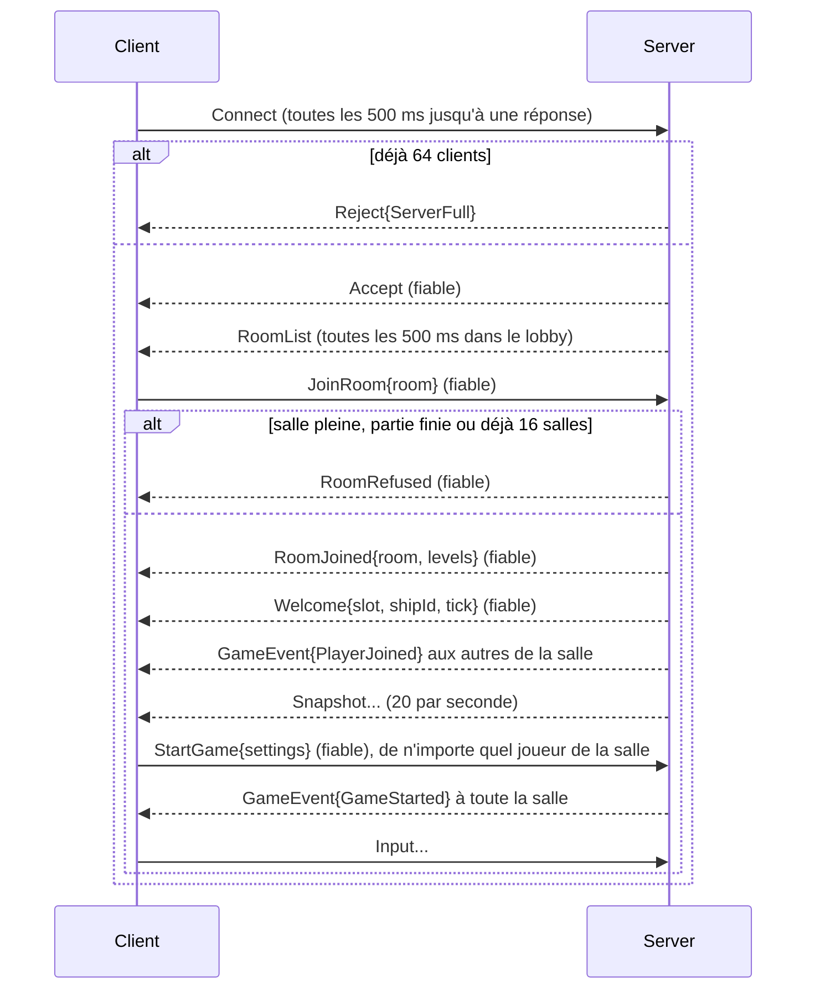

# Protocole réseau de R-Type (version 16)

Ce document spécifie le protocole binaire parlé entre le serveur de R-Type et ses clients. Il est
assez précis pour écrire un client ou un serveur compatible sans lire notre code. L'implémentation
de référence se trouve dans
[`common/include/common/protocol/`](https://github.com/T3a1/RType-mirror/blob/dev/common/include/common/protocol/) et
[`common/src/protocol/`](https://github.com/T3a1/RType-mirror/blob/dev/common/src/protocol/) ; les threads et les files qui
l'utilisent sont décrits dans [ARCHITECTURE.md](ARCHITECTURE.md), section 6.

Les mots-clés **MUST**, **MUST NOT**, **SHOULD** et **MAY** s'emploient comme dans la
[RFC 2119](https://www.rfc-editor.org/rfc/rfc2119) : ils signifient respectivement « doit », « ne doit pas »,
« devrait » et « peut ». Ils restent en anglais pour garder leur sens exact.

## Sommaire

1. [Vue d'ensemble](#1-vue-densemble)
2. [Conventions](#2-conventions)
3. [Transport](#3-transport)
4. [En-tête de paquet](#4-en-tête-de-paquet)
5. [Types de paquets](#5-types-de-paquets)
6. [Charges utiles](#6-charges-utiles)
7. [Fiabilité](#7-fiabilité)
8. [Cycle de vie d'une connexion](#8-cycle-de-vie-dune-connexion)
9. [Snapshots](#9-snapshots)
10. [Règles de robustesse](#10-règles-de-robustesse)
11. [Exemples](#11-exemples)
12. [Gestion des versions](#12-gestion-des-versions)

## 1. Vue d'ensemble

- Tout le trafic utilise **UDP**. Il n'y a pas de connexion TCP.
- Le serveur est **autoritaire** : les clients n'envoient que leurs entrées, le serveur simule le jeu et renvoie
  l'état.
- Chaque datagramme contient exactement **un paquet** : un en-tête de 12 octets suivi d'une charge utile dont la
  disposition dépend du type de paquet.
- La plupart du trafic est **non fiable et remplacé par le paquet suivant** : les entrées (du client au serveur, environ
  30 par seconde) et les snapshots (du serveur au client, 20 par seconde). En perdre un n'a pas d'importance.
- Quelques paquets sont **fiables** : acquittés, renvoyés jusqu'à l'acquittement, et livrés une seule fois et dans
  l'ordre. Ils portent des faits jamais répétés : `Accept`, `Welcome` et `GameEvent`.

## 2. Conventions

| Notation | Signification |
|----------|---------------|
| `u8`, `u16`, `u32` | Entiers non signés de 1, 2 et 4 octets |
| `f32` | Flottant IEEE 754 binary32, 4 octets, envoyé comme le `u32` de mêmes bits |
| Ordre des octets | **Little-endian** : l'octet de poids faible d'abord. `1000` (`0x000003E8`) s'envoie `E8 03 00 00` |
| Disposition | Les champs se suivent dans l'ordre indiqué, sans remplissage ni alignement |
| Énumérations | Envoyées sur un `u8`. Les valeurs non listées dans ce document sont invalides |
| Rejeter | Ignorer le datagramme en silence : aucune réponse, aucun changement d'état |

Les implémentations **MUST** écrire et lire les champs un par un. Copier une structure C ou C++ dans le datagramme
(`memcpy`) n'est pas portable : cela enverrait des octets de remplissage et dépendrait de l'ordre des octets du
processeur.

## 3. Transport

| Paramètre | Valeur |
|-----------|--------|
| Protocole | UDP sur IPv4 |
| Port par défaut du serveur | 4242 |
| Taille maximale d'un datagramme | **1200 octets**, en-tête compris (1188 octets de charge utile) |

1200 octets restent sous le MTU de chemin habituel (1280 octets est le minimum d'IPv6) : les datagrammes ne sont donc
jamais fragmentés par IP. Un émetteur **MUST NOT** envoyer un paquet plus grand ; un récepteur **MUST** le rejeter.

## 4. En-tête de paquet

Chaque paquet commence par cet en-tête de 12 octets :

| Position | Taille | Champ | Valeur |
|---------:|-------:|-------|--------|
| 0 | 2 | magic | `52 54` (ASCII `"RT"`). Reconnaît nos paquets : un datagramme quelconque ne commence presque jamais par ces octets |
| 2 | 1 | version | `16`. Voir [Gestion des versions](#12-gestion-des-versions) |
| 3 | 1 | type | La charge utile qui suit. Voir [Types de paquets](#5-types-de-paquets) |
| 4 | 1 | flags | Bit 0 : **Reliable**. Les bits 1 à 7 sont réservés et **MUST** valoir 0 |
| 5 | 1 | reserved | **MUST** valoir 0 |
| 6 | 2 | sequence | `u16`. Le compteur de paquets de l'émetteur, voir [Fiabilité](#7-fiabilité) |
| 8 | 2 | ack | `u16`. La dernière séquence fiable reçue dans l'ordre depuis l'autre côté |
| 10 | 2 | payload size | `u16`. Le nombre d'octets après l'en-tête |

Le drapeau Reliable **MUST** être mis sur les types de paquets fiables et **MUST NOT** l'être sur les autres
([section 5](#5-types-de-paquets)).

### Ordre de validation

Un récepteur vérifie un datagramme dans cet ordre et le rejette au premier échec. Les noms sont les valeurs de
`DecodeError` de l'implémentation de référence.

| # | Vérification | Erreur |
|--:|--------------|--------|
| 1 | 1200 octets au maximum | `TooLarge` |
| 2 | 12 octets au minimum | `TooShort` |
| 3 | Le magic est `"RT"` | `BadMagic` |
| 4 | La version est 16 | `BadVersion` |
| 5 | Le type figure à la section 5 | `UnknownType` |
| 6 | Aucun bit de drapeau réservé, et Reliable mis exactement sur les types fiables | `BadFlags` |
| 7 | L'octet réservé vaut 0 | `BadReserved` |
| 8 | La taille de la charge utile égale la taille du datagramme moins 12 | `BadPayloadSize` |
| 9 | Le côté de l'émetteur a le droit d'envoyer ce type (section 5) | `WrongSender` |
| 10 | La charge utile se décode, chaque valeur est dans ses limites, et il ne reste aucun octet | `BadPayload` |

La vérification 8 attrape les datagrammes tronqués ou rembourrés avant tout décodage de la charge utile.

## 5. Types de paquets

| Valeur | Nom | Envoyé par | Livraison | Taille de la charge (octets) |
|-------:|-----|------------|-----------|-----------------------------:|
| `0x01` | `Connect` | Client | Non fiable, répété | 0 |
| `0x02` | `Accept` | Serveur | Fiable | 0 |
| `0x03` | `Reject` | Serveur | Non fiable | 1 |
| `0x04` | `Disconnect` | Les deux | Non fiable (au mieux) | 1 |
| `0x05` | `Ack` | Les deux | Non fiable | 0 |
| `0x10` | `Input` | Client | Non fiable | 5 |
| `0x11` | `ChatSend` | Client | Fiable | 2 à 81 |
| `0x20` | `Snapshot` | Serveur | Non fiable | 8 + bloc des joueurs + 16 par entité |
| `0x21` | `Welcome` | Serveur | Fiable | 9 |
| `0x22` | `GameEvent` | Serveur | Fiable | 1 à 5 |
| `0x23` | `ChatMessage` | Serveur | Fiable | 3 à 82 |
| `0x30` | `RoomList` | Serveur | Non fiable, répété | 1 + 6 par salle |
| `0x31` | `JoinRoom` | Client | Fiable | 4 |
| `0x32` | `LeaveRoom` | Client | Fiable | 0 |
| `0x33` | `StartGame` | Client | Fiable | 3 |
| `0x34` | `RoomJoined` | Serveur | Fiable | 4 ou 5 |
| `0x35` | `RoomRefused` | Serveur | Fiable | 0 |
| `0x36` | `RoomClosed` | Serveur | Fiable | 0 |

Les valeurs sont groupées par plage : `0x0_` pour la connexion (les deux sens), `0x1_` du client au serveur, `0x2_` du
serveur au client, `0x3_` pour les salles (les deux sens). Un paquet envoyé par le mauvais côté (par exemple un
`Snapshot` envoyé par un client) **MUST** être rejeté.

## 6. Charges utiles

Dans cette section, les positions sont relatives au début de la charge utile, c'est-à-dire à l'octet 12 du datagramme.

### `Connect` (0x01), `Accept` (0x02), `Ack` (0x05)

Pas de charge utile. `Connect` demande à entrer dans le lobby (la version du protocole est dans l'en-tête). `Accept` y
répond. `Ack` ne porte que le champ `ack` de l'en-tête, pour un pair qui n'a rien d'autre à envoyer.

### `RoomList` (0x30)

Les salles du serveur, envoyées aux clients du lobby toutes les 500 ms. Chaque liste remplace la précédente : en perdre
une n'a donc pas d'importance.

| Taille | Champ | Valeurs |
|-------:|-------|---------|
| 1 | roomCount | `0` à `16` |
| 4 | room | `u32`, au moins `1`, répété `roomCount` fois avec les deux champs suivants |
| 1 | players | `0` à `4` |
| 1 | status | `0` Waiting, `1` Playing, `2` Over (personne ne peut entrer) |

### `JoinRoom` (0x31), `RoomJoined` (0x34)

`JoinRoom` demande à entrer dans une salle (client, fiable), et `RoomJoined` y répond (serveur, fiable). Un client déjà
dans une salle est ignoré.

| Position | Taille | Champ | Valeurs |
|---------:|-------:|-------|---------|
| 0 | 4 | room | `u32`. Dans `JoinRoom` : la salle, créée si elle n'existe pas, `0` pour la première salle avec une place libre (une nouvelle s'il n'y en a pas), ou `0xFFFFFFFF` pour une nouvelle salle. Dans `RoomJoined` : la salle rejointe, au moins `1` |
| 4 | 1 | levels | `RoomJoined` uniquement : le nombre de niveaux du serveur, `0` s'il ne joue que le mode sans fin. Le client les propose comme niveau de départ |

### `StartGame` (0x33)

Un joueur lance la partie de sa salle (client, fiable), avec les réglages choisis dans la salle d'attente. Il est ignoré
si la partie a déjà commencé : les réglages du premier `StartGame` s'appliquent.

| Position | Taille | Champ | Valeurs |
|---------:|-------:|-------|---------|
| 0 | 1 | difficulty | `0` Easy, `1` Normal, `2` Hard : la vie et la cadence de tir des ennemis, et la fréquence des vagues aléatoires du mode sans fin |
| 1 | 1 | level | Le niveau de départ, à partir de `1` (un niveau au-delà du dernier lance le dernier), ou `0` pour le mode sans fin seul |
| 2 | 1 | boss | `0` le boss de chaque fichier de niveau, `1` Warship, `2` Hive, `3` Walker, `4` Twin, `5` Behemoth : remplace le boss de chaque niveau qui en a un |

### `LeaveRoom` (0x32), `RoomRefused` (0x35), `RoomClosed` (0x36)

Pas de charge utile, tous fiables. `LeaveRoom` (client) retourne au lobby. `RoomRefused` (serveur) répond à un `JoinRoom`
pour une salle pleine ou dont la partie est finie, ou quand 16 salles tournent déjà. `RoomClosed` (serveur) indique à un
client qu'un administrateur a fermé sa salle : il est de retour au lobby.

### `Reject` (0x03)

| Position | Taille | Champ | Valeurs |
|---------:|-------:|-------|---------|
| 0 | 1 | reason | `0` ServerFull (le serveur a 64 clients, ce que peuvent contenir ses 16 salles), `1` VersionMismatch, `2` Banned (un administrateur a banni cette adresse), `3` NotWhitelisted (le serveur n'accepte que les adresses listées) |

### `Disconnect` (0x04)

| Position | Taille | Champ | Valeurs |
|---------:|-------:|-------|---------|
| 0 | 1 | reason | `0` Left (le joueur a quitté), `1` Timeout, `2` Kicked (pas d'acquittement, ou retiré par un administrateur), `3` ServerClosing |

### `Input` (0x10)

L'état complet des entrées du joueur. Envoyer tout l'état à chaque fois signifie qu'un paquet perdu est corrigé par le
suivant, et qu'un relâchement de touche ne peut pas se perdre. Un client **SHOULD** l'envoyer quand les actions changent
et sinon environ 30 fois par seconde, quelle que soit sa fréquence d'images, pour ne pas saturer un lien lent.

| Position | Taille | Champ | Valeurs |
|---------:|-------:|-------|---------|
| 0 | 4 | sequence | `u32`, incrémenté à chaque `Input` envoyé. Le serveur ne garde que le plus récent |
| 4 | 1 | actions | Champ de bits, voir ci-dessous. Les bits non listés **MUST** valoir 0 |

| Bit | Masque | Action |
|----:|-------:|--------|
| 0 | `0x01` | Haut |
| 1 | `0x02` | Bas |
| 2 | `0x04` | Gauche |
| 3 | `0x08` | Droite |
| 4 | `0x10` | Tir : tirs normaux tant qu'il est maintenu (tir automatique) |
| 5 | `0x20` | Charge : charge un tir tant qu'il est maintenu, tiré au relâchement |

### `Welcome` (0x21)

Envoyé une fois à un nouveau joueur, après `Accept`.

| Position | Taille | Champ | Valeurs |
|---------:|-------:|-------|---------|
| 0 | 1 | slot | Le numéro du joueur, de `1` à `4` |
| 1 | 4 | shipId | `u32`, l'identifiant réseau du vaisseau du joueur dans les snapshots |
| 5 | 4 | tick | `u32`, le tick actuel du serveur |

### `Snapshot` (0x20)

L'état des entités visibles à un tick du serveur. Un snapshot qui ne tient pas dans un datagramme est découpé en plusieurs
**parties** ([section 9](#9-snapshots)).

**En-tête du snapshot (8 octets)**

| Position | Taille | Champ | Valeurs |
|---------:|-------:|-------|---------|
| 0 | 4 | tick | `u32`, le tick du serveur de cet état |
| 4 | 1 | part | Le numéro de la partie, de `0` à `partCount - 1` |
| 5 | 1 | partCount | Le nombre de parties de ce tick, au moins `1` |
| 6 | 2 | entityCount | `u16`, le nombre d'enregistrements d'entités de cette partie |

**Bloc des joueurs (partie 0 uniquement) : 1 + 16 octets par joueur**

| Taille | Champ | Valeurs |
|-------:|-------|---------|
| 1 | playerCount | `0` à `4` |
| 1 | slot | `1` à `4`, répété `playerCount` fois avec les quatre champs suivants |
| 4 | score | `u32` |
| 4 | lastInput | `u32`. La `sequence` du dernier `Input` de ce joueur que le serveur a appliqué à ce tick, `0` s'il n'y en a pas. Le client rejoue ses entrées plus récentes par-dessus cet état (prédiction côté client) |
| 4 | shipId | `u32`, l'identifiant réseau du vaisseau du joueur, `0` s'il n'en a pas (détruit). Permet à chaque client de savoir quel vaisseau appartient à quel joueur (couleur et étiquette) |
| 3 | boosts | Un `u8` par type de bonus, dans l'ordre Spread, Aimed, Burst : les secondes restantes de ce boost du joueur, arrondies au supérieur, `0` s'il ne l'a pas ([WEAPONS.md](WEAPONS.md)) |

**Enregistrement d'entité (16 octets), répété `entityCount` fois**

| Position | Taille | Champ | Valeurs |
|---------:|-------:|-------|---------|
| 0 | 4 | networkId | `u32`, identifie l'entité. Jamais réutilisé par le serveur |
| 4 | 1 | type | Le type d'entité, voir ci-dessous. Le client en déduit le sprite |
| 5 | 1 | flags | Bit 0 (`0x01`) Invincible (clignotant), bit 1 (`0x02`) Charging (un vaisseau de joueur dont la touche de tir est maintenue : son tir chargé arrive). Bits 2 à 4 (`0x1C`) Owner : le numéro (`1` à `4`) du joueur qui a tiré un `PlayerMissile`, `0` pour toute autre entité. Bits 5 et 6 (`0x60`) Boost : le type d'un `PowerUp` (`0` Spread, `1` Aimed, `2` Burst ; `3` est invalide), `0` pour toute autre entité. Le bit 7 **MUST** valoir 0 |
| 6 | 2 | health | `u16`, les points de vie |
| 8 | 4 | x | `f32`, le centre, en unités de l'aire de jeu |
| 12 | 4 | y | `f32`, le centre, en unités de l'aire de jeu |

L'aire de jeu fait 1920 × 1080 unités, avec l'origine en haut à gauche et y croissant vers le bas. Les positions **MAY**
être hors de l'aire (les ennemis apparaissent au-delà de son bord droit) mais **MUST** être finies : NaN et les infinis sont
invalides.

| Valeur | Type d'entité |
|-------:|---------------|
| 0 | PlayerShip |
| 1 | PlayerMissile |
| 2 | EnemyBasic |
| 3 | EnemyWave |
| 4 | EnemyShooter |
| 5 | EnemyMissile |
| 6 | EnemySmall |
| 7 | EnemyMedium |
| 8 | EnemyLarge |
| 9 | Boss (boss de fin de niveau ; sa vie complète est `BossMaxHealth`, 2500, pour la barre de vie du client) |
| 10 | ChargedShot (le tir chargé d'un joueur, qui traverse les ennemis) |
| 11 | PowerUp (un bonus : le joueur qui le touche obtient pour un temps le boost indiqué par ses bits Boost) |
| 12 | BossHive (le second boss de fin de niveau ; sa vie complète est la vie de son premier enregistrement) |
| 13 | Obstacle (un mur du niveau : il arrête tous les tirs et détruit les vaisseaux qui le touchent) |
| 14 | DestroyableTile (un bloc du niveau qui arrête les tirs et casse après quelques coups ; sa vie complète est `TileMaxHealth`, 150) |
| 15 | EnemySpinner |
| 16 | EnemyBubble |
| 17 | EnemySpore |
| 18 | EnemyJelly |
| 19 | EnemyCrab |
| 20 | BossWalker (le boss qui marche au sol ; sa vie complète est la vie de son premier enregistrement) |
| 21 | BossTwin (la moitié au sol du boss jumeau, qui porte sa vie) |
| 22 | BossTwinTop (la moitié au plafond du boss jumeau ; vie 0, les coups qu'elle reçoit touchent le BossTwin) |
| 23 | BossBehemoth (le corps du dernier boss, qui porte sa vie) |
| 24 | BehemothHead (la tête du behemoth, son point faible ; vie 0) |
| 25 | BehemothTail (un segment de la queue du behemoth ; vie 0) |
| 26 | BehemothTailTip (le bout de la queue du behemoth ; vie 0) |
| 27 | BossFireball (un tir du walker) |

### `ChatSend` (0x11), `ChatMessage` (0x23)

Une ligne du chat d'une salle. Un joueur envoie `ChatSend` ; le serveur ajoute l'auteur et envoie `ChatMessage` à tous
les joueurs de la salle, auteur compris. L'auteur est le numéro que le serveur connaît pour ce client : un client ne peut
pas parler à la place d'un autre. Dans le lobby, un `ChatSend` est ignoré.

`ChatSend` :

| Position | Taille | Champ | Valeurs |
|---------:|-------:|-------|---------|
| 0 | 1 | size | De 1 à 80 |
| 1 | size | text | ASCII imprimable (`0x20` à `0x7E`) |

`ChatMessage` commence par l'auteur, puis a les mêmes champs :

| Position | Taille | Champ | Valeurs |
|---------:|-------:|-------|---------|
| 0 | 1 | slot | De 1 à 4 |
| 1 | 1 | size | De 1 à 80 |
| 2 | size | text | ASCII imprimable (`0x20` à `0x7E`) |

Une ligne d'une autre taille ou avec un autre caractère est un `BadPayload`. Un serveur **MUST** limiter les lignes de
chaque client, car chacune est renvoyée à chaque joueur jusqu'à son acquittement : ce serveur en accepte 5 d'affilée, puis
1 par seconde, et ignore les autres sans le dire au client.

### `GameEvent` (0x22)

Un fait ponctuel. Le corps dépend du type :

| Position | Taille | Champ |
|---------:|-------:|-------|
| 0 | 1 | kind |
| 1 | 0, 1 ou 4 | corps |

| Type | Nom | Corps | Signification |
|-----:|-----|-------|---------------|
| 0 | EntityDestroyed | networkId (`u32`) | Retirer cette entité |
| 1 | PlayerJoined | slot (`u8`, 1 à 4) | Un autre joueur est arrivé |
| 2 | PlayerLeft | slot (`u8`, 1 à 4) | Un joueur est parti, a expiré ou a été exclu |
| 3 | PlayerHit | slot (`u8`, 1 à 4) | Un joueur a été touché (son, flash à l'écran) |
| 4 | GameOver | aucun | Le vaisseau de chaque joueur connecté est détruit : la partie est finie. Les snapshots continuent de porter les scores finaux |
| 5 | GameStarted | aucun | La partie de la salle a commencé |
| 6 | LevelStarted | level (`u8`) | Un niveau commence après une courte pause (le précédent est terminé, ou la partie vient de commencer) : `1` pour le premier niveau, `0` pour le mode sans fin après le dernier. Le client l'affiche pendant la pause (3 secondes) |

## 7. Fiabilité

UDP peut perdre, dupliquer et réordonner les datagrammes. Les paquets non fiables l'acceptent : chacun porte un état plus
récent (`Input::sequence`, `Snapshot::tick`) et le récepteur ignore tout ce qui est plus ancien que ce qu'il a déjà. Les
paquets fiables utilisent les champs `sequence` et `ack` de l'en-tête comme suit. L'implémentation de référence de cette
section est `ReliableChannel`
([`ReliableChannel.hpp`](https://github.com/T3a1/RType-mirror/blob/dev/common/include/common/protocol/ReliableChannel.hpp)).

### Deux compteurs

Chaque côté tient, pour chaque pair, **deux compteurs séparés** pour les paquets qu'il envoie :

- **Compteur fiable** : écrit dans `sequence` des paquets fiables. Le premier paquet fiable porte la séquence **1**, puis 2,
  3...
- **Compteur non fiable** : écrit dans `sequence` des autres paquets. Il n'a aucun sens pour la fiabilité ; un récepteur
  **MAY** l'utiliser pour mesurer les pertes.

Les séparer signifie qu'un trou dans les séquences fiables indique toujours un paquet fiable perdu, jamais un snapshot perdu.

### Recevoir un paquet fiable

Chaque côté tient `lastInOrder`, la dernière séquence fiable reçue dans l'ordre depuis le pair, en partant de **0** (« rien
reçu »).

| Séquence reçue | Action |
|----------------|--------|
| `lastInOrder + 1` | Livrer le paquet, puis `lastInOrder = sequence` |
| Pas plus récente que `lastInOrder` | Doublon : le rejeter |
| Plus récente, mais pas la suivante | Un paquet précédent a été perdu : le rejeter. L'émetteur renvoie les deux |

Les paquets fiables sont donc livrés **dans l'ordre et une seule fois**. L'ordre compte : un client ne doit pas appliquer
`GameOver` avant un `EntityDestroyed` envoyé plus tôt.

### Acquitter

Chaque paquet, de tout type, porte `ack = lastInOrder` dans son en-tête. Comme les clients envoient des entrées environ 30
fois par seconde et le serveur des snapshots 20 fois par seconde, les acquittements ne coûtent aucun paquet de plus. Un pair
qui a reçu un paquet fiable et n'a rien d'autre à envoyer **SHOULD** envoyer un paquet `Ack` sous 50 ms.

L'acquittement est **cumulatif** : `ack = 7` acquitte tous les paquets fiables jusqu'à 7. À chaque paquet reçu, l'émetteur
oublie les paquets fiables stockés dont la séquence n'est pas plus récente que `ack`.

### Renvoyer

| Paramètre | Valeur |
|-----------|--------|
| Intervalle de renvoi | 100 ms |
| Maximum de paquets fiables non acquittés par pair | 256 |

Un paquet fiable non acquitté après 100 ms est renvoyé avec la même `sequence` (et un `ack` à jour). Un pair qui laisse plus de
256 paquets fiables sans acquittement est déconnecté, plutôt que de forcer l'émetteur à les stocker indéfiniment.

### Retour à zéro

Les séquences font 16 bits et passent de 65535 à 0. Les comparaisons **MUST** utiliser l'arithmétique de numéros de série :
`a` est plus récent que `b` quand `(a - b) mod 65536` est entre 1 et 32767. Ainsi, 3 est plus récent que 65530. Dans
l'implémentation de référence, c'est `isNewer(a, b)`.

## 8. Cycle de vie d'une connexion

### Rejoindre



En mots :

1. Le client envoie `Connect` et le répète toutes les **500 ms** jusqu'à recevoir `Accept` ou `Reject`.
2. Le serveur garde **64** clients au maximum. Un de plus reçoit `Reject{ServerFull}` et aucune session n'est créée pour lui.
3. Sinon, le serveur crée une session pour l'adresse et le port du client et répond `Accept`. Un `Connect` depuis une adresse qui
   a déjà une session est ignoré : la couche de fiabilité renvoie l'`Accept` en attente.
4. Le client est maintenant dans le **lobby** : il reçoit `RoomList` toutes les 500 ms et après avoir quitté une salle. Ses
   paquets `Input` ne servent qu'à garder la connexion ouverte.
5. Le client envoie `JoinRoom`. Le serveur répond `RoomJoined`, ou `RoomRefused` et le client reste dans le lobby. Il crée
   ensuite le vaisseau du joueur et envoie `Welcome` au nouveau joueur et `GameEvent{PlayerJoined}` aux autres de la salle.
6. Une nouvelle partie **attend** : rien ne bouge, et seuls les joueurs et leurs vaisseaux sont envoyés. N'importe quel joueur la
   lance avec `StartGame`, et toute la salle reçoit `GameEvent{GameStarted}`. Un joueur qui entre dans une partie en cours le
   reçoit seul. Le client envoie alors ses actions maintenues dans `Input`.
7. `LeaveRoom` ramène le client au lobby à tout moment, sans nouvelle connexion. Un client qui est parti **MUST** ignorer les
   snapshots encore en route.

Tout ce qu'un client échange dans une salle ne concerne que cette salle. Une salle est créée par son premier joueur et détruite
au départ du dernier, et son numéro peut alors être réutilisé. Un serveur fait tourner **16** salles au maximum.

Le serveur **MUST** rejeter tout paquet autre que `Connect` venant d'une adresse sans session. Un client **MUST** rejeter les
datagrammes qui ne viennent pas de l'adresse du serveur.

### Version différente

Un serveur qui reçoit un datagramme avec le bon magic mais une autre version **SHOULD** répondre `Reject{VersionMismatch}`. Cette
réponse est encodée avec la version du serveur : un client plus ancien ou plus récent ne peut donc pas la décoder entièrement.
C'est pourquoi un client qui reçoit, depuis l'adresse du serveur, un datagramme avec le bon magic mais une autre version **MUST**
cesser de se connecter et indiquer au joueur que les versions ne correspondent pas.

### Partir

| Cas | Détection | Sur le réseau |
|-----|-----------|---------------|
| Le joueur quitte | Immédiate | Le client envoie `Disconnect{Left}` (au mieux, pas de renvoi) |
| Un client plante ou perd son réseau | Aucun paquet valide de sa part pendant **5 secondes** | Rien |
| Un client n'acquitte jamais | Plus de 256 paquets fiables non acquittés | Le serveur envoie `Disconnect{Kicked}` |
| Un administrateur le retire | Les commandes `kick` et `ban` | Le serveur envoie `Disconnect{Kicked}` |
| Le serveur s'arrête | Immédiate | Le serveur envoie `Disconnect{ServerClosing}` à chaque client |

Dans tous les cas, le serveur retire la session et envoie `GameEvent{PlayerLeft}` aux clients restants, et la partie continue pour
eux. Un client qui ne reçoit rien du serveur pendant 5 secondes considère la connexion perdue ; les snapshots, 20 par seconde,
servent de signal de vie.

### Résumé des délais

| Paramètre | Valeur |
|-----------|--------|
| Intervalle de répétition de Connect | 500 ms |
| Intervalle de renvoi fiable | 100 ms |
| Expiration d'un pair | 5 s |
| Rythme des entrées du client | environ 30 par seconde, et aussitôt quand les actions changent |
| Fréquence de tick du serveur | 60 par seconde |
| Fréquence des snapshots | 20 par seconde (un tick sur 3) |

## 9. Snapshots

### Découpage

Un snapshot dont les entités ne tiennent pas dans 1188 octets de charge utile est découpé en parties. Chaque partie est
**autonome** : elle porte le tick et une liste d'enregistrements complets, donc en perdre une ne fait que retarder la mise à jour de
ses entités. Seule la partie 0 porte le bloc des joueurs.

| Partie | Place pour les entités |
|--------|------------------------|
| Partie 0, avec 4 joueurs | (1188 − 8 − 65) / 16 = **69** entités |
| Autres parties | (1188 − 8) / 16 = **73** entités |

`partCount` vaut 255 au maximum.

### Application

- Un client applique une partie si son `tick` n'est **pas plus ancien** que le tick le plus récent qu'il a appliqué. Les parties d'un
  même tick sont toutes appliquées.
- Un `networkId` inconnu crée une entité, avec `type` pour choisir le sprite. Un `networkId` connu la met à jour.
- Une entité n'est retirée **que** par `GameEvent{EntityDestroyed}`, jamais parce qu'elle manque dans un snapshot (sa partie a pu être
  simplement perdue).
- Les valeurs de `networkId` ne sont jamais réutilisées, et un client se souvient quelques secondes des identifiants récemment
  détruits : un snapshot en retard ne peut donc pas faire revenir une entité détruite.

## 10. Règles de robustesse

Le protocole est conçu pour qu'aucun datagramme, valide ou non, ne puisse faire planter un pair ni lui faire utiliser une mémoire sans
limite :

- Chaque champ est validé avant usage ([section 4](#ordre-de-validation)). Un datagramme invalide est rejeté ; il n'est jamais
  appliqué partiellement.
- Un compteur lu dans un paquet (`entityCount`, `playerCount`) est comparé aux octets réellement présents **avant** toute réservation de
  mémoire. Un paquet de 20 octets annonçant 65535 entités est rejeté sans rien allouer.
- Un récepteur lit chaque datagramme dans un tampon de taille fixe ; tout ce qui dépasse 1200 octets est rejeté, jamais réalloué.
- La taille d'une ligne de chat est comparée à sa limite et aux octets présents avant toute réservation de mémoire, et ses
  caractères excluent les retours à la ligne et les caractères de contrôle, ce qui les garde hors des logs du serveur.
- Le nombre de paquets fiables stockés par pair est plafonné ([section 7](#renvoyer)).

**Limite connue.** Cette version n'a pas de jeton à la connexion. Un `Connect` envoyé avec une adresse source falsifiée fait envoyer par
le serveur `Accept`, `Welcome` et des snapshots à cette adresse jusqu'à l'expiration de 5 secondes, et occupe l'une des 64 sessions
pendant ce temps. Une connexion par défi-réponse (le serveur répond à `Connect` avec un jeton aléatoire que le client doit renvoyer)
réglerait cela dans une version future.

Le décodeur de référence est couvert par des tests unitaires avec des paquets valides, tronqués, rembourrés et hors limites, et par des
tests aléatoires qui lui donnent des centaines de milliers de datagrammes modifiés et aléatoires
([`tests/src/packet_fuzz_test.cpp`](https://github.com/T3a1/RType-mirror/blob/dev/tests/src/packet_fuzz_test.cpp)).

## 11. Exemples

Tous les octets sont en hexadécimal.

### `Input` d'un client : Haut et Tir maintenus

Séquence non fiable 298, acquittant le paquet fiable 17, entrée numéro 1000 :

```text
52 54 10 10 00 00 2A 01 11 00 05 00   header: "RT", v16, Input, no flags,
                                              sequence 298, ack 17, size 5
E8 03 00 00                           sequence 1000
11                                    actions 0x11 = Up | Fire
```

### `Welcome` à un nouveau joueur

Séquence fiable 2, numéro 2, vaisseau 58, tick 1200 :

```text
52 54 10 21 01 00 02 00 00 00 09 00   header: Welcome, Reliable,
                                              sequence 2, ack 0, size 9
02                                    slot 2
3A 00 00 00                           shipId 58
B0 04 00 00                           tick 1200
```

### `Snapshot` avec un joueur et une entité

```text
52 54 10 20 00 00 2B 01 11 00 29 00   header: Snapshot, size 41
2C 01 00 00                           tick 300
00 01                                 part 0 of 1
01 00                                 1 entity
01                                    1 player
01 DC 05 00 00 E8 03 00 00              slot 1, score 1500, last input 1000,
07 00 00 00                               ship 7
00 00 00                                  no boost
07 00 00 00                           networkId 7
00                                      type PlayerShip
00                                      flags none
64 00                                   health 100
00 00 48 43                             x = 200.0 (bits 0x43480000)
00 00 07 44                             y = 540.0 (bits 0x44070000)
```

## 12. Gestion des versions

- Le magic, la version et le type restent aux positions 0, 2 et 3 dans toute version future, pour que chaque version puisse reconnaître
  un paquet d'une autre.
- Tout changement de disposition ou de sens d'un paquet incrémente la version. Des pairs de versions différentes ne se parlent pas
  ([section 8](#version-différente)).
- Les nouveaux types de paquets, valeurs d'énumération et bits de drapeau n'arrivent qu'avec une nouvelle version : d'ici là, les
  récepteurs les rejettent.

| Version | Changements |
|--------:|-------------|
| 1 | Prototype de la partie 1. |
| 2 | Bloc des joueurs du snapshot : ajout de `lastInput` (9 octets par joueur). Drapeaux d'entité : bits Owner 2 à 4. Types d'entité `EnemySmall`, `EnemyMedium` et `EnemyLarge`. |
| 3 | Bloc des joueurs du snapshot : ajout de `shipId` (13 octets par joueur). |
| 4 | `Connect` et `Accept` portent un numéro de salle (4 octets). |
| 5 | Lobby : `Connect` et `Accept` sont de nouveau vides ; nouveaux `RoomList`, `JoinRoom`, `LeaveRoom`, `StartGame`, `RoomJoined` et `RoomRefused` ; nouvel événement `GameStarted`. |
| 6 | Nouvel événement `LevelStarted` (niveaux lus depuis des fichiers, [LEVELS.md](LEVELS.md)). |
| 7 | Nouveau type d'entité `Boss`. |
| 9 | Nouveaux types d'entité `ChargedShot` et `PowerUp` ; le drapeau `Charging` est maintenant envoyé ([WEAPONS.md](WEAPONS.md)). La version 8 est la console d'administration. |
| 10 | `StartGame` porte les réglages de partie (difficulté, niveau de départ, boss), `RoomJoined` le nombre de niveaux ; nouveau type d'entité `BossHive`. |
| 11 | Nouveaux types d'entité `Obstacle` et `DestroyableTile` (obstacles lus depuis les fichiers de niveau, [LEVELS.md](LEVELS.md)). |
| 12 | Les bonus donnent des boosts temporaires d'un type tiré au hasard : bits Boost (5 et 6) des drapeaux d'un `PowerUp`, ajout de `boosts` au bloc des joueurs (16 octets par joueur) ([WEAPONS.md](WEAPONS.md)). |
| 13 | Chat textuel d'une salle : nouveaux `ChatSend` et `ChatMessage`. |
| 14 | Action `Charge` d'`Input` (bit 5) : la touche de tir ne fait que charger, les tirs normaux viennent de `Fire`. |
| 15 | Nouveaux types d'entité 15 à 27 : les ennemis et les boss des niveaux 3 à 5 ([LEVELS.md](LEVELS.md)). |
| 16 | Choix de boss `3` Walker, `4` Twin et `5` Behemoth dans `StartGame`. |
