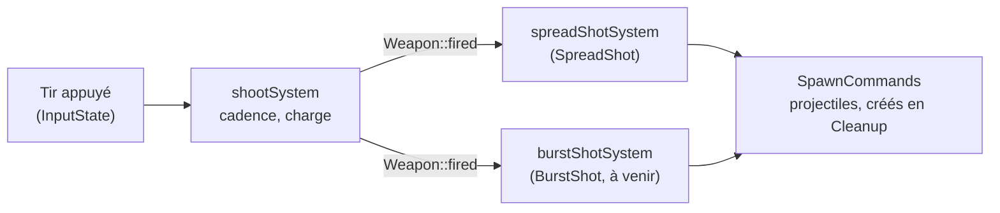

# Armes et bonus

## Dans le jeu

- **Tir normal** : chaque appui sur la touche de tir tire une fois (4 fois par seconde
  au maximum). Tapotez pour tirer vite.
- **Tir chargé** : maintenez la touche de tir. Tant qu'elle est maintenue, le vaisseau
  cesse de tirer et se charge : une lueur apparaît devant lui. Relâché après 1 seconde,
  un large rayon traverse l'écran, passe **à travers** tous les ennemis sur son chemin
  et inflige à chacun de lourds dégâts (300, contre 50 pour un tir normal). Relâché plus
  tôt, rien de plus n'est tiré.
- **Tir automatique** (F ou Maj droite) appuie sur la touche de tir pour vous 4 fois par
  seconde : un tir rapide sans tapoter, mais pas de tir chargé.
- **Bonus** : les ennemis moyens et grands, ainsi que le boss, laissent un orbe quand ils
  sont détruits. Il flotte lentement vers la gauche ; le vaisseau qui le touche gagne un
  niveau de son **style de tir**. Il existe aujourd'hui un seul style, l'éventail :

  | Niveau d'éventail | Tirs simultanés |
  |------------------:|-----------------|
  | 1 | 1 |
  | 2 | 3, en éventail |
  | 3 | 5, en éventail plus large |

  Un nouveau vaisseau commence avec un éventail de niveau 1 (un seul tir).

## Réglages des armes : `server/weapons.json`

Les armes sont des données, lues par le serveur au démarrage, depuis `weapons.json` à
côté de son exécutable (`build/weapons.json`, copié là par le build, ou `/weapons.json`
dans l'image Docker). Chaque clé est facultative : une clé absente garde sa valeur par
défaut. Un fichier absent, trop gros (plus de 64 Kio) ou invalide est signalé dans la
sortie du serveur et les valeurs par défaut s'appliquent ; il n'arrête jamais le serveur.

```json
{
    "fireInterval": 0.25,
    "shotSpeed": 900,
    "shotDamage": 50,
    "enemyShotSpeed": 450,
    "chargeTime": 1.0,
    "beamSpeed": 1300,
    "beamDamage": 300,
    "spreadAngle": 0.12,
    "maxLevel": 3
}
```

| Clé | Défaut | Plage | Signification |
|-----|-------:|-------|---------------|
| `fireInterval` | 0.25 | 0.05 à 5 | Le temps minimal entre deux tirs d'un joueur : les appuis plus rapides sont ignorés |
| `shotSpeed` | 900 | 100 à 5000 | La vitesse d'un tir de joueur, en unités de l'aire de jeu par seconde (l'aire fait 1920 de large) |
| `shotDamage` | 50 | 1 à 10000 | Les dégâts d'un tir de joueur (un ennemi basique a 100 points de vie) |
| `enemyShotSpeed` | 450 | 100 à 5000 | La vitesse d'un tir ennemi |
| `chargeTime` | 1.0 | 0.1 à 10 | Les secondes de maintien de la touche de tir pour un tir chargé |
| `beamSpeed` | 1300 | 100 à 5000 | La vitesse d'un tir chargé |
| `beamDamage` | 300 | 1 à 10000 | Les dégâts d'un tir chargé à chaque ennemi traversé |
| `spreadAngle` | 0.12 | 0 à 1 | L'angle entre deux tirs d'un éventail, en radians |
| `maxLevel` | 3 | 1 à 5 | Le niveau maximal d'un style de tir ; un éventail de niveau N tire 2N - 1 tirs |

Les clés inconnues et les valeurs du mauvais type ou hors limites rendent le fichier
invalide, pour qu'une faute de frappe soit signalée au lieu d'être ignorée en silence.

## Styles de tir

Un style de tir est **la façon dont l'arme d'un joueur transforme un tir en projectiles**.
C'est un composant ECS sur le vaisseau du joueur, appliqué par son propre système :



- `shootSystem` gère ce que toutes les armes partagent : la cadence, le maintien pour
  charger et le tir chargé. Quand le joueur tire pendant ce tick, il se contente de
  mettre `Weapon::fired`.
- Le système de chaque style transforme `fired` en projectiles pour les joueurs qui ont
  son composant. Un vaisseau a exactement un style : sans style, il ne tire rien.
- Un bonus porte le style qu'il donne (`PowerUpKind`). Ramasser le style que le vaisseau
  a déjà augmente son niveau ; un autre style le remplace.

### Ajouter un style de tir

Exemple : une rafale, qui tire 3 coups l'un après l'autre.

1. **Composant**, dans `server/include/components/ShotStyles.hpp` : le style et son
   propre état, par exemple
   `struct BurstShot { std::uint8_t level = 1; std::uint8_t left = 0; engine::Duration next{0.0F}; };`,
   et un nouveau `PowerUpKind::Burst`.
2. **Système**, dans `server/include/systems/ShotStyleSystems.hpp` et son `.cpp` :
   `burstShotSystem(registry, commands, stats, dt)` parcourt `Weapon, BurstShot, Transform` ;
   sur `weapon.fired`, il démarre une rafale (`left = 3`) et tire les coups restants à
   l'expiration de `next`, avec `commands.emplace_back(SpawnProjectile{...})`.
3. **Enregistrez-le** dans `server::Game::registerSystems()`, juste après `"spreadShot"`,
   avec l'option `playing`.
4. **Bonus** : dans `applyPowerUp()` (`server/src/systems/PowerUpSystem.cpp`), ajoutez le
   cas `PowerUpKind::Burst` : retirez les autres composants de style
   (`registry.remove<SpreadShot>(player)`) et ajoutez ou améliorez `BurstShot`. Choisissez
   ensuite qui le laisse tomber : le `SpawnPowerUp::kind` utilisé par
   `powerUpDropSystem()` (par exemple un champ dans `EnemyDef`).
5. **Réglages** : s'il en a besoin (tirs par rafale, délai), ajoutez-les à `WeaponStats`
   et à `parseWeapons()` (`server/src/Weapons.cpp`), puis au tableau ci-dessus.
6. **Client** : tous les bonus sont dessinés avec le même orbe. Pour dessiner celui-ci
   autrement, donnez-lui son propre `EntityType` (un changement de protocole : nouvelle
   valeur à la fin, version incrémentée, `docs/PROTOCOL.md`) et son sprite dans
   `client/src/SpriteSheets.cpp` (`lookOf()`).
7. **Tests**, dans `tests/src/weapons_test.cpp` : la fixture exécute `shootSystem` puis
   `spreadShotSystem` ; ajoutez votre système à `hold()` et vérifiez le nombre de
   `PlayerMissile` créés.

## Code

- [`server/include/Weapons.hpp`](https://github.com/T3a1/RType-mirror/blob/dev/server/include/Weapons.hpp) :
  `WeaponStats`, `parseWeapons()` et `loadWeapons()`.
- [`server/include/systems/ShootSystem.hpp`](https://github.com/T3a1/RType-mirror/blob/dev/server/include/systems/ShootSystem.hpp) :
  la cadence, la charge et le tir chargé (projectile `Piercing`).
- [`server/include/components/ShotStyles.hpp`](https://github.com/T3a1/RType-mirror/blob/dev/server/include/components/ShotStyles.hpp)
  et [`server/include/systems/ShotStyleSystems.hpp`](https://github.com/T3a1/RType-mirror/blob/dev/server/include/systems/ShotStyleSystems.hpp) :
  les styles de tir et leurs systèmes.
- [`server/include/systems/PowerUpSystem.hpp`](https://github.com/T3a1/RType-mirror/blob/dev/server/include/systems/PowerUpSystem.hpp) :
  le lâcher des bonus (`EnemyDef::dropsPowerUp`) et leur ramassage (`applyPowerUp()`).
- Le drapeau `Charging` de l'enregistrement d'un vaisseau dans les snapshots fait
  dessiner la lueur par les clients (voir le [protocole](PROTOCOL.md)).
