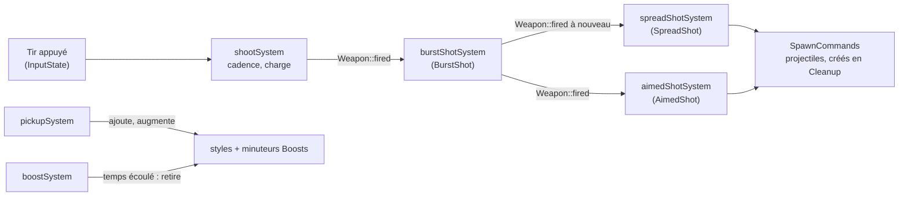

# Armes et bonus

## Dans le jeu

- **Tir normal** : le vaisseau le tire **tout seul**, environ 4 fois par seconde (tir
  automatique, toujours actif). Aucune touche ne le tire.
- **Tir chargé** : maintenez la touche de tir (Espace ou Ctrl droit). Elle ne tire jamais
  de tir normal : tant qu'elle est maintenue, le vaisseau cesse de tirer et se charge,
  et une lueur apparaît devant lui. Relâché après 1 seconde,
  un large rayon traverse l'écran, passe **à travers** tous les ennemis sur son chemin
  et inflige à chacun de lourds dégâts (300, contre 50 pour un tir normal). Relâché plus
  tôt, rien de plus n'est tiré.
- **Tir automatique** : il s'arrête tant que la touche de tir est maintenue, et reprend
  quand elle est relâchée.
- **Bonus** : les ennemis moyens et grands, ainsi que les boss, laissent un orbe quand
  ils sont détruits. Il flotte lentement vers la gauche ; le vaisseau qui le touche
  obtient son **boost** pour un temps limité. Chaque orbe a un type tiré au hasard,
  reconnaissable à sa couleur et à sa lettre :

  | Lettre | Boost | Effet | Durée |
  |:------:|-------|-------|------:|
  | S (jaune) | Éventail | 3 tirs en éventail ; repris pendant qu'il est actif, 5 en éventail plus large | 10 s |
  | A (bleu) | Visée | Un tir de plus, qui part vers l'ennemi le plus proche | 8 s |
  | B (orange) | Rafale | Chaque tir est tiré deux fois de plus, juste après lui | 5 s |

  Les boosts **se cumulent** : chacun a son propre minuteur. Par exemple, un éventail
  pris à 5:02 et une visée prise à 5:22 tirent ensemble jusqu'à 5:32, quand l'éventail
  se termine ; la visée continue jusqu'à 6:07. Reprendre un boost que le vaisseau a déjà
  relance son minuteur. Le HUD liste les boosts actifs du joueur local avec leurs
  secondes restantes (`Spread 12s`). Sans boost, un vaisseau tire un seul tir.

## Réglages des armes : `server/weapons.json`

Les armes sont des données, lues par le serveur au démarrage, depuis `weapons.json` à
côté de son exécutable (`build/weapons.json`, copié là par le build, ou `/weapons.json`
dans l'image Docker). Chaque clé est facultative : une clé absente garde sa valeur par
défaut. Un fichier absent, trop gros (plus de 64 Kio) ou invalide est signalé dans la
sortie du serveur et les valeurs par défaut s'appliquent ; il n'arrête jamais le serveur.

```json
{
    "fireInterval": 0.22,
    "shotSpeed": 1400,
    "shotDamage": 50,
    "enemyShotSpeed": 450,
    "chargeTime": 1.0,
    "beamSpeed": 1800,
    "beamDamage": 300,
    "spreadAngle": 0.12,
    "maxLevel": 3,
    "spreadDuration": 10,
    "aimedDuration": 8,
    "burstDuration": 5,
    "burstShots": 2,
    "burstDelay": 0.08
}
```

| Clé | Défaut | Plage | Signification |
|-----|-------:|-------|---------------|
| `fireInterval` | 0.22 | 0.05 à 5 | Le temps entre deux tirs normaux du tir automatique d'un joueur |
| `shotSpeed` | 1400 | 100 à 5000 | La vitesse d'un tir de joueur, en unités de l'aire de jeu par seconde (l'aire fait 1920 de large) |
| `shotDamage` | 50 | 1 à 10000 | Les dégâts d'un tir de joueur (un ennemi basique a 100 points de vie) |
| `enemyShotSpeed` | 450 | 100 à 5000 | La vitesse d'un tir ennemi |
| `chargeTime` | 1.0 | 0.1 à 10 | Les secondes de maintien de la touche de tir pour un tir chargé |
| `beamSpeed` | 1800 | 100 à 5000 | La vitesse d'un tir chargé |
| `beamDamage` | 300 | 1 à 10000 | Les dégâts d'un tir chargé à chaque ennemi traversé |
| `spreadAngle` | 0.12 | 0 à 1 | L'angle entre deux tirs d'un éventail, en radians |
| `maxLevel` | 3 | 1 à 5 | Le niveau maximal de l'éventail ; un éventail de niveau N tire 2N - 1 tirs (le premier boost Éventail donne le niveau 2) |
| `spreadDuration` | 10 | 1 à 255 | Les secondes que dure un boost Éventail |
| `aimedDuration` | 8 | 1 à 255 | Les secondes que dure un boost Visée |
| `burstDuration` | 5 | 1 à 255 | Les secondes que dure un boost Rafale |
| `burstShots` | 2 | 1 à 5 | Le nombre de fois qu'un boost Rafale retire chaque tir |
| `burstDelay` | 0.08 | 0.02 à 1 | Les secondes entre deux tirs d'une rafale |

Les clés inconnues et les valeurs du mauvais type ou hors limites rendent le fichier
invalide, pour qu'une faute de frappe soit signalée au lieu d'être ignorée en silence.

## Styles de tir

Un style de tir est **la façon dont l'arme d'un joueur transforme un tir en projectiles**.
C'est un composant ECS sur le vaisseau du joueur, appliqué par son propre système, si
bien qu'un vaisseau peut avoir plusieurs styles à la fois :



- `shootSystem` gère ce que toutes les armes partagent : la cadence, le maintien pour
  charger et le tir chargé. Quand le joueur tire pendant ce tick, il se contente de
  mettre `Weapon::fired`.
- Le système de chaque style transforme `fired` en projectiles pour les joueurs qui ont
  son composant. `SpreadShot` est sur chaque vaisseau (niveau 1 : un seul tir) ;
  `AimedShot` et `BurstShot` viennent des boosts. `burstShotSystem` s'exécute en premier
  et se contente de remettre `fired` aux ticks suivants d'une rafale, si bien que tous
  les autres styles se répètent avec lui.
- Un bonus porte son boost (`rtype::PowerUpKind`, partagé avec le client).
  `pickupSystem` met le minuteur de ce boost dans les `Boosts` du vaisseau à sa durée
  complète et ajoute le style (un boost Éventail augmente plutôt le niveau de
  l'éventail). `boostSystem` décompte les minuteurs et, quand l'un d'eux arrive à zéro,
  retire son style (l'éventail revient au niveau 1).
- `powerUpDropSystem` tire au hasard le type de chaque bonus lâché.

### Ajouter un boost

Exemple : un tir rapide, qui divise par deux le temps entre deux tirs.

1. **Type**, dans `common/include/common/components/PowerUpKind.hpp` : ajoutez
   `PowerUpKind::Rapid` avant `Count`, dans `PowerUpKinds` et dans `powerUpName()`.
   C'est un changement de protocole (voir l'étape 6).
2. **Composant et système** : un style qui crée des tirs va dans
   `server/include/components/ShotStyles.hpp` avec son propre système dans
   `systems/ShotStyleSystems.*`, enregistré dans `server::Game::registerSystems()` à côté
   de `"spreadShot"`. Un boost qui modifie plutôt l'arme (ici : `struct RapidFire {};`,
   lu par `shootSystem` quand il fixe le délai de recharge) n'a pas besoin de nouveau
   système.
3. **Boost** : dans `server/src/systems/PowerUpSystem.cpp`, ajoutez le cas à
   `applyPowerUp()` (ajouter le composant) et à `endBoost()` (le retirer).
4. **Réglages** : ajoutez sa durée (`rapidDuration`) à `parseWeapons()`
   (`server/src/Weapons.cpp`, dans l'ordre de `PowerUpKind`) et au tableau ci-dessus.
5. **Client** : donnez-lui une couleur dans `powerUpColor()`
   (`client/include/PlayerColors.hpp`) ; sa lettre et sa ligne du HUD viennent de
   `powerUpName()`.
6. **Protocole** : le bloc des joueurs gagne un octet par joueur et les bits Boost des
   drapeaux peuvent avoir besoin d'un bit de plus : incrémentez `ProtocolVersion` et
   mettez à jour `docs/PROTOCOL.md`.
7. **Tests**, dans `tests/src/weapons_test.cpp` : `pick()` de la fixture donne un
   boost, `wait()` fait avancer les minuteurs et `hold()` tire.

## Code

- [`server/include/Weapons.hpp`](https://github.com/T3a1/RType-mirror/blob/dev/server/include/Weapons.hpp) :
  `WeaponStats`, `parseWeapons()` et `loadWeapons()`.
- [`server/include/systems/ShootSystem.hpp`](https://github.com/T3a1/RType-mirror/blob/dev/server/include/systems/ShootSystem.hpp) :
  la cadence, la charge et le tir chargé (projectile `Piercing`).
- [`server/include/components/ShotStyles.hpp`](https://github.com/T3a1/RType-mirror/blob/dev/server/include/components/ShotStyles.hpp)
  et [`server/include/systems/ShotStyleSystems.hpp`](https://github.com/T3a1/RType-mirror/blob/dev/server/include/systems/ShotStyleSystems.hpp) :
  les styles de tir et leurs systèmes.
- [`server/include/systems/PowerUpSystem.hpp`](https://github.com/T3a1/RType-mirror/blob/dev/server/include/systems/PowerUpSystem.hpp) :
  le lâcher des bonus (`EnemyDef::dropsPowerUp`), leur ramassage (`applyPowerUp()`) et
  les minuteurs des boosts (`boostSystem()`).
- Le drapeau `Charging` de l'enregistrement d'un vaisseau dans les snapshots fait
  dessiner la lueur par les clients (voir le [protocole](PROTOCOL.md)).
